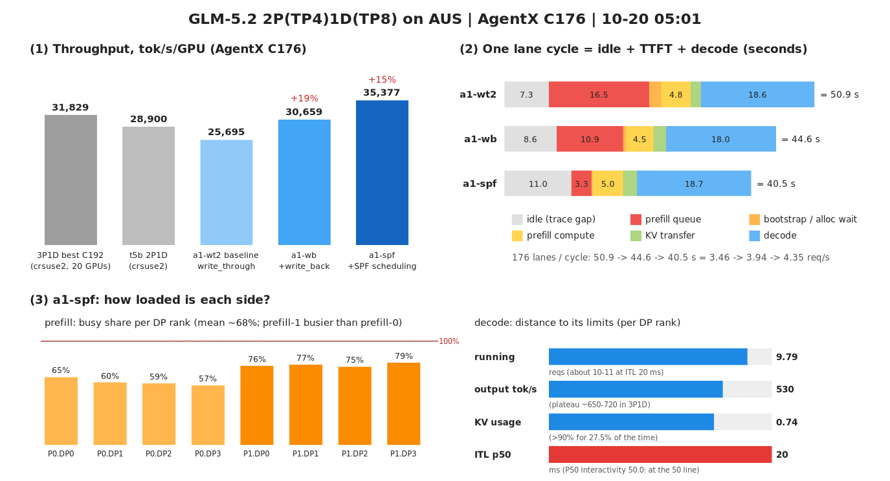

# 2P(TP4)1D(TP8) on AUS：结果与分析

> 部署与运行方式见 `README.zh-CN.md`，逐条时间线见 `operations/STATUS.zh-CN.md`。每卡吞吐按 16 张 GPU 计。
> 表格由运行目录的 `scripts/tune_report.py` 从 `results/<变体>/c<C>/` 生成；`ref-*` 两行是 crsuse2 上的参照
> （`ref-t5b-2p1d` = 3P1D 实验里的 2P1D C176，`ref-3p1d-t6-mem092` = 3P1D 目前最高 C192）。

## 0. 摘要（持续更新）

（图：① 每卡吞吐；② 每条 lane 一个周期的时间构成；③ a1-spf 两侧资源利用。生成脚本 `figures/make_progress_svg.py`。）

- **当前状态（10-19 20:05）**：作业 34439 在 19:17 开始、约 19:50 被抢占并自动重新排队（预计 20:22 再开始），这次起栈未完成。
  第一次分配（34389）在 15:23 被抢占，期间只拿到一轮不计分的预热。现在由 `scripts/campaign.sh` 在作业每次重新开始时自动从计划当前位置继续
  （起栈 → 20 分钟预热 → write_through 基线 C176 → write_back）。
- **第一个有效基线（10-20 00:20）**：a1-wt2（write_through，prefill 关 QuickReduce）C176 = **25,695 tok/s/GPU**，P50 / P90 交互 47.4 / 41.4，
  为 t5b 的 89%。约束是 prefill：每请求排队 16.5 s；关 QuickReduce 使 prefill 每 chunk 慢约 13%；decode KV 约 60% 被等传输的请求占着（§2.5）。
  **write_back（10-20 02:33）：a1-wb C176 = 30,659 tok/s/GPU（+19.3%）**，16 卡追平 3P1D 20 卡的 C176（30,562），P50 交互 50.8（§2.7）。
  C176 瓶颈是 prefill 的 FCFS 排队头阻塞（prefill 只忙约 65%，但排队 10.9 s；49% 的忙碌时间被单个长冷请求独占）（§2.8）。
  **prefill `shortest-prefill-first`（10-20 05:01）：a1-spf C176 = 35,377 tok/s/GPU（+15.4%），超过 3P1D 20 卡最高（31,829）11%**；
  排队 10.9 → 3.3 s；代价是 TTFT 极端尾部（最大 685 s）（§2.9）。正确性门禁按用户决定在所有优化完成后统一跑。
- **找到 prefill 挂起的直接证据（§2.4）**：挂起时 prefill 的 4 个 rank 里 3 个在 RCCL 集合通信、1 个在 QuickReduce all-reduce，互相等待。
  sglang 按本 rank 张量大小逐次选 all-reduce 后端，DP attention 下各 rank 可能选到不同后端。22:32 起 prefill 关闭 QuickReduce 重测。
  这很可能也是 3P1D prefill-2 三次挂起的根因（`HSA_NO_SCRATCH_RECLAIM=1` 已证明无效）。
- **decode 冷热差的根因（10-21 08:30，§2.13）**：prefill 没开 MTP（`speculative_algorithm=None`），PD 传输不带草稿层的 KV / DSA index-K，
  decode 的草稿层读未初始化显存：新进程里是 0，草稿 indexer 打分大量并列，top-k 散射 kernel 每次调用慢 15–170 倍（冷轮 33,793 / 热轮 34,862）。
  官方跑法每次新起服务，跑的正是冷态。修法是官方 recipe 的配置：prefill 也加 EAGLE 参数（`config/stage-b6-spf-pmtp.sh`），E12 验证中。
- 已确认：AUS 上必须 `MOONCAKE_DISABLE_HIP_DMABUF=1`（否则起栈即段错误）；正确性门禁结果与 crsuse2 一致。
- 待查：decode 同等负载下每步比 crsuse2 的 t5b 慢约 20%，在两台不同的 AUS decode 节点上都出现（§2.2）。

## 1. 实验列表

| # | 时间（10-19 → 10-20） | ROUND / 变体 | 内容 | 结果 |
|---|---|---|---|---|
| E0 | 10:08–10:27 | b1（第一次起栈） | 3P1D 配置照搬到 AUS | 起栈失败：prefill-0 三个 scheduler 段错误 → `MOONCAKE_DISABLE_HIP_DMABUF=1` |
| E1 | 11:02–12:12 | warm-b1 C176 | 30 分钟不计分预热（write_through，NSR prefill-0=0 / prefill-1=1） | 24,958 tok/s/GPU（不可与 60 分钟轮直接比，见 §2.2） |
| E2 | 12:13–13:19 | b1-wt C176 | write_through 基线 | **无效**：13:04 prefill-0 GPU 内存访问错误，AgentX 失败率 > 10% 中止 |
| — | 15:23 | — | 作业 34389 被抢占 | |
| — | 19:17–19:50 | b1n | 作业 34439 第一次运行，起栈中被抢占（自动重新排队） | 无 |
| E3 | 20:59–21:56 | warm-a1 C176 | 34439 restart 1（n01-29 + n02-33），20 分钟不计分预热，两 prefill NSR=1 | 22,011 tok/s/GPU（窗口短、输入 100.3k；decode 每步仍慢约 20%） |
| E4 | 21:56–22:30 | a1-wt C176 | write_through 基线 | **无效**：22:19 prefill-0 挂起，抓到 QuickReduce 与 RCCL 互锁（§2.4） |
| E5 | 22:43–00:20 | a1-wt2 C176 | 同 E4，prefill 关 QuickReduce（只重启 prefill） | **25,695 tok/s/GPU**（t5b 28,900 的 89%），无挂起（§2.5） |
| — | 00:20–00:53 | — | HiCache 正确性检查（write_through 对照、write_back） | 都通过（§2.6） |
| E6 | 00:53–02:33 | a1-wb C176 | write_back（只重启 prefill） | **30,659 tok/s/GPU**（+19.3%，t5b 的 106%，P50 交互 50.8）（§2.7） |
| — | 02:33–02:55 | a1-wb C144 | write_back，降并发 | 停掉：分析后预期不超过 C176（§2.8） |
| E8 | 05:42–07:49 | a1-spf C192 | 同 E7，加并发 | 33,698（比 C176 −4.7%）：decode KV 被等传输的请求占满（§2.10） |
| — | 10:53–11:57 | a1-pcwb-r4 C192 | + router R4（新会话按待算量放置） | **作业被抢占**（测量 8 分钟后），无结果；重新排队，预计 10-21 02:53 开始 |
| E9 | 07:55–10:30 | a1-pcwb C192 | write_back + SPF + prefill_complete（全栈重启；HiCache 检查通过） | 32,339（同并发 SPF −4.0%）：decode KV 释放如预期，但 KV 传输进关键路径 + decode 冷启动（§2.11） |
| E7 | 03:13–05:01 | a1-spf C176 | write_back + prefill `--schedule-policy shortest-prefill-first`（只重启 prefill） | **35,377 tok/s/GPU**（+15.4%，3P1D 最高的 111%）；TTFT 最大值 685 s（§2.9） |
| — | 10-20 20:56 – 10-21 02:17 | a2 / a3 | 作业又被抢占两次（a2 起栈中；a3 n02-25 GPU1 检查不通过） | 无 |
| E10 | 10-21 03:38–05:15 | a4-spf C176 | SPF + early，新节点（n01-33 + n10-29），decode 重启后第 1 轮，抓 decode profile | 33,793（a1-spf 的 95.5%）；decode 冷：每步 +11 ms @6（§2.13） |
| E11 | 10-21 05:15–07:16 | a4-spf2 C176 | 同 E10，第 2 轮 | **34,862**（a1-spf 的 98.5%，换节点复现最好成绩）；decode 已热 |
| — | 10-21 07:16–07:31 | a4-r4 C176 | + router R4 | 作业第 5 次被抢占，无结果；容器守护按预期删除容器 |
| E12 | 10-21 08:50– | a5-pmtp / a5-pmtp2 C176 | **prefill 加 EAGLE 参数**（修冷热差的根因，§2.13），decode 保持冷态 | 进行中 |

## 2. 分析

### 2.1 E0：起栈段错误（DMABUF）

prefill-0 的 DP1–3 在初始化完成、进入事件循环时读 `schedule_stream.cuda_stream` 段错误（原生栈 `c10::hip::HIPStream::stream()`）；
此后在存活 rank 所在 GPU 上新开的进程（包括全新容器）一建 stream 就段错误，而空闲 GPU 正常，停栈后 16 张卡逐卡测试全部正常。
3P1D 配置沿用了 crsuse2 的 `MOONCAKE_DISABLE_HIP_DMABUF=0`；AUS 历来用 1（`../b4-align-crsuse2-20261008/README.zh-CN.md`：两个集群网卡驱动不同）。
改为 1 后同样的起栈通过（Mooncake 日志 "HIP dmabuf disabled"），未再出现。

### 2.2 E1：预热 24,958 为什么比 t5b 28,900 低 13.6%

1. **几乎全部来自平均输入更短**：105.1k vs 122.6k（−14.3%）；每秒完成请求 3.77 vs 3.74（持平）。吞吐 99% 是输入 token，
   0.857 × 1.007 ≈ 0.864，正好对上。30 分钟窗口紧接 AgentX 预热段，会话还在较早轮次、上下文短。3P1D 的预热轮同样
   （warm-mem092b C144：输入 102.8k vs 正式轮 119.9k，吞吐 22,596 vs 25,269）。预热轮按设计不计分。
2. **decode 每步慢约 20%（真实差异）**：同一最忙 rank 在跑数下 @8 / @10 / @12 / @14 = 50.1 / 63.1 / 77.9 / 80.6 ms，t5b 为
   40.7 / 52.1 / 63.6 / 66.1；E2 崩溃前 17 分钟为 44.0 / 62.5 / 71.6 / 76.5（慢 8%–20%）。输入更短本应更快，所以不是负载口径。
   部分来自重启后首轮偏慢（3P1D 见过 3%–17%）；其余待定：AUS 节点 / 驱动（amdgpu 6.16.13），或 DMABUF 关闭后 KV 写入 decode 显存的路径不同。
   影响：每卡输出 216 vs 230.7，ITL p50 23.9 vs 18.2 ms（P50 交互 41.8 vs 54.8）；请求速率没掉，因为 decode mem 0.92 让每 rank 在跑更多（8.7 vs 7.6）。
3. **prefill 侧与 t5b 相当**：缓存份额 92.3% vs 93.6%，新算 30.8k vs 29.7k tok/s；两实例对称后排队 5.5 / 6.3（t5b 2.7 / 8.1，失衡）。
   每卡主机缓存少（250 GB×8 vs 400×4+200×4）但均衡更好，总命中 92.0% vs 90.4%。
4. decode 侧仍被等 KV 传输的请求占着：每 rank 7.85 个（t5b 6.95，3P1D C192 3.38）——prefill 时延长（排队 5.5–6.3）直接转化为 decode KV 占用。

更正：E1 首次发布的服务端表按 60 分钟窗口计算（`AGENTX_DURATION` 被配置写死为 3600），后半段是空闲；已按 11:37:30–12:08:00 重算，
配置改为 `${AGENTX_DURATION:-3600}`。

### 2.3 E2：prefill-0 GPU 内存访问错误

13:04:06 prefill-0 报 "Memory access fault by GPU node-3 (Agent handle …) on address 0xfffffffff000. Reason: Unknown."，GPU core dump 失败，
进程中止。之前 13 s 的日志只有正常的 prefill batch 和 aiter 未调优 bf16 GEMM 形状提示，没有其他错误。随后 decode 侧成串
"Decode transfer failed"，13:14 起 prefill-1 有 8 个请求停住（py-spy：事件循环正常，不是 3P1D prefill-2 的 `synchronize` 挂起签名），
13:19 AgentX 因失败请求 10.07% 中止。崩的是 `HSA_NO_SCRATCH_RECLAIM=0` 的实例；按用户决定，b1n 两个 prefill 都设 1 再测。

崩溃时出错 scheduler 的主线程停在 `prefill.py:910`（`process_batch_result_disagg_prefill`，等前向结果拷回的 event），**正是 3P1D 里
prefill-2 三次挂起时 4 个 scheduler 停住的同一行**（`../3p1d-tp4-tp8-v0521-20261012/RESULT.zh-CN.md` §4.12）。两者都是 prefill 前向里某个
GPU kernel 出了问题：那边是 GPU 100% 自旋、无报错，这边是访问非法地址。0xfffffffff000 是 48 位地址空间里的 −4096，像是页号 −1 乘以页大小，
提示可能是某个按页/索引寻址的 kernel 拿到了无效索引（例如 DSA top-k 的填充值 −1）。出错的 GPU node-3 按 KFD 编号（CPU 占 0、1）是第二张卡，
即 prefill-0 的 DP1；它最后一个 batch 是 4,491 新算 + 259,584 缓存 token（长前缀、可能有主机回读）。这只是推断：若 b1n（两个 prefill 都 NSR=1）
仍出现同类错误，说明与 scratch 回收无关，下一步考虑换 DSA prefill 后端（AUS 历史上也用过 tilelang）并在出错时抓 kernel 级信息。

### 2.4 E4（a1）：prefill 挂起的直接证据——同一组 rank 进了不同的 all-reduce

a1 的基线 a1-wt（两个 prefill 都已 `HSA_NO_SCRATCH_RECLAIM=1`，容器环境已核实）在 22:19:08 后 prefill-0 不再出 batch，4 张卡 GPU 100%，
scheduler 主线程都在 `prefill.py:910` 等 event（与 3P1D prefill-2 三次挂起、b1 的内存访问错误同一位置）。hang 监视器 10 分钟后自动抓取
（`evidence/hang-a1-prefill-0/`）；rocgdb 列出的各 rank **正在 GPU 上执行的 kernel**：

| rank（pid） | 活跃 dispatch |
|---|---|
| TP0（30997）、TP1（31147）、TP3（31470） | `ncclDevKernel_Generic_1`（RCCL 集合通信） |
| TP2（31294） | `quickreduce::allreduce_prototype_twoshot<… CodecQ8 …>`（QuickReduce，INT8 量化） |

即 TP2 在 QuickReduce 里等另外三个 rank，另外三个在 RCCL 里等 TP2：**互相等待的死锁**，GPU 一直自旋、没有报错——正是"挂起"的全部特征。
sglang v0.5.21 的 `parallel_state` 按**本 rank 输入张量大小**逐次选择 all-reduce 后端（custom AR → QuickReduce（`ROCM_QUICK_REDUCE_QUANTIZATION`，
基础镜像默认 INT8）→ RCCL），各 rank 只要在同一次调用上张量大小不同（或调用序列错开），就会选到不同后端。挂住前最后一个 batch 是 DP2
（即 TP2）的 5 个请求、8,192 新算 + 948,736 缓存 token，其他 rank 的 batch 不同。

- 这解释了：3P1D prefill-2 的挂起（同样停在 `prefill.py:910`）、为什么 `HSA_NO_SCRATCH_RECLAIM=1` 不管用；b1 的 GPU 内存访问错误也可能是同一机制的
  另一种结果（QuickReduce 读对端缓冲区时对端并不在同一次调用里）。2P1D 每个 prefill 承担的流量比 3P1D 高（排队更长、batch 更大），出现得更频繁
  （b1 约 2 小时、a1 约 1 小时 20 分钟）。decode 从未挂起：它用固定尺寸的 CUDA graph，各 rank 张量大小一致。
- 处理（22:32）：prefill 关闭 QuickReduce（`ROCM_QUICK_REDUCE_QUANTIZATION=NONE`，`config/stage-b1-wt-qr0.sh`），其余不变，只重启两个 prefill
  （decode 保持预热），重测基线 a1-wt2。若仍挂起，下一步把 prefill 的 custom AR / aiter allreduce fusion 也关掉，全部走 RCCL。
- 这个结论对 3P1D 同样适用，值得单独提给上游（v0.5.21 DP attention + QuickReduce 在 prefill 上的后端选择不一致）。

### 2.5 E5：write_through 基线 a1-wt2 C176 = 25,695 tok/s/GPU（第一个有效计分结果）

条件：a1 栈（n01-29 + n02-33），两 prefill mem 0.88、HiCache write_through 250 GB/rank、`HSA_NO_SCRATCH_RECLAIM=1`、**QuickReduce 关**；
decode mem 0.92、4 个 tokenizer worker（已跑过预热轮和半轮，处于预热状态）；router R1 + P 会话亲和 + R2。测量窗口 23:13:26–00:13:26，
完成 12,439、错误 0、窗口结束取消 75；**全程无挂起**（关 QuickReduce 后首次跑满一轮）。

**与 t5b（28,900）比低 11.1%**：完成请求 −8.4%、平均输入 −2.9%（119.0k vs 122.6k）；输出 205.7 vs 230.7 tok/s/GPU（−10.8%）；
P50 / P90 交互 47.4 / 41.4（t5b 54.8 / 49.2）；TTFT p50 / p90 9.8 / 60.5 s（8.7 / 46.1）。

瓶颈链（sampler 窗口分段 + 引擎日志）：

1. **prefill 是瓶颈，且比 t5b 更慢**。每请求 prefill 到达 → 完成 26.1 s：排队 16.5 s、bootstrap 2.0 s、传输 1.7 s（6.24 GB）、计算及其他约 5.9 s
   （3P1D C176 共 5.6 s）。新算 28.9k tok/s（t5b 29.7k），缓存份额 93.0%（93.6%），客户端 GPU / 主机命中 50.1% / 41.7%（合计 91.8%，理论 96.5%）。
   排队时满 8192-token chunk 的耗时 1699 / 1654 ms，t5b 1217 / 1565，warm-a1（同节点、QuickReduce 开）1505 / 1460 →
   **关 QuickReduce 让 prefill 每 chunk 慢约 13%**，另有约 7% 来自 AUS 与 crsuse2 的差别。按新算量估 prefill 每 rank 利用率约 75%，加上长尾服务时间和
   会话亲和，排队非线性变长。两实例排队 9.1 / 6.2（t5b 2.7 / 8.1）。
2. **decode KV 被等传输的请求占满**：每 rank 等 KV 传输 10.06 个（t5b 6.95，3P1D C192 3.38），每个约 20 万 token，约占 decode KV 的 60%；
   KV>90% 时间 62.4%，真正在跑只有 7.26 / rank（t5b 7.64，3P1D 11–12）。等预分配 0.87 / rank、decode 分配 KV 等待 2.0 s，后者又以 bootstrap
   等待的形式推迟 prefill（early 策略下 prefill 要等 decode 分到 KV）。decode 有效并发 63.3，与 t5b 相同。
3. **decode 每步仍慢约 14%**（同等负载 @8 / @10 / @12 / @14：46.6 / 59.1 / 70.9 / 76.7 ms，t5b 40.7 / 52.1 / 63.6 / 66.1；预热轮慢约 22%）：
   比首轮好，但第二轮仍慢，说明 AUS 上 decode 本身更慢（两台不同的 decode 节点都如此）。它主要影响 ITL，对吞吐的影响小于 prefill（decode 不是瓶颈）。

**结论与下一步**：2P1D 在 AUS 上的约束是 prefill 容量（排队 16.5 s）与它连带的 decode KV 占用。最直接的手段是减少 prefill 要新算的量：
**write_back**（缓存容量从"主机"变成"GPU + 主机"，每 rank 约 +45%）——已排在队列里（先在 write_through 上跑 HiCache 正确性对照，再只重启 prefill）。
若 write_back 有效，接着是 **prefill_complete**（去掉 bootstrap 等待与 decode 上等传输请求占的 KV）；另一个方向是降并发（C144/C160：GPU 命中只有 50%，
会话数少一些命中会回升）。QuickReduce 的代价（每 chunk +13%）要等后端选择一致性问题修好才能拿回。

### 2.6 HiCache 正确性检查：write_through 对照与 write_back 都通过

重写后的 `hicache_check.py`（16 个约 4 万 token 的检索探针，答案唯一；填充量为两 prefill GPU 池之和 × 1.6 ≈ 3,200 万 token，把探针挤到主机；再问一次）：

| | write_through（00:21，a1-wt2 栈） | write_back（00:43，只重启 prefill 后） |
|---|---|---|
| 结论 | pass，首 token 16/16 一致 | pass，首 token 16/16 一致 |
| top-1 logprob 最大差 | 0.0005 | 0.0006 |
| 填充阶段回写 / 淘汰（token） | 2,785 万 / 2,786 万（插入即回写） | 1,114 万 / 1,114 万（只在淘汰时回写） |
| 第二次从主机读回 | 557,056（探针的 100%） | 557,056（100%） |
| 探针耗时：首次 / 读回 | 7–16 s / 0.7–1.4 s | — / 1.2–1.5 s |

主机路径确实走到、读回的 KV 与新算一致；write_back 的回写行为符合设计。3P1D 那次 t8 的检查失败（探针答案不唯一、填充量不够）不再作为顾虑。

### 2.7 E6：write_back a1-wb C176 = 30,659 tok/s/GPU（+19.3%，16 卡追平 3P1D 20 卡的 C176）

条件：与 a1-wt2 只差 prefill HiCache 写策略（write_back；只重启 prefill，decode 保持预热）。窗口 01:25:23–02:25:23，完成 14,192、错误 0、
窗口结束取消 54（census 的 10 条传输失败都在 02:25:54–57，即取消）。

| | a1-wt2（write_through） | a1-wb（write_back） | 变化 |
|---|---|---|---|
| tok/s/GPU | 25,695 | **30,659** | +19.3%（t5b 28,900 的 106%，3P1D C176 30,562 的 100%） |
| 完成请求 / 平均输入 | 12,439 / 119.0k | 14,192 / 124.4k | +14.1% / +4.5% |
| 输出 tok/s/GPU | 205.7 | 237.9 | +15.7% |
| P50 / P90 交互 | 47.4 / 41.4 | **50.8** / 45.4 | P50 过 50 |
| TTFT p50 / p90 / 均值 (s) | 9.8 / 60.5 / 25.6 | 9.8 / 40.3 / 18.1 | |
| prefill 缓存份额 / 新算 tok/s | 93.0% / 28.9k | 95.3% / 22.9k | 新算 −21% |
| prefill 到达→完成：排队 / bootstrap / 传输 / 合计 (s) | 16.5 / 2.0 / 1.7 / 26.1 | 10.9 / 0.5 / 2.1 / 19.4 | |
| decode 分配 KV 等待 (s) | 2.0 | 0.5 | |
| decode 每 rank 在跑 / KV / KV>90% | 7.26 / 0.83 / 62.4% | 8.35 / 0.79 / 41.8% | |
| decode 等 KV 传输 / rank | 10.06 | 8.28 | |
| decode 每步 @8 / @10 / @12 (ms) | 46.6 / 59.1 / 70.9 | 42.2 / 55.4 / 65.9 | 更快（预热更充分；t5b 40.7 / 52.1 / 63.6） |
| prefill 满 chunk 耗时 (ms) | 1699 / 1654 | 1942 / 1847 | +13% |

机制：write_back 让每 rank 的缓存容量从"主机 5.56M token"变成"GPU 2.50M + 主机 5.56M"，缓存份额 93.0% → 95.3%（理论约 96.7%），
prefill 要新算的量少了 21%，排队 16.5 → 10.9 s；排队变短又让请求在 decode 上占 KV 等传输的时间变短（每 rank 10.1 → 8.3 个），
decode 每 rank 在跑多了 15%，输出和完成请求都涨。注意两点：
- prefill 每个满 chunk 反而慢了 13%：write_back 在 GPU 池满时要先把被淘汰的页回写到主机，落在新请求分配显存的路径上（ROCm 上回写走非 JIT 的
  `transfer_kv_all_layer_mla_lf_pf`）。新算量减少的收益远大于这部分代价。
- 客户端统计的 GPU / 主机命中（51.7% / 48.8%）相加超过 100%，write_back 下主机命中的统计口径可能有重叠，以服务端缓存份额（95.3%）为准。
- router 有 29 条 "dropped store events whose parent was never seen"（write_through 时没有）：write_back 从主机读回再插入的块，KV 事件链缺父节点，
  router 的前缀视图会不完整；有会话亲和时影响小，但值得后续查。

**下一步**：decode 每 rank 仍有 8.3 个等传输的请求（约占其 KV 的一半），在跑只有 8.35（3P1D 为 11–12），bootstrap 0.5 s——这正是 prefill_complete
要解决的。已排队：C144 write_back（判断峰值位置，02:33 开始）→ prefill_complete + write_back（全栈重启 → HiCache 检查 → 20 分钟预热 → C176）。

### 2.8 C176（write_back）的瓶颈分析与决策（10-20 02:40–03:20，与用户讨论）

> 更正：02:33 我在没有做瓶颈分析的情况下插入了 C144（只为让栈不空转），不符合"先分析再决定"的约定；分析后判断 C144 预期不会超过 C176，02:55 停掉。

**周期分解**（闭环：176 条 lane ÷ 3.94 req/s = 每条 lane 周期 44.7 s）：trace 自带轮间空闲约 8.7 s + TTFT 18.0 s（prefill 排队 10.9、计算约 5.9、
传输 2.1、bootstrap 0.5）+ decode 约 18 s（约 966 输出 token × ITL 19.7 ms）。**prefill 排队是最大的单项**。

**prefill 并不满载，排队来自排队头阻塞**：

| 指标（a1-wb，60 分钟） | 数据 |
|---|---|
| 两实例 | 新算 11.6k / 11.3k tok/s，缓存份额 95.0% / 95.7%，排队 5.4 / 4.9 → 均衡 |
| 8 个 DP rank | 新算 2.4–3.1k tok/s（最大/最小 1.29×），忙碌约 56–69%，平均排队 3.0–6.4、p90 11–19 |
| 长请求占比 | **49% 的 prefill 忙碌时间（60% 的新算 token）是"单个请求占满 8192-token chunk"** |
| 独占段 | 每 rank 每小时 28–49 段 ≥ 5 个连续满 chunk 的单请求，最长 26–92 个 chunk（92 个约 175 s） |
| 逐秒不均衡 | **38% 的时间有 rank 空闲、同时另一 rank 排队 ≥ 5**；8 个 rank 排队数最大减最小：中位数 15、p90 21；两实例排队差中位数 11 |
| 调度策略 | `schedule_policy=fcfs` |

AgentX 的轨迹从 25–75% 处开始，新轨迹首轮是十几万到几十万 token 的冷 prefill，会连续独占所在 rank；会话亲和把同 rank 其他会话的续轮请求
（只需新算几千 token）固定在后面，FCFS 下它们只能等，而别的 rank 可能空着。把排队的续轮请求挪去空闲 rank 会丢失前缀缓存（几千 token 变成十几万），
不可取；能跨 rank 平衡的只有冷请求。

**理论评估各候选**：

| 候选 | 理论预期 | 结论 |
|---|---|---|
| C144 | 缓存份额已 95.3%（理论 96.7%），降并发命中提升有限；要追平 C176，周期须从 44.7 s 降到 ≤ 36.6 s（−8 s），排队减半也只到约 39 s → 约 −6% | 不做（已停） |
| prefill_complete | 直接省 bootstrap 0.5 s + decode 分配 KV 等待 0.5 s ≈ 周期的 2%；释放的 decode KV 只在加并发时有用，而加并发会先恶化 prefill 排队 | 推后 |
| **shortest-prefill-first（SPF）** | 按未缓存工作量排序（主机命中算已缓存），并**压缩正在进行的长请求 chunk、给短请求留预算**；短续轮请求排队从约 11 s 降到几秒 → 周期约 38–40 s → **+8%–15%**；长冷请求 TTFT 变长 | **下一步（03:13 开始）** |
| hrrn | "等待 ÷ 新算量"排序、有老化防饿死；不压缩进行中的 chunk（正在跑的长请求仍挡路，估计平均排队里约 2–3 s 来自这部分） | SPF 出现饿死（TTFT p99 恶化、lane 停滞）时的后备 |
| 冷请求按待算量放置（router） | 回收"有 rank 空着、别的 rank 在排队"的 38% 时间里的算力；只对无缓存的冷请求生效（历史 R4 不分冷热 −34%） | 第三优先，需改 router |
| 1P(TP8)1D | GPU KV +25%，但缓存份额只剩约 1.4 个百分点空间；不解决排队头阻塞；MoE 每步汇总 8 rank 约 6.5 万 token（mixed TP8 在 chunk 8192 下 OOM 过）、8 rank 锁步、单一故障域 | 暂不做 |

SPF / hrrn 与会话亲和 router 互补：router 决定去哪个 rank（保住约 95% 的命中），调度策略只决定同 rank 内先算谁；会话亲和最大的代价正是续轮请求在
有长冷请求的 rank 上干等，SPF 去掉了大部分这个代价；router 的负载记账（R1、R2）不受 rank 内排序影响，不需要改。v0.5.21 的 disagg prefill 路径
已接入两者（`scheduler.py` 设 `chunked_req_limit`，`prefill.py` 记 `arrival_processed_tokens`）。

**关于 all-reduce 后端（用户问）**：`ROCM_QUICK_REDUCE_QUANTIZATION=NONE` 只关 QuickReduce，小张量仍走 custom all-reduce（`AiterCustomAllreduce`），
大张量走 RCCL；`--disable-custom-all-reduce` 两个都不建（QuickReduce 只在 custom AR 分支里创建），全部走 RCCL；`--enable-aiter-allreduce-fusion`
是独立的融合路径。custom AR 与 RCCL 之间同样按本 rank 张量大小切换，理论上仍可能分歧；抓取里另外三个 rank 停在 `ncclDevKernel_Generic_1`，
也可能是 all-gather / reduce-scatter（即各 rank 不在同一次调用上），机制未完全确定。关 QuickReduce 后已在负载下约 4.5 小时无挂起（此前两次
分别在 1 小时 20 分钟、约 2 小时出事），支持但不证明。若再挂起，prefill 改 `--disable-custom-all-reduce`。

**正确性状态（用户问）**：真实接受的已知答案门禁只在 10-19 10:56（第一次分配，write_through、QuickReduce 开、FCFS）跑过一次，结果与 crsuse2
一致；当前配置（QuickReduce 关 + write_back + SPF，新节点、重建镜像）只做过 HiCache 一致性检查（首 token，读回 vs 新算），decode TP8 + KV 传输
+ MTP 多 token 生成未在当前配置上验证，吞吐轮是模拟接受（输出按设计为乱码）。用户决定：**所有优化做完后在最终配置上统一跑一次门禁**。

### 2.9 E7：shortest-prefill-first a1-spf C176 = 35,377 tok/s/GPU（+15.4%）

条件：与 a1-wb 只差 prefill `--schedule-policy shortest-prefill-first`（只重启 prefill，decode 保持预热）。窗口 03:53:45–04:53:45，完成 15,657、
错误 0、取消 55，无挂起。

| | a1-wb | **a1-spf** | 变化 |
|---|---|---|---|
| tok/s/GPU | 30,659 | **35,377** | +15.4%（t5b 的 122%，3P1D 最高 C192 31,829 的 111%） |
| 完成请求 / 平均输入 / 输出 tok/s/GPU | 14,192 / 124.4k / 237.9 | 15,657 / 130.2k / 265.3 | +10.3% / +4.7% / +11.5% |
| P50 / P90 交互 | 50.8 / 45.4 | 50.0 / 46.0 | 持平 |
| prefill 排队 / 到达→完成（sampler） | 10.9 / 19.4 s | 3.25 / 12.1 s | 排队 −70% |
| 单请求满 chunk 占 prefill 忙碌时间 | 49% | 23% | chunk 压缩生效 |
| 有 rank 空闲而另一 rank 排队 ≥ 5 | 38% | 9% | |
| decode 每 rank 在跑 / KV / KV>90% / 等传输 | 8.35 / 0.79 / 41.8% / 8.28 | 9.79 / 0.74 / 27.5% / 5.21 | |
| TTFT p50 / p90 / p95 / p99 / p99.9 / max (s) | 9.8 / 40.3 / 60.0 / 138.7 / 237 / 280 | 7.3 / 15.0 / 25.5 / 86.4 / **283** / **685** | 尾部 0.1% 变差 |
| TTFT > 120 s 的请求 | 187 | 106 | |

- 机制如预期：SPF 把进行中的长请求 chunk 压小，短续轮请求同一步一起算；排队头阻塞和逐秒不均衡基本消失；排队变短 → decode 上等传输占 KV 的
  请求变少 → decode 在跑 +17%。
- **代价在极端尾部**：SPF 没有老化，少数长冷请求被一再推后，TTFT 最大值 685 s（客户端 TCP_USER_TIMEOUT 为 900 s）。C176 下不影响结果，
  但再加并发时这些请求可能超时变成失败，需要防饿死（hrrn，或给 SPF 加老化）。

**新的瓶颈位置**（周期 = 176 ÷ 4.35 req/s = 40.5 s：TTFT 11.0 s + decode 约 18.7 s + 轮间空闲约 11 s）：
- prefill：每 rank 忙碌 57%–79%，两实例不均衡（prefill-1 新算 13.0k、各 rank 忙 75%–79%；prefill-0 10.9k、57%–65%），排队 3.25 s。
- decode：每 rank 在跑 9.79、ITL p50 20.0 ms（P50 交互 50.0，正在 50 的边界），每 rank 输出约 530 tok/s（3P1D 中 decode 在每 rank 8–14 个时
  约 650–720 tok/s 走平，仍有余量）；KV>90% 27.5%，等传输仍占约 30% 的 decode KV。
- 两侧都还有余量但都在逼近：prefill 约 7 成、decode 接近 ITL 20 ms。

### 2.10 E8：a1-spf C192 = 33,698 tok/s/GPU（比 C176 低 4.7%）——decode KV 成为约束

窗口 06:40:04–07:40:04（AgentX 自带预热用了 58 分钟，C176 约 30 分钟），完成 15,271、错误 0、取消 59。

| | a1-spf C176 | a1-spf C192 |
|---|---|---|
| tok/s/GPU / 完成请求 / 输出 tok/s/GPU | 35,377 / 15,657 / 265.3 | 33,698 / 15,271 / 257.6 |
| 周期（lane ÷ req/s） | 40.5 s | 45.3 s |
| TTFT 均值（sampler） | 10.7 s | 18.0 s |
| prefill 排队 / bootstrap / 传输 / 到达→完成 | 3.25 / 0.19 / 2.26 / 12.1 s | 7.29 / **2.34** / 2.62 / 19.5 s |
| decode 分配 KV 等待 | 0.21 s | **2.46 s** |
| decode 每 rank 在跑 / KV / **KV>90%** / 等预分配 / 等传输 | 9.79 / 0.74 / 27.5% / 0.11 / 5.21 | **9.50** / 0.81 / **61.9%** / 1.19 / **7.61** |
| prefill 新算 tok/s / 缓存份额 | 23.9k / 95.8% | 25.3k / 95.3% |
| TTFT p99 / p99.9 / max (s)；> 120 s 的请求 | 86 / 283 / 685；106 | 201 / 645 / **1,182**；290 |

机制：多出的 16 条 lane 让 decode 上"已分配 KV、等 prefill 算完再传过来"的请求从每 rank 5.2 个增加到 7.6 个（early 策略下请求一到 decode 就
占 KV，直到 prefill 排队 + 计算 + 传输结束，约 19.5 s）；decode KV 超过 90% 的时间从 27.5% 升到 61.9%，新请求要等 KV（2.46 s），这个等待又以
bootstrap（2.34 s）的形式推迟 prefill 开算 → TTFT 均值 10.7 → 18.0 s → 周期变长，**真正在跑的请求反而从 9.79 降到 9.50**，吞吐下降。
decode 本身的计算还有余量（每步耗时与 C176 相同，在跑数更低）。按 KV 占用估算：在跑请求只占 decode KV 约 45%，其余主要是等传输的请求。

另：SPF 的饿死尾部随负载放大，TTFT 最大值 1,182 s、p99.9 645 s（错误数仍为 0）。再往上推需要防饿死。

**结论**：C192 的约束是 early 分配策略下"等传输占 KV"，正是 **prefill_complete** 解决的问题：decode 只在 prefill 算完后才分配 KV，等传输的
占用从约 19.5 s 缩到传输本身（约 2.6 s），bootstrap 和 decode 分配等待（合计约 4.8 s）基本消失。理论预期：C192 周期回到约 40–41 s，
吞吐约 192 ÷ 40.5 ≈ 4.7 req/s，比 C176 再高约 8%（前提是 decode 能把在跑数提到约 10.5–11 / rank，按 KV 与每步耗时估算可以）。

### 2.11 E9：prefill_complete + write_back + SPF，C192 = 32,339 tok/s/GPU（比同并发 SPF 低 4.0%）——预期未兑现

窗口 09:20:21–10:20:21，完成 14,842、错误 0、取消 58；全栈重启后第一轮（decode 冷启动，未单独预热）。

| | SPF C176 | SPF C192（early） | **pcwb C192** |
|---|---|---|---|
| tok/s/GPU | 35,377 | 33,698 | 32,339 |
| decode 每 rank 在跑 / KV / KV>90% / 等传输 | 9.79 / 0.74 / 27.5% / 5.21 | 9.50 / 0.81 / 61.9% / 7.61 | **10.75 / 0.63 / 10.0% / 2.23** |
| decode 分配 KV 等待 | 0.21 s | 2.46 s | 0.12 s |
| KV 传输（每请求约 6.7 GB） | 2.26 s | 2.62 s | **4.69 s** |
| 服务端 TTFT 均值 | 10.7 s | 18.0 s | 17.2 s |
| decode 每步 @8 / @12 / @14 (ms) | 38.7 / 66.4 / 69.1 | 39.3 / 66.0 / 69.3 | **48.0 / 73.9 / 76.7** |
| ITL p50 / decode 生成阶段 | 20.0 ms / 18.7 s | 19.9 ms / 18.8 s | 23.1 ms / 21.8 s |
| 周期 | 40.5 s | 45.3 s | 46.6 s |

1. **设计效果达到**：decode 上等传输占 KV 的请求从 7.6 降到 2.2 / rank，KV>90% 的时间 62% → 10%，在跑 9.50 → 10.75（+13%）。
2. **漏算的代价：KV 传输进入关键路径**。early 策略下 chunked prefill 每算完一块就先传，传输与计算重叠，只有最后一块的传输在关键路径上；prefill_complete
   要等整段算完、decode 分配好后才传整段 6.7 GB，传输 2.6 → 4.7 s 全部加到 TTFT 上。省下的 bootstrap + 分配等待（约 4.8 s）被抵消一大半，TTFT 只降 0.8 s。
3. **公平性不达标**：同等负载下 decode 每步慢 11%–22%（门槛 5%），生成阶段多 3 s。AUS 上 decode 重启后要数小时才"热"：@8 每步
   a1-wt2 46.6 → a1-wb 42.2 → a1-spf 38.7 ms，本轮 48.0 正是冷状态的典型值。
- 结论：本轮低估了 prefill_complete（decode 冷启动约 −5%~−10%）；即使 decode 热起来，按机制估算它在 C192 上只比 SPF C192 略好，未必超过 SPF C176。
- 新问题：**decode 长时间预热漂移**（不是"首轮偏慢"，持续数小时），影响所有重启后的对比，需单独查明（显存分配器 / autotune / 其他）。

### 2.12 深入分析（10-20 10:40）：decode 冷启动、prefill_complete 的真实效果、吞吐上限

**1. decode 冷启动效应（控制负载后）**。`scripts/decode_pace2.py`：每 rank 每 40 步一行日志，相邻两行间隔 ÷ 40 = 每步耗时；DP attention 下每步
由最忙 rank 决定，按 3 s 分箱取最忙 rank 的 `#token`（在跑请求的上下文总量）与各 rank 合计。用三轮已热数据（a1-wb、a1-spf C176/C192）拟合：

    每步 ms ≈ 22.1 + 3.5 × 最忙 rank 上下文(M token) + 0.38 × 全部 rank 在跑总数 + 0.20 × 全部 rank 上下文总量(M)

| 轮次 | decode 重启后第几轮 | 实际 ÷ 模型 |
|---|---|---|
| warm-a1 | 1（新节点首次启动） | 1.157 |
| a1-wt2 | 2 | 1.086 |
| a1-wb / a1-spf C176 / a1-spf C192 | 3 / 4 / 5 | 1.020 / 0.995 / 0.992 |
| a1-pcwb C192 | 1（重启） | **1.123** |

- decode 重启后第 1 轮慢约 12%–16%，第 2 轮约 9%，第 3 轮起才热（约 4–5 小时）。pcwb 重启时 decode 在同一节点、磁盘上的 triton / aiter 缓存都在，
  照样慢；服务期间日志里没有 JIT 编译事件 → 原因在进程内部状态（显存分配器 / 运行时 autotune / 其他），未查明。
- **更正**：之前"AUS 上 decode 比 crsuse2 慢约 14%–20%"是冷启动造成的；热状态下 @8 每步 38.7 ms，t5b 为 40.7 ms，并不慢。
- 影响方法：每次重启 decode，要约 2 轮（约 4 小时）才能做公平对比；只动 prefill / router 的实验没有这个代价。

**2. prefill_complete 的真实效果**：按模型扣除冷启动（12.3%），pcwb C192 的 decode 生成阶段从 21.8 s 降到约 19.4 s，周期约 44.2 s →
约 34,100 tok/s/GPU，**≈ SPF C192 +1%、SPF C176 −4%**。KV 释放带来的在跑 +13% 被"整段 KV 传输进关键路径"（TTFT +约 2 s）抵消了大半；
这个代价是机制本身的，在 C176 上大概率是负收益。

**3. 吞吐上限在哪里**。闭环下请求速率 ≈ decode 输出 ÷ 平均输出长度（约 976 token），decode 输出 = 在跑总数 R × 3.61 ÷ 每步耗时。
取最忙 rank 上下文 3.0M、总上下文约 21M：

| 全部 rank 在跑 R | 每步 | ITL | decode 输出 | 折合 tok/s/GPU（输入 130k） |
|---|---|---|---|---|
| 84（SPF C176 实测；实际 35,377） | 68.7 ms | 19.0 ms | 4,413 tok/s | 约 36,700 |
| 100 | 74.8 | 20.7 | 4,826 | 约 40,200 |
| 120 | 82.4 | 22.8 | 5,257 | 约 43,800 |

- decode 在吞吐意义上没有饱和：R 越大输出越多（代价是 ITL 上升）。**真正限制 R 的是 decode KV**：最忙的 decode rank 绝大多数时间上下文在
  3.0–3.5M（单 rank 容量 3.36M），已经装满；其余 rank 平均 0.63–0.81。
- 所以继续推高吞吐 = 让 decode 同时跑更多请求（R 从 84 往 100+），同时不让 TTFT 变长。这需要：decode KV 只留给在跑请求（prefill_complete 能做到，
  但有传输代价）、更大的 decode KV（mem 0.92 → 0.94 只多约 2.5%）、prefill 有余量（平均约 68%，prefill-1 约 77%，加并发会先挤 prefill-1）、
  以及防饿死（SPF 的 TTFT 尾部随并发放大）。

### 2.13 decode 冷热差的根因（10-21 08:30）：prefill 没开 MTP，decode 的草稿层读的是未初始化的 KV

**现象（E10 / E11，同一 decode 的第 1、2 轮）**：冷轮 33,793、热轮 34,862（−3.1%）；同等负载下 decode 每步：

| 最忙 rank 在跑 | @6 | @8 | @10 | @12 | @14 |
|---|---|---|---|---|---|
| a4-spf（冷） | 48.7 ms | 50.4 | 60.6 | 72.9 | 75.6 |
| a4-spf2（热） | 37.6 | 39.2 | 54.7 | 66.2 | 69.2 |

低负载时差得最多（@6 +11 ms），说明是每步固定多出的一块，不随批大小成比例。

**profile 定位（测量开始 15 分钟时自动抓 40 步，`scripts/start_profile_round.sh` + `scripts/kscatter_calls.py`）**：每步 GPU 忙碌时间
冷 820 ms / 热 364 ms（40 步合计），差值几乎全部来自一个 kernel：DSA indexer top-k 的散射 `sglang::dsa_gfx950::topk::k_scatter<0,true,16>`。
每步 4 次调用，都在 `draft` 标注下的 CUDA graph 里（EAGLE 5 步：第 1 个草稿 token 由 verify 后的 draft extend 产生，其余 4 步在草稿 graph 里），
即 **MTP 草稿层自己的 indexer**。每次调用的中位数（`results/a4-spf*/profile/kscatter_calls.txt`）：

| rank | 0 | 1 | 2 | 3 | 4 | 5 | 6 | 7 |
|---|---|---|---|---|---|---|---|---|
| 冷（µs） | 2,351 | 2,342 | 3,188 | 2,689 | 2,423 | 887 | 2,398 | 2,764 |
| 热（µs） | 16 | 16 | 183 | 182 | 14 | 137 | 16 | 17 |

DP attention 下各 rank 每步经 all-reduce 对齐，由最慢 rank 决定步长（冷 TP2 每步约 12.8 ms，热约 0.75 ms）。

**机制**（`kernels/jit/csrc/dsa_gfx950/topk_transform.cuh`）：先用直方图定出 top-2048 的阈值档；扫描整行 logits，高于阈值档的直接选中，**等于阈值档的
作为候选**逐个追加（每 block 暂存 512 个，溢出后每个元素一次对该行同一游标的全局原子操作），再做二次精选（候选 > 2048 时从全局内存流式读）。
indexer 打分是 ReLU 加权和，K 为 0 的位置打分恰好为 0；一行里大量位置的 K 为 0 时，这些 0 全部落在阈值档 → 候选暴增 → 慢 15–170 倍。

**为什么草稿层的 K 是 0**：prefill 启动参数 `speculative_algorithm=None`（只有 decode 有 `--speculative-algorithm EAGLE`），prefill 不加载 NextN 层、
没有草稿 KV 池，PD 传输里 `num_draft_entries = 0`，草稿层的 KV 和 DSA index-K 一个字节都没传。decode 上草稿层读到的 prompt 位置全是未初始化的显存：
新进程里是 0（冷，打分并列，慢），被 decode 自己生成的 token 写过之后是旧请求的残留（热，打分是乱的，快，但选出的 token 也是错的）。这同时解释了：

- **"预热漂移"**：快慢取决于 decode 槽位被"弄脏"的比例，所以和跑了多少量相关、和重启 prefill 无关（a1 只重启 prefill 后下一轮直接是最好成绩）；
  §2.12 里"重启后第 1 轮慢 12%–16%、第 3 轮才热"就是它。
- **真实接受率偏低**：起栈时真实接受率检查（b1，长上下文检索题 41k–122k）接受长度只有 1.6–2.1；yihou 的 1P1D AgentX 实测 2.59；官方 golden 3.61。

InferenceX 官方 AMD 多节点 recipe（`benchmarks/multi_node/amd_utils/server_sglang.sh` 第 433–439 行）明确写了：MTP 参数要同时给 prefill 和 decode，
只给 decode 时 prefill 少一个 nextn KV 层，新版 sglang 直接报 "state component count mismatch"，旧版静默容忍、让 decode 的 nextn 读未初始化状态。
我们的配置从 3P1D 继承了"只给 decode"，而这版 sglang 没有报错。

**对计分的影响与规则**：agentic 工作负载的投机解码必须用模拟接受、AL 取 golden 曲线（`docs/PR_REVIEW_CHECKLIST.md`），所以草稿质量不影响计分，
影响只有性能；而官方每次按 recipe 新起服务后直接跑（预热只有每条 lane 10 个请求），**跑的正是冷态**——我们此前"热轮"的成绩在官方跑法下拿不到。
修法 = 给 prefill 加同样的 EAGLE 参数（`PREFILL_MTP=1`，`config/stage-b6-spf-pmtp.sh`），这就是官方 recipe 的配置，符合规则。
不采用的办法：在 benchmark 前灌流量把 KV 池弄脏（规则外的预热，且只是把 0 换成乱数据）、把 KV 池初始化成非 0（同样掩盖问题）、改 kernel 处理并列
（只修性能，草稿仍读错数据）。

**预期与代价**：decode 草稿层拿到真实的 index-K 后，`k_scatter` 应在冷态也接近热态（每次约 0.02–0.2 ms），冷轮 ≈ 热轮；草稿 indexer 的选择变正确后
是否比"乱数据"的热态更快或更慢，要看真实数据的阈值档分布，由 profile 验证。代价在 prefill：多一个 NextN 层（约 1/79 的层数）的前向和 KV 传输量、
约 4.6 GB/卡权重（KV 池略小）。HiCache 会把草稿层打包进主机缓存（`packed_draft_device_pools`），从主机命中的前缀也应带上草稿 KV。

**验证（E12）**：a5 起栈后只重启 prefill（decode 保持冷态，只经过冒烟流量），HiCache 检查（含 192 个 8k 传输冒烟），然后 C176 两轮各抓 profile：
判据是 a5-pmtp（冷 decode）的 `k_scatter` 每次调用回到热态量级、decode 每步与 a4-spf2 同等负载持平、吞吐 ≥ 热轮；a5-pmtp2 与 a5-pmtp 无漂移。

## 3. 数据表

<!-- tune-tables:begin -->

**A. 客户端结果**（AgentX；interactivity = 1/ITL 分位数）

| 轮次 | tok/s/GPU | 输出 tok/s/GPU | 完成请求 | 平均输入 | P50 / P90 intv | ITL p50 / p90 (ms) | TTFT p50 / p90 / 均值 (s) | GPU / host 命中（理论） |
|---|---|---|---|---|---|---|---|---|
| ref-3p1d-t6-mem092 C192 | 31,829 | 240.6 | 17,800 | 128.8k | 47.2 / 43.3 | 21.2 / 23.1 | 3.8 / 14.7 / 7.2 | 71.0% / 22.4%（96.7%） |
| ref-t5b-2p1d C176 | 28,900 | 230.7 | 13,575 | 122.6k | 54.8 / 49.2 | 18.2 / 20.3 | 8.7 / 46.1 / 19.9 | 50.3% / 40.1%（96.6%） |
| warm-b1 C176 | 24,958 | 216.0 | 6,885 | 105.1k | 41.8 / 37.5 | 23.9 / 26.7 | 8.0 / 46.4 / 19.5 | 54.7% / 37.3%（96.1%） |
| warm-a1 C176 | 22,011 | 187.7 | 4,283 | 100.3k | 42.5 / 37.8 | 23.6 / 26.5 | 7.4 / 47.8 / 20.0 | 55.0% / 36.7%（95.7%） |
| a1-wt2 C176 | 25,695 | 205.7 | 12,439 | 119.0k | 47.4 / 41.4 | 21.1 / 24.1 | 9.8 / 60.5 / 25.6 | 50.1% / 41.7%（96.5%） |
| a1-wb C176 | 30,659 | 237.9 | 14,192 | 124.4k | 50.8 / 45.4 | 19.7 / 22.0 | 9.8 / 40.3 / 18.1 | 51.7% / 48.8%（96.7%） |
| a1-spf C176 | 35,377 | 265.3 | 15,657 | 130.2k | 50.0 / 46.0 | 20.0 / 21.7 | 7.3 / 15.0 / 11.0 | 62.2% / 32.7%（96.9%） |
| a1-spf C192 | 33,698 | 257.6 | 15,271 | 127.2k | 50.4 / 46.1 | 19.9 / 21.7 | 9.9 / 25.2 / 18.1 | 58.5% / 34.5%（96.8%） |
| a1-pcwb C192 | 32,339 | 248.4 | 14,842 | 125.6k | 43.4 / 38.6 | 23.1 / 25.9 | 11.7 / 21.6 / 17.4 | 56.8% / 40.8%（96.7%） |
| a4-spf C176 | 33,793 | 254.2 | 15,305 | 127.2k | 42.8 / 38.0 | 23.4 / 26.3 | 6.6 / 13.2 / 9.4 | 64.1% / 38.2%（96.8%） |
| a4-spf2 C176 | 34,862 | 263.1 | 15,583 | 128.9k | 49.9 / 45.6 | 20.0 / 21.9 | 7.3 / 14.6 / 11.2 | 62.2% / 31.6%（96.9%） |

**B. 瓶颈链**（服务端为测量窗口均值；首 token 前在途 / decode 有效并发为 AIPerf 的 effective prefill / decode concurrency）

| 轮次 | prefill 缓存份额 | prefill 新算 tok/s | prefill 排队（实例均值） | 首 token 前在途 | decode 有效并发 | decode 每 rank 在跑 | decode KV 使用率 | KV>90% 时间 | 等预分配 / rank | 等 KV 传输 / rank |
|---|---|---|---|---|---|---|---|---|---|---|
| ref-3p1d-t6-mem092 C192 | 95.0% | 31,704 | 1.50 | 35.1 | 98.7 | 11.77 | 0.77 | 45.9% | 0.47 | 3.38 |
| ref-t5b-2p1d C176 | 93.6% | 29,710 | 5.37 | 74.2 | 63.3 | 7.64 | 0.82 | 61.8% | 1.94 | 6.95 |
| warm-b1 C176 | 92.3% | 30,782 | 5.91 | 73.1 | 75.9 | 8.69 | 0.73 | 59.2% | 1.00 | 7.85 |
| warm-a1 C176 | 92.0% | 28,864 | 5.74 | 69.0 | 63.9 | 7.62 | 0.63 | 46.3% | 1.08 | 6.89 |
| a1-wt2 C176 | 93.0% | 28,932 | 7.63 | 87.5 | 63.3 | 7.26 | 0.83 | 62.4% | 0.87 | 10.06 |
| a1-wb C176 | 95.3% | 22,925 | 5.13 | 70.5 | 70.5 | 8.35 | 0.79 | 41.8% | 0.25 | 8.28 |
| a1-spf C176 | 95.8% | 23,870 | 1.34 | 47.2 | 81.7 | 9.79 | 0.74 | 27.5% | 0.11 | 5.21 |
| a1-spf C192 | 95.3% | 25,311 | 3.23 | 76.1 | 79.0 | 9.50 | 0.81 | 61.9% | 1.19 | 7.61 |
| a1-pcwb C192 | 95.2% | 25,079 | 2.30 | 71.0 | 89.2 | 10.75 | 0.63 | 10.0% | 5.98 | 2.23 |
| a4-spf C176 | 95.6% | 23,655 | 0.95 | 39.5 | 92.2 | 11.15 | 0.76 | 29.3% | 0.12 | 4.33 |
| a4-spf2 C176 | 95.6% | 24,366 | 1.51 | 48.1 | 81.3 | 9.77 | 0.75 | 28.2% | 0.11 | 5.37 |

**C. prefill 实例均衡**（新算 tok/s / 缓存份额 / 排队）

| 轮次 | prefill-0 | prefill-1 | prefill-2 |
|---|---|---|---|
| ref-3p1d-t6-mem092 C192 | 9.0k / 96.2% / 0.7 | 11.7k / 93.9% / 2.0 | 11.1k / 94.7% / 1.8 |
| ref-t5b-2p1d C176 | 13.4k / 95.6% / 2.7 | 16.3k / 89.5% / 8.1 | — |
| warm-b1 C176 | 15.1k / 92.2% / 5.5 | 15.7k / 92.5% / 6.3 | — |
| warm-a1 C176 | 15.0k / 91.6% / 6.6 | 13.9k / 92.5% / 4.9 | — |
| a1-wt2 C176 | 14.9k / 92.4% / 9.1 | 14.0k / 93.5% / 6.2 | — |
| a1-wb C176 | 11.6k / 95.0% / 5.4 | 11.3k / 95.7% / 4.9 | — |
| a1-spf C176 | 10.9k / 96.4% / 1.1 | 13.0k / 95.1% / 1.6 | — |
| a1-spf C192 | 13.3k / 95.2% / 3.7 | 12.0k / 95.5% / 2.7 | — |
| a1-pcwb C192 | 11.9k / 95.4% / 2.1 | 13.1k / 95.0% / 2.5 | — |
| a4-spf C176 | 11.5k / 95.7% / 1.0 | 12.2k / 95.6% / 0.9 | — |
| a4-spf2 C176 | 12.2k / 95.3% / 1.8 | 12.2k / 95.9% / 1.3 | — |

**D. decode rank 均衡**（8 个 DP rank 的最小 – 最大）

| 轮次 | 在跑请求 | KV 使用率 | KV>90% 时间 | 等预分配最多的 rank | 等 KV 传输 |
|---|---|---|---|---|---|
| ref-3p1d-t6-mem092 C192 | 10.62 – 12.47 | 0.77 – 0.78 | 43.3% – 47.5% | DP0 0.50 | 3.01 – 3.69 |
| ref-t5b-2p1d C176 | 7.13 – 9.02 | 0.81 – 0.83 | 59.4% – 63.4% | DP6 2.05 | 6.60 – 7.45 |
| warm-b1 C176 | 7.88 – 9.46 | 0.72 – 0.75 | 54.6% – 61.8% | DP4 1.18 | 6.62 – 9.72 |
| warm-a1 C176 | 6.19 – 8.66 | 0.61 – 0.65 | 42.8% – 50.8% | DP1 1.21 | 5.91 – 8.42 |
| a1-wt2 C176 | 6.95 – 7.79 | 0.82 – 0.85 | 57.1% – 66.7% | DP1 0.96 | 9.39 – 11.15 |
| a1-wb C176 | 7.77 – 9.08 | 0.78 – 0.79 | 39.5% – 43.5% | DP6 0.32 | 7.31 – 8.95 |
| a1-spf C176 | 9.27 – 10.30 | 0.73 – 0.74 | 25.4% – 32.1% | DP3 0.13 | 4.75 – 5.89 |
| a1-spf C192 | 9.05 – 9.87 | 0.80 – 0.82 | 59.2% – 63.9% | DP7 1.31 | 6.89 – 8.28 |
| a1-pcwb C192 | 9.84 – 11.47 | 0.60 – 0.66 | 7.6% – 14.0% | DP2 6.52 | 2.03 – 2.44 |
| a4-spf C176 | 10.43 – 12.07 | 0.76 – 0.77 | 27.6% – 31.6% | DP0 0.14 | 4.09 – 4.97 |
| a4-spf2 C176 | 8.73 – 10.49 | 0.74 – 0.75 | 25.8% – 31.5% | DP3 0.14 | 4.85 – 5.83 |

**E. 引擎节奏（判断栈是否漂移）与 router 会话**：decode 每步 ms 按同一 3 s 内最忙 rank 的在跑数分组；prefill 为排队时满 8192-token chunk 的耗时中位数 (ms)

| 轮次 | decode @6 | @8 | @10 | @12 | @14 | prefill-0 / prefill-1 / prefill-2 | 会话命中 / 新绑定 |
|---|---|---|---|---|---|---|---|
| ref-3p1d-t6-mem092 C192 | 36.9 | 39.6 | 45.2 | 68.5 | 70.1 | 1029 / 1215 / 1153 | 17,438 / 2,566 |
| ref-t5b-2p1d C176 | 36.4 | 40.7 | 52.1 | 63.6 | 66.1 | 1217 / 1565 / — | 13,527 / 2,051 |
| warm-b1 C176 | 45.1 | 50.1 | 63.1 | 77.9 | 80.6 | 1441 / 1473 / — | 7,463 / 1,451 |
| warm-a1 C176 | 41.7 | 51.1 | 61.9 | 76.9 | 82.4 | 1505 / 1460 / — | 5,241 / 1,086 |
| a1-wt2 C176 | 40.8 | 46.6 | 59.1 | 70.9 | 76.7 | 1699 / 1654 / — | 12,453 / 2,014 |
| a1-wb C176 | 37.4 | 42.2 | 55.4 | 65.9 | 70.0 | 1942 / 1847 / — | 14,036 / 2,163 |
| a1-spf C176 | 35.5 | 38.7 | 53.4 | 66.4 | 69.1 | 2263 / 2011 / — | 15,423 / 2,242 |
| a1-spf C192 | 35.2 | 39.3 | 58.5 | 66.0 | 69.3 | 2219 / 2473 / — | 15,151 / 2,307 |
| a1-pcwb C192 | 40.1 | 48.0 | 59.4 | 73.9 | 76.7 | 2308 / 2061 / — | 14,693 / 2,335 |
| a4-spf C176 | 48.7 | 50.4 | 60.6 | 72.9 | 75.6 | 1933 / 1861 / — | 15,079 / 2,240 |
| a4-spf2 C176 | 37.6 | 39.2 | 54.7 | 66.2 | 69.2 | 2108 / 2046 / — | 15,337 / 2,240 |

<!-- tune-tables:end -->

## 4. 下一步与决策记录

- 10-19 16:20（用户）：重新申请节点；两个 prefill 都 `HSA_NO_SCRATCH_RECLAIM=1`。
- 已排队（作业开始后自动执行）：b1n 起栈 → warm-b1n（30 分钟）→ b1n-wt C176（基线）→ HiCache 正确性检查（write_through 对照）→
  只重启 prefill 改 write_back → 同一检查 → b2-wb C176。
- 每轮结束后根据数据决定下一步，写入本节。
- 10-20 02:55（用户）：停掉 C144；先做 prefill shortest-prefill-first（hrrn 为后备），prefill_complete 推后，1P(TP8)1D 暂不做（§2.8）。
- 10-20 03:20（用户）：已知答案门禁在所有优化完成后、在最终配置上统一跑一次。
- 10-20 05:41（用户）：P50 交互 ≥ 50 不是硬约束，继续以吞吐为目标。05:42 起 a1-spf C192（同一栈不重启）：理论预期 +3%–8%（prefill 约 68% 忙、
  decode 输出约为走平值的八成）；风险是 ITL 上升、TTFT 极端尾部逼近客户端 900 s 超时、decode KV 压力。
- 10-20 07:55（用户）：C192 比 C176 低 4.7%、约束是 decode KV 被等传输的请求占满（§2.10）→ prefill_complete + write_back + SPF（全栈重启，
  `config/stage-b5-pcwb-spf.sh`）→ HiCache 检查 → C192；不单独加预热轮，用同等负载下 decode 每步耗时检验公平性（慢 > 5% 则补测）。
- 10-20 10:50（用户）：不加并发到 C208；留在 pcwb 上做 prefill / router 改动 → R4（10:53 开始，11:57 作业被抢占，无结果）。
- 10-20 15:00（用户）：作业重新开始后换回 SPF + early（`config/stage-b4-spf.sh`）：C176 两轮（预热 decode，并在轮次中自动抓冷 / 热 decode profile）→
  R4 C176 → SPF 加老化 → 正确性门禁。
- 10-20 15:20（用户）：`mix-v0522-correctness-20261019` 发现 aiter custom all-reduce 会导致乱码（只关 QuickReduce 不够，需 `--disable-custom-all-reduce`），
  与本实验的正确性和 prefill 挂起可能相关；用户决定暂不处理，按原计划进行。
- 10-21 07:40：a4 两轮 C176（冷 33,793 / 热 34,862）完成，R4 轮被抢占。冷 / 热 profile 把差距定位到草稿层 indexer 的 `k_scatter`（§2.13）。
- 10-21 08:00（用户）：先修冷热轮差距，R4 暂缓；方案必须符合 InferenceX agentic bench 规则。08:30 定位根因为 prefill 没开 MTP，
  修法 = prefill 加同样的 EAGLE 参数（官方 recipe 的做法）。a5 队列改为：起栈（旧配置，已在跑）→ 只重启 prefill（`PREFILL_MTP=1`）→ HiCache 检查 →
  C176 两轮（冷 decode 上直接测，各抓 profile）；以后的分配直接用新配置起栈（`operations/current_stage` = `config/stage-b6-spf-pmtp.sh`）。
