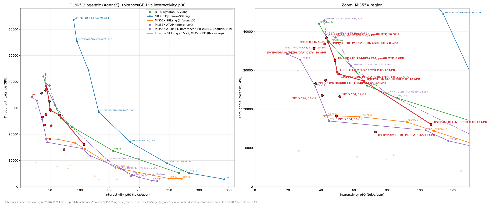

# GLM-5.2-MXFP4 2P(TP4)1D(TP8)，sglang v0.5.22，138 + 140（10-20 起）

目标：在 v0.5.22 镜像上做 2P1D 的 example（`examples/sglang_2p1d_glm5.2`，分支 `feat/sglang-mix-glm5.2-tp4-v0522`），
端到端验证正确性，用融合配置测性能，再测 C176 以外的并发点，为 InferenceX 上 infera + sglang 的 Pareto 线提供数据。
每卡吞吐按 16 张 GPU 计。

## 合入 main 的 PR 准备（10-21 14:00 起，用户决定）

一个 PR：镜像升级（`Dockerfile.sglang` v0.5.22 + 补丁 + `infera/engine/sglang/args.py` 兼容 + router `responses_input.py` 修复 + 测试）+ mixed 与 2P1D
两个 example + lint 修复；ssh e2e 分支不合入（只是本地临时适配，CI 以 SLURM 为准）。已同步到 `feat/sglang-mix-glm5.2-tp4-v0522` 的 sweep 修复：
端口 stride 256、`MC_MAX_MR_SIZE`（note 8）、up.sh 等 router 列出 prefill、down.sh 删不掉时继续（2P1D 与 mixed）、两 example 的
`--disable-custom-all-reduce` + top-k v2、InferenceX GSM8K；14:10 新增 `c7b7a35d`（ruff format `moe_mlp.py`，全仓 ruff format / check 通过）、
`cdfb8dc4`（mixed down.sh）、`4ad59fc2`（2P1D `PREFILL_WORKERS=1` 跑 1P1D，README 全部测点 + note 9 prefill 内存访问错误 / GPU 卡死）。
15:20 进度：
- C88 已补进 example README（`aab4cc36`，note 9 改为约 19 个 prefill 实例小时）。
- 完整 pre-commit `--all-files` 在 138 的 `python:3.10` 一次性容器里通过：trailing-whitespace / end-of-file / check-yaml / large-files / merge-conflict / ruff format / ruff check 全过，没有改动任何文件。
  - `cargo-fmt`、`gofmt` 跳过：分支相对 main 不改 Rust 和 operator Go，容器里也没有工具链。
  - `check-author-email` 在容器里因为没有 git 身份退出 128；在登录节点用真实身份运行通过，分支 26 个提交的作者和提交者都是 `liyingli@amd.com`。
- 15:30 按用户决定先开 PR（draft，不合入）：[AMD-AGI/Infera#210](https://github.com/AMD-AGI/Infera/pull/210)，head `aab4cc36`，39 个文件，描述里注明 smoke 未做。
- 待办：`PREFILL_WORKERS=1` 用 example 本身起一次栈做 smoke，结果补到 PR。15:15 起 140 GPU 4–7 被 anandaku 的 ATOM DeepSeek-V4.1 TP4 rocprof 作业占用（约 95 GB/卡），decode 需要 140 全部 8 卡，等其结束。

## 复现所需文件

- 2P1D kit：分支 `feat/sglang-mix-glm5.2-tp4-v0522` 的 `examples/sglang_2p1d_glm5.2/`；各点运行时用的是同内容的快照
  `/home/liyingli/bench_agentx/baseline/2p1d-kit/v5`（与分支脚本一致，只有 README 后来又更新）。
- 1P1D：实验副本 `2p1d-kit/v5-1p`，相对 v5 的改动见 `config/kit-v5-1p.diff`（`up.sh` 不起 prefill 1、router 期望 1 prefill + 1 decode，
  `agentx.sh` `PREFILL_NUM_WORKERS=1`）。
- 站点配置：`config/site.env`（2P1D）、`config/site-1p-gpu4567.env`（1P1D，prefill 在 GPU 4–7）。
- 串行与分析：`scripts/pd_perf_chain.sh`（`pd_perf_chain.sh KIT SITE_ENV LOG_DIR CONC...`）、`analyze_pd_logs.py`、`summarize_points.py`、
  `plot_pareto.py`；注册复现 `mr_align_test*.py`。

## 部署

| 实例 | 节点 | GPU |
|---|---|---|
| prefill 0（TP4 / DP4 attention） | crsuse2-m2m-138（10.245.157.237） | 0–3 |
| prefill 1（TP4 / DP4 attention，PID 偏移 30000） | 138 | 4–7 |
| decode（TP8 / DP8 attention，EAGLE MTP） | crsuse2-m2m-140（10.245.159.30） | 0–7 |
| etcd / router / AgentX、GSM8K 客户端 | 138 | — |

镜像 `infera-sglang:v0522-fdbafb60`（合并 main 后的分支 `fdbafb60` 按 `Dockerfile.sglang` 构建，ID `sha256:509b8427…`，
138 构建后 `docker save | load` 到 140，两边 ID 相同）。运行配置 138 `/mnt/m2m_nobackup/liyingli_3p1d/mix-v0522/2p1d/site.env`，
运行目录 `.../2p1d/work/runs/`。

## 融合配置（example 默认值）

以 AUS 2P1D 最高吞吐 a1-spf（`../2p1d-aus-v0521-20261019/`，v0.5.21，C176 = 35,377）为底，叠加今天 mixed 的 A/B 结论
（`../mix-v0522-correctness-20261019/`）：

| 项 | 取值 | 来源 |
|---|---|---|
| prefill | mem 0.88，chunk 32768，max running 256，HiCache 250 GB/rank `write_back`（ratio 1.5、kernel、page_first），`--schedule-policy shortest-prefill-first`，`HSA_NO_SCRATCH_RECLAIM=1` | a1-spf |
| decode | mem 0.92，decode graph 到 256，max running 256，`--tokenizer-worker-num 4`，EAGLE 5 / 1 / 6 | a1-spf |
| 两侧 | `--disable-custom-all-reduce`（同时关掉 QuickReduce，覆盖 a1-spf 的 prefill `ROCM_QUICK_REDUCE_QUANTIZATION=NONE`） | mixed：custom AR 导致乱码 |
| 两侧 | `SGLANG_OPT_USE_TOPK_V2=true` | mixed：+8.6% 吞吐、正确性不变 |
| 两侧 | `index_share_for_mtp_iteration=false` | mixed：默认值无收益 |
| router | kv-aware，prefill / decode 重叠权重 20 / 2，`--session-affinity prefill`，`--pd-prefill-guard-release completion`（R1），`--decode-input-demand on`（R2） | 3P1D / a1-spf（R1、R2 现为正式参数） |
| Mooncake | 8 条 ionic，GID 1，`MOONCAKE_DISABLE_HIP_DMABUF=0`，dest-local-rail + `MC_IB_TIMEOUT=18`，dest device affinity | crsuse2 3P1D（AUS 的 DMABUF=1、NodePort 等不适用） |
| 分配策略 | early（默认） | a1-spf（prefill_complete 在 AUS 上更差） |

## 计划

1. main 合入分支（无文本冲突），lint / unit / 镜像内 unit / engine 检查。
2. 写 example（无自动门禁，手动起停），GSM8K 与 InferenceX 一致（`run_eval`），AgentX 沿用 InferenceX `918524ff`。
3. 正确性：真实 MTP 接受率起栈，smoke + GSM8K 全量 1,319 题、并发 64。
4. 性能：C176（模拟接受率 3.61），对照 AUS 35,377。
5. 并发点 C128 → C96 → C64 → C32，每点按 InferenceX 方式整栈重启（down → 等显存释放 → up → 预热 10/lane → 3,600 s）。
   每点开测前检查两台节点有无他人 GPU 进程 / 显存 / CPU 负载。

## 并发点的选择（任务 4）

InferenceX 的 Pareto 图横轴是每用户交互速度（tok/s/user），纵轴是每卡吞吐；一套配置在不同并发下给出一条曲线，最终的线是
各配置曲线的上包络。2P1D（16 卡）在这条线上的位置：

- **C176 以上没有意义**：AUS 上 C192 比 C176 低 4.7%（decode KV 被等传输的请求占满，`../2p1d-aus-v0521-20261019/` §2.10），
  吞吐已过峰值，交互也不会更好。
- **C176 是吞吐峰值**，但它的优势不只在吞吐：AUS a1-spf C176 的 interactivity p50 / p90 = 50.0 / 46.0，而今天 mixed（TP4 单机
  4 卡）C48 吞吐 34,662 时 p90 只有 22.7。2P1D 的 decode 独占 8 卡、没有 prefill 抢占，尾部交互远好于 mixed，所以它在"同等吞吐、
  更高交互"的区间最可能进入上包络；往低并发走，交互继续提高、每卡吞吐下降，正是 Pareto 线需要的那一段。
- **下限 C32**：decode 8 个 DP rank，C32 时每 rank 约 4 个会话，已接近 decode 每步耗时的平台；再往下（C16 及以下）16 卡的每卡
  吞吐会很低，会被单机 TP4 / TP8 配置（InferenceX MI355X 单机 conc 1–16 的点）压在下面，不值得占两台机器。
- **中间取 C128、C96、C64**：与 C176、C32 大致等比（每档约 ×0.7），曲线上间距均匀；InferenceX GB300 2P1D 高吞吐配置也测
  128 / 192，低延迟的 1PnD 测 45–48，覆盖范围相当。
- 顺序从高到低：先拿到峰值附近的点，若中途机器被占用或出问题，已测的点更有价值。

## 进度

**15:20 main 合入**（`fdbafb60`，已推送）：无文本冲突；PR #187 在 main 上的最终内容与分支已有的完全一致（合并后 `deploy/` 无差异）。
合并后检查：unit（python:3.10）2,789 passed / 149 skipped；镜像内 unit 2,579 passed / 91 skipped；engine（sglang，8 个文件）全部通过。
lint 只有 `ruff format` 失败一处：`infera/projection/core/projection/module_profilers/moe_mlp.py`，与 origin/main 完全相同，
来自 main 的 PR #205，不是本分支改动，未在本分支修改（会与 main 产生分歧）。140 上没有 `python:3.10` 且 Docker Hub 凭据过期，lint 改在 138 跑。

**15:40 第一次起栈（正确性，真实 MTP 接受率）**：prefill 1 启动失败——`port_base at 27436 is not available`。DP attention 下
sglang 从 `--port + 233` 起占 11 个端口（DP4），两个 prefill 端口只差 1（27201 / 27202）时两段重叠。改为 prefill i 用
`PREFILL_PORT + 256 i`（与 AUS harness 的 stride 256 一致），只删掉并重启 prefill 1（prefill 0 与 decode 在冷启动中，不重来），
其余照 `up.sh` 继续。KV 事件内部端口由 infera 随机挑选，两个 prefill 不冲突（17471 / 17123）。

**15:50 起栈失败：decode 2 个 rank 的 KV 缓冲区注册失败 → `MC_MAX_MR_SIZE=1073741824`**。两个 prefill 健康后，infera 启动时的
PD 探测（每个 DP rank 发一个请求走一遍 KV 传输）在 decode DP3 上连续 3 次失败（prefill 侧 `Failed to send kv chunk`、decode 侧
`Failed to get kvcache from prefill instance`），两个 prefill 都退出。decode 日志：DP3、DP5 各有一个缓冲区
`Failed to register memory 0x77ffc0000000 / 0x7e58c0000000: Invalid argument [22]`（chunk 0，context 0）。decode 每 rank 79 个
KV 缓冲区，每个 2,320,846,848 字节，超过 ionic 的 `max_mr_size`（2 GiB），Mooncake（#2644 自动分块）切成 2 GiB + 余量两段，
用 dma-buf 注册。632 个缓冲区里**恰好只有这 2 个起始地址按 1 GiB 对齐，正是失败的 2 个**。8 条 ionic 链路 IPv6 互 ping 全通。

独立复现（`scripts/mr_align_test*.py`，镜像内用 Mooncake Python 接口，138 GPU 0，8 条 ionic）：分配 131 个同尺寸张量，其中起始
1 GiB 对齐的那个整块注册失败（同样的 EINVAL），4 个不对齐的对照都成功；在大分配**中间**的 1 GiB 对齐地址注册 2 GiB 成功
（失败条件是分配本身从 1 GiB 对齐处开始、首段 2 GiB）；同一对齐分配注册前 1 GiB / 512 MiB / 2 MiB、或跳过前 2 MiB 都成功。
`MC_MAX_MR_SIZE=1073741824`（Mooncake 读的环境变量，分块上限 1 GiB）后对齐分配切成 3 段注册成功。ionic `max_mr` 16384，
decode 每网卡约 1,900 个 MR，够用。3P1D 的 REPRODUCE 里"只重启 decode 后部分传输通道失效、某个 decode rank 收不到 KV、
重启后好了"应是同一个原因（地址对齐是随机的）。example 的 `worker.sh` 已加，README note 8。值得报给 Mooncake / ionic。

**16:02 第二次起栈（正确性）**，kit v3（端口 stride 256 + `MC_MAX_MR_SIZE`）。约 4 分钟三个引擎健康，decode 无注册失败，
prefill 启动探测"verified real KV transfer for 8 DP rank pair(s)"，router 列出 2 prefill + 1 decode。

**正确性结果（真实 MTP 接受率，产物 `results/correct-v2/`）**：

| 项 | 结果 |
|---|---|
| smoke（`smoke.sh`） | **6/6**：PD 注册 `decode prefill prefill`、completion、chat、stream、66k token 长前缀冷 40.0 s / 复用 1.9 s |
| GSM8K（`eval.sh` = InferenceX `run_eval`，全量 1,319 题，并发 64，`max_tokens` 16384） | **strict-match 0.9697 ± 0.0047，flexible-extract 0.9704**，用时约 4 分钟 |
| 乱码扫描（lm-eval 样本） | 0 条模板标签泄漏、0 条空回答；16 条回答超过 1 万字符（15 条答错），均为连贯的反复推敲直到 16384 token 上限（人体金字塔、勺子、邀请人数等有歧义的题），不是乱码 |
| decode MTP 平均接受长度 | 4.18（失控长回答在重复文本上接受 ~5.97，拉高均值） |

发现：up.sh 原先在 router 健康 10 s 后就打印 worker 列表，此时 prefill 还没通过启动探测、尚未注册（只列出 decode）。改为等到
router 列出 2 prefill + 1 decode（prefill 容器中途退出则报错），kit v4。

**16:22 性能串行开始**：`scripts/pd_perf_chain.sh`（kit v4，138 后台），C176 → C128 → C96 → C64 → C32，每点：等两节点显存释放 →
记录干扰检查 `perf/c<C>.env-check` → `SIM_ACCEPT_LEN=3.61 up.sh` → `agentx.sh`（3,600 s，预热 10/lane）→ `down.sh`。

**18:26–19:18 C176 下线后 138 显存回收 52 分钟**（GPU 0 停在 52%、GPU 3–7 停在 95% 约 30 分钟，期间无 D 状态 kworker、
ionic MR 已全部注销、无进程持有 `/dev/kfd`），驱动延迟回收，只能等。顺手结束了两个 17 小时前遗留的 agg 实验采样器
（`agg_sampler.py`，b3 / b3b 中止后残留，CPU 0%，不影响测量）。

**19:20 C128 起栈后中止**：19:21 140 上出现他人容器 `v41-dbg`（`rocm/atom-dev:nightly_202610131505`，`HIP_VISIBLE_DEVICES=4,5`，
ATOM TP0/TP1 各占约 790% CPU，TP1 占 GPU 5 约 160 GB 显存），正在用 decode 的 GPU 4–5。按约定不动他人容器；本点结果无效，
19:23 手动结束串行脚本并下线（`down.sh` 第一次在 prefill 0 上 `docker rm -f` 失败——容器进程卡在内核里收不到退出事件——
因 `set -e` 中途退出，第二次清干净；example 的 `down.sh` 已改为删不掉时提示并继续）。等 140 GPU 4–5 空出后从 C128 续跑。

**19:26 串行重启（kit v5，C128 → C96 → C64 → C32）**：`v41-dbg` 已退出。但 19:32 同一人在 140 上同时起了两个 ATOM 容器
`v41-laneA-a`（GPU 0–3）和 `v41-laneB-r1`（GPU 4–7），占满 140 的 8 张卡（每卡约 82% 显存）。140 是共享机器，不动他人工作；
串行脚本本身会等两节点显存都 < 1% 才起栈，即 140 空出后自动续跑。巡检中若再次撞上他人作业则中止该点重测。
该扫描每 8–14 分钟换一个容器（laneA / laneB 交替），为避免在两个容器之间的空档自动起栈后被撞，19:58 手动暂停串行、改为人工判断。
138 在 C128 中止后显存卡在 46% / 88% 约 65 分钟（20:29 才归零）。140：v41 扫描约 21:10 结束，随后另一人的 `anandaku-blogb-mk27acc`
短暂占用 GPU 2，21:24 已退出，剩一个空闲的 `anandaku-blogb-monofly`（`sleep infinity`）。21:24、21:29 两次巡检两节点均空闲，
**21:29 手动重启串行（C128 → C96 → C64 → C32）**。被占用期间（19:21–21:29）两节点空等约 2 小时。

## 性能结果（每卡按 16 张计，产物 `results/c<C>/`）

| 点 | tok/s/GPU | 输出 tok/s/GPU | 每秒请求 | 完成 / 无效 | intvty p50 / p90 | ITL p50 / p90 (ms) | TTFT p50 / p90 / 均值 (s) | E2E p90 (s) | API 命中（理论） |
|---|---|---|---|---|---|---|---|---|---|
| **C176** | **35,637** | 265.7 | 4.375 | 15,881 / 11 | 40.4 / 35.7 | 24.8 / 28.0 | 4.28 / 8.08 / 5.99 | 62.2 | 95.85%（96.83%） |
| C128 | 26,592 | 227.0 | 3.638 | 13,202 / 7 | 43.8 / 36.7 | 22.8 / 27.2 | 2.38 / 4.62 / 2.87 | 51.8 | 95.74%（96.37%） |
| C96 | 23,515 | 193.1 | 3.103 | 11,248 / 4 | 44.9 / 40.8 | 22.3 / 24.5 | 1.58 / 3.72 / 2.13 | 47.6 | 96.14%（96.55%） |
| C64 | 18,202 | 138.3 | 2.248 | 8,158 / 9 | 63.2 / 49.4 | 15.8 / 20.3 | 0.96 / 2.90 / 1.52 | 35.8 | 96.71%（96.91%） |
| 参照：AUS a1-spf C176（v0.5.21） | 35,377 | 265.3 | — | 15,657 / — | 50.0 / 46.0 | 20.0 / 21.7 | 7.3 / 15.0 / 11.0 | — | — |

**C176（16:45 起栈，预热 25 分钟，计分 17:16–18:16）**：干扰检查无他人 GPU 进程，他人容器 CPU ≈ 0（138 负载 5.6 来自刚结束的显存
回收 kworker）。**吞吐与 AUS 最高持平（+0.7%）**，延迟分布不同：TTFT p90 15.0 → 8.1 s（−46%），ITL p50 20.0 → 24.8 ms（+24%），
interactivity p50 50.0 → 40.4。decode 每 token 变慢的主要嫌疑是 `--disable-custom-all-reduce`（decode 集合通信走 RCCL；mixed
上同一改动使 interactivity p90 −15%），这是正确性必需的代价；TTFT 改善来自 crsuse2 的 decode 不慢于 AUS（AUS decode 每步比
crsuse2 慢约 20%，见 AUS §2.2）以及 decode 释放更快。11 条 `InvalidInferenceResultError`（0.07%）。
每点下线后 138 显存回收约 20 分钟（`kfd_process_wq` / `ttm` kworker，D 状态），140 一两分钟。

**C176 decode 每步耗时**（decode 日志每 40 步一行，同一 DP rank 相邻两行间隔 / 40，按该 rank 在跑请求数分组，计分窗口内；
平均接受长度 3.61）：

| 本 rank 在跑 | 2 | 4 | 6 | **7** | 8 | 10 | 12 | 14 | 16 | 18 | 20 |
|---|---|---|---|---|---|---|---|---|---|---|---|
| 每步中位数 (ms) | 38.4 | 47.1 | 53.0 | **79.1** | 80.4 | 81.6 | 82.9 | 86.6 | 89.5 | 92.0 | 93.2 |

6 → 7 个在跑请求时每步耗时跳 +49%，之后进入平台。AUS a1-spf（按最忙 rank 分组，custom all-reduce 开）为 @8 38.7、@10 53.4、
@12 66.4、@14 69.1 ms；同等负载下本次每步约慢 25–30%，与 ITL +24% 对得上。跳变形态像 RCCL 在消息变大时换协议：decode TP8 每步
对 8 个 rank 做 gather / reduce-scatter，`--disable-custom-all-reduce` 后全走 RCCL，代价比 mixed（TP4）大。可能的收回办法是
之前搁置的窄修复（只关 custom reduce-scatter + all-gather、保留 custom all-reduce，需先验正确性），本轮按用户决定不做。

**C128（21:29 起栈，预热 16 分钟，计分 21:50–22:50）**：干扰检查两节点无他人 GPU 进程（140 上 `anandaku-blogb-monofly` 空闲）。
吞吐 −25%，但 interactivity 只 +8% / +3%（p50 / p90），ITL p50 24.8 → 22.8 ms；TTFT 减半。原因即上表的平台：只要每个 decode
rank 在跑 ≥ 7 个请求，每步就在 80–90 ms，C128 时多数 rank 仍在平台上。预期 C96 / C64 每 rank 降到 7 以下后交互才会明显上去；
在当前（RCCL）条件下，C176 → C128 这段在 Pareto 上很陡（用 25% 吞吐换几个百分点交互）。

**C96（23:12 起栈，C128 下线后显存回收 14 分钟；预热 13.5 分钟，计分 23:30–00:30）**：干扰检查无他人 GPU 进程。吞吐 −12%（相对 C128），
interactivity p50 / p90 44.9 / 40.8，ITL p50 22.3 ms（× 接受长度 3.61 ≈ 每步 80 ms，仍在平台上）。decode 在跑请求（每 10 s 取各 rank
最新值，计分窗口）：

| 点 | decode 在跑总数中位数 | 最忙 rank 中位数 / p90 |
|---|---|---|
| C176 | 104（每 rank 平均 13） | 18 / 24 |
| C128 | 81（10） | 15 / 23 |

DP attention 下每步由最忙 rank 决定（MoE 同步），最忙 rank 远高于 7，所以 C176–C96 都在 80–90 ms 平台上，交互基本不动。
按比例 C64 时最忙 rank 约 8–9（平台边缘），C32 约 4–5 才会跌到平台以下（每步约 45 ms → ITL ≈ 12.5 ms → interactivity ≈ 80）。
即这套配置在 Pareto 上是"C176–C64 交互约 40–45 的一段平台 + C32 附近的跳变"；C128 / C96 被 C176 支配（吞吐更低、交互几乎相同），
曲线的有效信息集中在 C176、C64 以下。若要在 C64 与 C32 之间加点，C48 比 C96 更有价值。

## 瓶颈分析（10-21 02:00，`scripts/analyze_pd_logs.py` + AIPerf 有效并发）

**各点瓶颈链**（计分窗口；prefill 满 chunk = 排队时连续的 8192 token chunk）：

| 点 | prefill 满 chunk 中位 (ms) | prefill 新算 tok/s（两实例） | prefill 有排队的 10 s 占比 | decode 在跑总数 | 最忙 rank 中位 / p90（÷ 均值） | decode 等 KV 传输 | 首 token 前在途 / decode 有效并发 |
|---|---|---|---|---|---|---|---|
| C176 | 1,548 / 1,632 | 12,195 + 11,593 | 57% / 55% | 105 | 18 / 24（1.37） | 25.9 | 26.1 / 100.8 |
| C128 | 1,190 / 1,163 | 8,748 + 9,532 | 14% / 14% | 81 | 15 / 23（1.48） | 10.1 | 10.4 / 81.4 |
| C96 | 1,277 / 971 | 7,541 + 6,943 | 9% / 4% | 68 | 13 / 18（1.53） | 6.4 | 6.6 / 62.7 |
| AUS a1-spf C176 | 2,263 / 2,011 | 23,870（合计） | — | ~78 | — | ~42 | 47.2 / 81.7 |

decode 每步耗时按**最忙 rank** 在跑数分组（DP attention 下每步等最忙 rank）：@4 35、@6 48、@8 52、@10 60、@12 73、@14 77、
@16 81、@18 83、@22 94 ms；AUS a1-spf @6 35.5、@8 38.7、@10 53.4、@12 66.4、@14 69.1。同等最忙负载下本次慢 10%–35%（低负载段差得多）。

**TTFT 为什么约为 AUS 的一半**：两边每秒请求（4.38 / 4.35）、活跃会话（126.9 / ~128.9）、单请求总时延（29.1 / 29.8 s）都几乎相同，
只是时间在两段之间换了位置：本次 decode 段 23.1 s（AUS ~18.8 s）、首 token 前 6.0 s（AUS 11.0 s）。原因：
1. **prefill 每 chunk 快 25%–30%**（1.55–1.63 s 对 2.01–2.26 s），而新算工作量相同（23.8k tok/s）→ prefill 更闲 → 排队短得多
   （排队等待对利用率是非线性的）。AUS 报告本身记录了 AUS 节点 prefill / decode 都比 crsuse2 慢（crsuse2 t5b 满 chunk 1,217 / 1,565 ms）；
   v0.5.22 与 top-k v2（prefill 的 DSA top-k 也走它）可能也有贡献。
2. **KV 传输等待少**：decode 侧等传输 25.9（每 rank 3.2）对 AUS 每 rank 5.21。
3. **闭环再分配**：decode 每 token 慢（RCCL），同样的活跃会话更多停在 decode（100.8 对 81.7），留在 prefill 段的更少（26.1 对 47.2）。
即 TTFT 低、ITL 高是同一闭环的两面；TTFT 覆盖 100%，有效时延与 TTFT + decode 段吻合，不是测量问题。

**交互不随并发下降的原因与 Pareto 方向**：
1. **decode DP rank 不均衡**是交互平台的主因之一：最忙 rank / 均值从 1.37（C176）升到 1.53（C96），并发降了 45%，最忙 rank 只从 18 降到 13，
   每步仍 ~79 ms。若完全均衡，C96 最忙约 8.5 → 每步约 52–55 ms（ITL −30%）。R2（`--decode-input-demand`）均衡的是在途输入 token，
   不是在跑请求数；DP attention 的步长取决于最忙 rank 的在跑数。→ router 按在跑请求数均衡 decode rank（或 sglang 侧 DP 负载均衡）。
2. ~~prefill 在 C128 及以下大量空闲~~ **更正（02:35）**：上面"有排队的 10 s 占比"只说明很少有请求在等，不代表 prefill 闲。按实例
   计算时间占比（每行 Prefill batch 的步长取到同 rank 下一步、上限按 token 估计，4 个 rank 取并集）：C176 83% / 78%、C128 73% / 77%、
   C96 67% / 62%、C64 45% / 50%（有请求排队的步数占比 26–27% / 6% / 2–5% / 0–3%）。DP attention 下只要有一个 rank 在算，整个实例
   都在走这一步；agentic 的长冷首轮（几十个 chunk）会让单个 rank 长时间占住实例。所以把 prefill 减半到 1P1D（12 卡）在 C128 / C96
   会把实例推到 130%–150% 的负荷、TTFT 大涨，**不是"每卡 +33% 而交互不变"**；只有 C64（约 95%）勉强、需实测。即使可行，
   1P1D C128 ≈ 26.6k × 16 / 12 ≈ 35k，也只是和 C176 重合，冲不破 C176。
3. **decode 每步成本比 AUS 高 10%–35%**（主要嫌疑 `--disable-custom-all-reduce` 后 TP8 集合通信走 RCCL）：窄修复（关 custom
   reduce-scatter / all-gather、保留 custom all-reduce，需先验正确性）或 RCCL 协议调优；步长曲线在 @6、@9、@11 有台阶，
   需要一次 decode profile 确认是 graph 批大小分档、MoE kernel 切换还是通信协议切换（kernel / 通信优化方向）。
4. **decode 并行策略**：TP8 + DP8 attention 的同步让最忙 rank 决定全体；2 个 TP4 + DP4 的 decode 实例（同样 8 卡）不均衡面更小、
   集合通信组更小；低并发（≤32）纯 TP8（无 DP attention）单步延迟更低（InferenceX B300 在 conc ≤ 16 用 TP8 的理由）。需要实测。
5. MTP 5 / 6 draft 在大批次时 draft 成本高；InferenceX 按 K 给定接受长度，换 K 是另一个可调项（需对应的 golden AL）。

**C64（00:55 起栈，C96 下线后显存回收 16 分钟）**：干扰检查无他人 GPU 进程（140 上只有空闲的 `anandaku-blogb-monofly`），
01:00 开始预热；预计 02:20 前后出结果，之后串行自动跑 C32（约 04:20 结束）。

**C64 结果（计分 01:12–02:12）**：18,202 tok/s/GPU，**interactivity p50 / p90 63.2 / 49.4（较 C96 的 44.9 / 40.8 跳升）**，ITL p50 15.8 ms，
TTFT p50 0.96 s。瓶颈链：decode 在跑总数 36（有效 decode 并发 34.6），最忙 rank 中位 7 / p90 11（÷ 均值 1.56），每步约 53 ms；
prefill 几乎全闲（有排队的 10 s 占比 0% / 3%，新算合计 9.5k tok/s，首 token 前在途 3.4）。比上节按比例的估计早一档跳出平台
（估计 C64 最忙 8–9，实测 7）。结论不变：C128 / C96 被 C176 支配；C64 起交互明显上升，但 8 张 prefill 卡基本空转。

**按 InferenceX 横轴（interactivity p90）看**：C176 35.7、C128 36.7、C96 40.8、C64 49.4（p50 则是 40.4 / 43.8 / 44.9 / 63.2）。
ITL p90（28.0 / 27.2 / 24.5 / 20.3 ms）几乎完全由**最忙 rank 的尾部**决定：最忙 rank p90 = 24 / 23 / 18 / 11，对应每步 96 / 94 / 84 / 72 ms，
÷ 接受长度 3.61 = 26.6 / 26.0 / 23.3 / 19.9 ms，与实测吻合。尾部不均衡（最忙 p90 ÷ 均值）= 1.83 / 2.28 / 2.12 / 2.44，比中位数的
1.37–1.56 严重得多。即在 p90 轴上，decode DP rank 均衡是最直接的杠杆：若 C96 尾部最忙接近均值（~9–10），每步约 60 ms →
ITL p90 ≈ 17 ms → interactivity p90 ≈ 59（现 40.8）。3P1D 的记录也支持这一点：R2（`--decode-input-demand on`）把 KV 拉平，但各 rank
在跑请求数的差距变大（`../3p1d-tp4-tp8-v0521-20261012/RESULT.zh-CN.md` §2 第 4 条）；DSA decode 的每步成本主要随在跑请求数增长。

**prefill 容量与计算利用率（02:50，按用户要求列出）**：

| 点 | 新算 tok/s（合计） | 实例忙碌占比 | 每 rank 计算占比（4 rank 均值） | 满 chunk 中位 (s) | 有请求排队的步数 | GPU / host 命中 | TTFT p50 / p90 (s) |
|---|---|---|---|---|---|---|---|
| C176 | 23.8k | 83% / 78% | 48% / 46% | 1.55 / 1.63 | 26% / 27% | 57.8% / 18.3% | 4.3 / 8.1 |
| C128 | 18.3k | 73% / 77% | 30% / 32% | 1.19 / 1.16 | 6% / 6% | 68.8% / 8.7% | 2.4 / 4.6 |
| C96 | 14.5k | 67% / 62% | 25% / 23% | 1.28 / 0.97 | 5% / 2% | 73.9% / 3.2% | 1.6 / 3.7 |
| C64 | 9.5k | 45% / 50% | 14% / 16% | 0.83 / 1.01 | 0% / 3% | 63.8% / 0.6% | 1.0 / 2.9 |

DP attention 下一个 rank 在算整个实例就在走这一步，所以实例忙碌远高于每 rank 计算占比。换 1 个 prefill 时同样的工作集中到 4 个
rank，每 rank 约翻倍：C176 ~94%（饱和）、C128 ~62%（实例层面大概率满）、C96 ~48%（勉强，TTFT 变长）、C64 ~30%、C32 ~15%（可行）。
C64 host 命中只有 0.6%，host 池减半也无影响。→ **1P(TP4)+1D(TP8)（12 卡）值得在 C32、C64 实测**（02:35 的"C64 约 95%"按实例
忙碌估计，偏悲观，以此为准）。

**decode KV 余量**（计分窗口，每 10 s 取 8 个 rank 的最新值）：

| 点 | 已用 KV 均值 | 最忙 rank 已用 p90 | 已用 + 预分配 均值 / 最忙 p90 | 有 rank > 0.9 的时间 | 最忙 rank 在跑 p90（÷ 均值） |
|---|---|---|---|---|---|
| C176 | 0.68 | 0.87 | 0.80 / 1.20 | 73% | 24（1.83） |
| C128 | 0.45 | 0.64 | 0.50 / 0.80 | 4% | 23（2.28） |
| C96 | 0.33 | 0.50 | 0.36 / 0.65 | 0% | 18（2.12） |
| C64 | 0.20 | 0.35 | 0.21 / 0.45 | 0% | 11（2.44） |

C176 KV 是约束（R2 按预分配容量均衡在这里正确）；C128 及以下 KV 余量大、在跑请求数严重不均。建议策略：在"已用 + 预分配 +
本请求 ≤ 阈值（如 0.85）"的 rank 里选在跑请求最少的，都接近阈值时退回 R2。免改代码的验证：C96 / C64 上 `--decode-input-demand off`
（R2 关时 router 近似按派发个数轮转，`../b4-align-crsuse2-20261008/P8D4-OPTIMIZATION.zh-CN.md` §6）。

**以前的 1P1D 数据**（v0.5.19，`../experiment-summary-20261008/metrics.csv`、`../b4-align-crsuse2-20261008/`）：

| 配置 | 卡 | 点 | tok/s/GPU | intvty p90 | ITL p50 | TTFT p90 | 备注 |
|---|---|---|---|---|---|---|---|
| P8D8（1P TP8 + 1D TP8） | 16 | C80 | 20.1k–22.8k | 49.6–55.2 | 13–14 ms | 8–25 s | custom AR 开、R2 关、decode radix 开 |
| P8D8 | 16 | C112 | 18.2k | 55.2 | 12.6 ms | 79 s | 单 TP8 prefill 约 C100 饱和 |
| P8D4（1P TP8 + 1D TP4） | 12 | C80 | 19.3k → R2 后 23.1k | — | 21 ms | 16 s | decode KV 不足（TP4 每 rank KV 约 TP8 的 70%）；R2 换吞吐，intvty p50 70 → 47 |

结论：P8D8 C80（22.5k @ p90 ~50）支配我们 2P1D 的 C64（18.2k @ 49.4）/ C96（23.5k @ 40.8），差别正是 decode 按个数均衡 +
custom AR 开（后者正确性存疑）；R2 在 decode KV 受限时换吞吐、损交互，与本次两端一致；decode TP4 的 KV 不够，"2 个 TP4 decode"
会少约 30% KV，优先级下调；单 prefill 只适合中低并发。Pareto 分段设想：C176 用 2P1D + R2；C64–C128 用 2P1D + 按个数均衡；
C32–C64 用 1P(TP4)+1D(TP8)；都保留 `--disable-custom-all-reduce`，decode 每步成本另靠窄修复 / kernel 优化。

**C32 作废（02:44 起栈，02:54 计分开始）**：03:07 巡检发现 138 上只剩 4 个容器——prefill 0 在 02:59:24 报
`Memory access fault by GPU node-4 ... on address 0xfffffffff000. Reason: Unknown.`，GPU core dump 失败，`scheduler_3`（pid 301）中止（-6），其余
3 个 rank 停在 `process_batch_result_disagg_prefill`（`prefill.py:882`）等前向事件；sglang 60 s 后杀进程树，03:01:31 注销，
之后计分窗口只剩 prefill 1。**更正（06:40）**：崩溃的是 **DP2**（py-spy 记录 pid 299 / 300 / 302 = DP0 / DP1 / DP3，故 pid 301 = DP2），
在 GPU 2 上，与 KFD node-4 = PCI 0002:00:03.0 = rocm-smi GPU 2 一致；之前写的 "DP3、352 新算 + 174,848 缓存" 是 DP3 的 batch，记错了。
DP2 崩溃前最后记录的 batch（02:59:12）：553 新算 + 104,768 缓存 token（长缓存前缀、小增量）。**与 AUS §2.3 的崩溃
完全同一签名**（同一地址 0xfffffffff000、长前缀小增量 batch、同一函数），而本次已 `--disable-custom-all-reduce`（QuickReduce 也关），
所以与 custom AR / QuickReduce 无关，更像某个按页 / 索引寻址的 kernel 拿到 −1（如 DSA top-k 的填充值，AUS 当时的推断）；AUS 用的是
top-k v1，所以也不是 top-k v2 引入的。证据摘录 `evidence/c32-prefill0-memfault.txt`，完整日志 138 `.../runs/c32-1021T0244/logs/`。
03:13 手动结束串行并下线（prefill 1 第一次 stop 又"收不到退出事件"，改过的 down.sh 继续并清干净）。这是 v0.5.22 上第一次见到；
前 4 个点（共约 5 小时计分）没有出现。

**03:27 重跑 2P1D C32，之后 1P(TP4)+1D(TP8) C32**（用户选"两个都跑"）。1P1D 用实验副本 kit `v5-1p`（只改 `up.sh` 不起 prefill 1、
router 期望 1 prefill + 1 decode，`agentx.sh` `PREFILL_NUM_WORKERS=1` → 按 12 卡计），日志 `perf-1p1d/`。两次都**不挂** ROCm debug
agent，与前 4 个点配置一致：AUS harness 里"lean mode … ~1.00x"只是一行代码注释，没有找到有记录的开 / 关对比，是否影响性能未验证；
是否在之后的运行里挂上待用户决定。

**03:27–03:38 两次起栈都失败 → 138 GPU 2 卡死**：2P1D C32 重跑时 prefill 0 在启动时段错误（`parallel_state.py:401`，第一次在设备上分配
`torch.ones(..., device=...)`），随后 1P1D 也一样（返回码 −11）；中间 prefill 1 的容器 stop 又"收不到退出事件"。逐卡检查（每卡一个容器，
分配张量 + 建 stream）：138 GPU 2 无输出、其余 15 张正常；`rocm-smi` 显示 GPU 2 无进程、显存 0、**GPU use 94%**。即 02:59 内存访问错误
（KFD node-4 = GPU 2）留下的任务没有退出，卡被占住，新上下文无法初始化。这与 AUS §2.1 "出过故障的 GPU 上新开进程一建 stream 就段错误"
相同。恢复需要重置该卡（`rocm-smi --gpureset -d 2`），要 sudo，本账号没有权限 → **需要管理员**。在此之前 2P1D 无法起栈（要 138 全部 8 卡）。
**03:41 改跑 1P(TP4)+1D(TP8) C32，prefill 放在 138 健康的 GPU 4–7**（`site-1p-gpu4567.env`，其余同 v5-1p），2P1D C32 等 GPU 2 恢复后再重跑。
失败的两次日志在 `perf/aborted/`、`perf-1p1d/aborted/`。

**1P(TP4)+1D(TP8) C32 结果（12 卡，prefill 在 138 GPU 4–7，计分 03:57–04:57，产物 `results/1p1d-c32/`）**：

| 点 | 卡 | tok/s/GPU | 输出 tok/s/GPU | 每秒请求 | 完成 / 无效 | intvty p50 / p90 | ITL p50 / p90 (ms) | TTFT p50 / p90 / 均值 (s) | E2E p90 (s) | API 命中（理论） |
|---|---|---|---|---|---|---|---|---|---|---|
| 1P1D C32 | 12 | **14,153** | 89.8 | 1.071 | 3,881 / 1 | **91.7 / 73.2** | 10.9 / 13.7 | 1.04 / 2.86 / 1.54 | 28.3 | 97.37%（97.67%） |

瓶颈：prefill 单实例忙碌 45%、每 rank 计算 15%（新算 4.5k tok/s，几乎无排队，GPU / host 命中 64.8% / 0.1%）；decode 在跑总数 12，
最忙 rank 中位 2 / p90 4，每步 35–45 ms；decode 每步下限约 30 ms（最忙 1 个请求时），即接受长度 3.61 下 ITL ≥ ~9.7 ms、interactivity
上限约 100。同样的总吞吐按 16 卡（2P1D）只有 ~10.6k，即 1P1D 在 C32 每卡 +33%，与估计一致；TTFT 与 2P1D C64 相同，单 prefill 不是约束，
按每 rank 15% 推算 1P1D 到 C64 仍有余量。巡检全程无他人 GPU 作业。05:08 复查 138 GPU 2 仍卡住（GPU use 13%，测试容器在该卡上挂住）。

**与 InferenceX 对比（10-21 06:30，`figures/pareto-p90-20261021.png` / `.svg`，脚本 `scripts/plot_pareto.py`）**：InferenceX 数据为
10-21 拉取的 `evidence/inferencex-api-glm52-20261021.json`（`api/v1/benchmarks?model=GLM-5.2`，117 行，取 agentic_traces），每条线是该
硬件 + 框架所有点的 Pareto 前沿：B300 Dynamo+SGLang（单机聚合 TP4 / TP4 DPA，C1–C48）、GB300 Dynamo+SGLang（聚合 + PD，
1P(TP1)+nD(TP4) 与 3–4P(TP1)+1D(TP8/16 EP DPA)，C1–C264）、MI355X SGLang（TP8 与 TP4/EP4 单机，C1–C16）、MI355X ATOM（TP8 / TP4，C1–C48）。

- **C176（35.7, 35,637）是 MI355X 上吞吐最高的点**：同一交互下 MI355X 前沿只有 ~25.7k（ATOM TP4 C24 @ 36.6），ours +39%；也支配 ATOM C40 / C48
  和 mixed TP4/DPA C48。**C96（40.8, 23,515）也在 MI355X 前沿之上**（该处前沿约 20k）。
- **C64 和 1P1D C32 被 InferenceX 的 MI355X SGLang 单机 TP4/EP4 支配**：TP4/EP4 C14 是 18.0k @ 63.2（vs ours C64 18.2k @ 49.4），C12 16.0k @ 85.0
  （vs 1P1D C32 14.2k @ 73.2，同交互下低约 17%）。即交互 > ~45 的区间，4 卡单机聚合（无 PD、单机 EP4）比我们的 PD 配置更划算。
- **与 NVIDIA**：B300 单机 4 卡 TP4/DPA C48 是 42.0k @ 38.7、C32 37.4k @ 44.9，同交互下比 ours C176 高约 18%；GB300 PD（3P(TP1)+1D(TP8/EP8/DPA)
  C264）63.6k @ 89.4，高一个量级的交互与近 2 倍吞吐。

**07:56 起 1P(TP4)+1D(TP8) C64**（用户确认）：与 1P1D C32 完全相同的实验副本 `v5-1p` 与 `site-1p-gpu4567.env`（prefill 在 138 GPU 4–7），
不挂 debug agent，整栈重启，3,600 s；日志 `perf-1p1d/c64.log`。起栈前两节点显存 0、无他人 GPU 进程（140 只有空闲的 `anandaku-blogb-monofly`）；
138 GPU 2 仍卡住（13%），本次不用。预期：若总吞吐不变，按 12 卡约 24k @ p90 ~49，会成为 MI355X 在 p90 40–55 段的新前沿（并压过 2P1D C96）；
单 prefill 使 TTFT 尾部上升、decode 并发略降，实际可能 22k–24k。重新打开 15 分钟一次的巡检。

**1P(TP4)+1D(TP8) C64 结果（12 卡，计分 08:20–09:20，产物 `results/1p1d-c64/`）**：

| 点 | 卡 | tok/s/GPU | 输出 tok/s/GPU | 每秒请求 | 完成 / 无效 | intvty p50 / p90 | ITL p50 / p90 (ms) | TTFT p50 / p90 / 均值 (s) | E2E p90 (s) | API 命中（理论） |
|---|---|---|---|---|---|---|---|---|---|---|
| 1P1D C64 | 12 | **23,241** | 179.1 | 2.159 | 7,831 / 3 | **65.0 / 51.4** | 15.4 / 19.4 | 2.65 / 5.21 / 3.22 | 38.4 | 96.58%（96.94%） |
| 对照 2P1D C64 | 16 | 18,202 | 138.3 | 2.248 | 8,158 / 9 | 63.2 / 49.4 | 15.8 / 20.3 | 0.96 / 2.90 / 1.52 | 35.8 | 96.71%（96.91%） |

- **每卡 +27.7%，交互还略高（p90 51.4 对 49.4）**；与 2P1D C96（23,515 @ 40.8）吞吐只差 1.2%、p90 交互高 26%，即实际支配 C96。比 InferenceX
  MI355X 前沿在 p90 ~51 处（~18.2k）高约 28%。
- 代价是 TTFT（p50 0.96 → 2.65 s，p90 2.90 → 5.21 s）和每秒请求 −4%：首 token 前在途 3.4 → 6.9，decode 有效并发 34.6 → 32.6，
  decode 少了一点在跑请求，ITL 反而略好。
- prefill（单实例，09:45 按 dp 排序重算并更正）：实例忙碌 78%，**dp0–3 计算 25 / 31 / 32 / 46%**（均值 33%，与 ~30% 的估计一致；最忙的是 DP3，
  之前写成 DP0 是没按 dp 排序），实例忙时平均 1.71 个 rank 同时在算（2P1D C64 为 1.29–1.31，C96 为 1.46–1.52）。新算 9.5k tok/s（与 2P 合计相同），
  满 chunk 中位 1.14 s。
- **prefill 侧缓存份额（日志里 cached ÷ (new + cached)）96.6%**，与 2P1D C64 的 96.7% 相同（理论 96.94%）：单实例 host 池满（`cpu_kv_usage` 99.9%，
  server 口径 GPU / host 命中 55.9% / 8.5%，2P 时 63.8% / 0.6%）只是把一部分命中从 GPU 挪到 host，没有增加重算。
- **prefill 排队**：每 10 s 全实例等待请求数均值 0.47、p90 1、最大 10，有等待的时间 24%；各 rank 均值 dp0–3 = 0.03 / 0.10 / 0.08 / 0.39（DP3 最多 7），
  即排队集中在最忙的 DP3（会话亲和把长会话固定在它上面）。这个排队水平与 2P1D C128 相同（均值 0.47、p90 2、最大 10、26%），2P1D C64 为 0.05 / 3%。
- decode：在跑总数 34、最忙 rank 中位 7 / p90 10、每步约 53 ms（与 2P1D C64 一样）。
- 巡检全程两节点无他人 GPU 作业。

**13:21 起 1P(TP4)+1D(TP8) C88**（用户确认；选 C88 的理由：prefill 负荷按"每实例会话数"缩放——2P1D C64 / C96 / C128 / C176 每实例
32 / 48 / 64 / 88 会话，实例忙碌 45–50% / 62–67% / 73–77% / 78–83%、每 rank 15% / 24% / 31% / 47%，1P1D C64（64 会话）78% / 33% 与 2P1D C128
吻合；1P1D C88 的单实例负荷 = 2P1D C176 每实例的负荷，已实测可稳定运行（TTFT p90 8.1 s），C96 则超出实测范围）。配置同 1P1D C32 / C64
（`v5-1p`、`site-1p-gpu4567.env`、无 debug agent、整栈重启、3,600 s）。起栈前两节点显存 0、无他人 GPU 进程。预期约 28k @ p90 42–45。

**1P(TP4)+1D(TP8) C88 结果（12 卡，计分 13:51–14:50，产物 `results/1p1d-c88/`）**：

| 点 | 卡 | tok/s/GPU | 输出 tok/s/GPU | 每秒请求 | 完成 / 无效 | intvty p50 / p90 | ITL p50 / p90 (ms) | TTFT p50 / p90 / 均值 (s) | E2E p90 (s) | API 命中（理论） |
|---|---|---|---|---|---|---|---|---|---|---|
| 1P1D C88 | 12 | **27,453** | 228.5 | 2.749 | 9,970 / 3 | **49.1 / 42.8** | 20.4 / 23.4 | 4.94 / 9.45 / 7.29 | 53.5 | 95.77%（96.55%） |
| 对照 2P1D C128 | 16 | 26,592 | 227.0 | 3.638 | 13,202 / 7 | 43.8 / 36.7 | 22.8 / 27.2 | 2.38 / 4.62 / 2.87 | 51.8 | 95.74%（96.37%） |

- 与预期（约 28k @ p90 42–45）吻合。**同时支配 2P1D C128（吞吐 +3%、p90 交互 +17%）和 C96（+17% / +5%）**，2P1D 只剩 C176 在前沿上。
- prefill（单实例）已饱和：实例忙碌 81%，**dp0–3 计算 60 / 62 / 48 / 59%**（均值 57%，2P1D C176 每实例 47%），新算 14.0k tok/s；
  每 10 s 等待请求均值 4.61、p90 12、最大 22，有等待的时间 74%（各 rank 均值 1.09 / 1.74 / 0.69 / 1.07）。缓存份额 95.8%（C64 96.6%），
  host 池满（server 口径 GPU / host 命中 48.0% / 15.8%）。TTFT p50 4.94 s 是 2P1D C176（4.28 s）的水平，所以 1P1D 不再往上加并发。
- decode：在跑总数中位 54，最忙 rank 中位 11 / p90 16（÷ 均值 2.4），等 KV 传输 20.2；最忙 16 对应每步约 82 ms，÷ 3.61 ≈ 22.7 ms，
  与 ITL p90 23.4 ms 吻合——交互仍由 decode 最忙 rank 决定。
- 巡检全程两节点无他人 GPU 作业；14:57 下线，15:00 停掉巡检定时器。

**当前 Pareto 点（横轴 interactivity p90，都保留 `--disable-custom-all-reduce`；图已更新，另加 ATOM PD 的未上榜点作对照）**：

| 配置 / 点 | 卡 | intvty p90 | tok/s/GPU | 备注 |
|---|---|---|---|---|
| 1P1D C32 | 12 | 73.2 | 14,153 | 高交互端 |
| **1P1D C64** | 12 | 51.4 | 23,241 | 支配 2P1D C64 |
| **1P1D C88** | 12 | 42.8 | 27,453 | 支配 2P1D C96 / C128 |
| 2P1D C64 | 16 | 49.4 | 18,202 | 被 1P1D C64 支配 |
| 2P1D C96 | 16 | 40.8 | 23,515 | 被 1P1D C88 支配 |
| 2P1D C128 | 16 | 36.7 | 26,592 | 被 1P1D C88 支配 |
| **2P1D C176** | 16 | 35.7 | 35,637 | 吞吐峰值 |

与 GB300 Dynamo+SGLang、ATOM MI355X PD 的配置对比和可借鉴项见单独报告 `../gb300-atom-pd-analysis-20261021/README.zh-CN.md`。

10-21 02:21 起用本地定时器每 15 分钟唤醒做一次人工巡检（用户要求巡检不中断，同时可以讨论下一步）。

**干扰检查（15:36）**：两节点 GPU 显存为 0；138 上他人容器 `dev_xb`、`yihou-expert8-tools-138` CPU ≈ 0；138 有一个
12 天前启动的 root python 进程（pid 2906078）持有 GPU 句柄、显存 0，之前所有性能测试期间都在，不动它。140 只有系统 `gpuagent`。

## 10-21 17:00 起：prefill MTP + PP4 prefill（用户决定）

**决定**（17:11）：先跑通 PP4 prefill（TP1 × PP4，同时带 prefill MTP），不限时；调试时先不开 HiCache（失败重启不用等显存回收），正确性通过后
再开 HiCache 验证正确性，然后做性能测试。之后用 example 本身（TP4/DPA prefill + prefill MTP）补 PR #210 的 smoke 与 GSM8K。prefill MTP
不再单独测 C64 的性能 A/B（AUS 已在 v0.5.21 测过，见 `../2p1d-aus-v0521-20261019/RESULT.zh-CN.md` §2.13–2.14）。

**prefill MTP 改动**（example，未提交，`config/example-prefill-mtp.diff`）：EAGLE 5/1/6 从 decode 专用参数移到两侧共用参数；模拟接受率的环境变量
仍只给 decode（与 AUS `PREFILL_MTP=1` 相同）；README 加 note 10。

**v0.5.22 对 PP prefill 的支持（只读查镜像源码）**：
- 支持：`deepseek_v2.py`（GLM-5.2 走这条路径）有 PP 层切分，最后一级带 MTP 时也加载 embedding；PD 连接层允许"prefill PP4 + decode PP1"，
  Mooncake 支持 PP；PP + EAGLE 只允许在 PD prefill 上用（不设 `SGLANG_ENABLE_PP_SPEC` 的分支要求 `disaggregation-mode == prefill`）；
  PP 要求 `--disable-overlap-schedule`；KV event 只由 pp_rank 0 发布（不会抢端口）。
- 不支持：DSA 的 DCP 只有 trtllm（NVIDIA）实现，ROCm 的 triton 后端没有，所以 TP4 + DCP4 decode 在这个镜像上用不了。

**PP4 实验副本**：`2p1d-kit/v6-pp4`（由 example 复制，不进 PR，相对 example 的全部改动见 `config/kit-v6-pp4.diff`）：prefill `--tp-size 1 --pp-size 4
--disable-overlap-schedule --chunked-prefill-size 16384`，`SGLANG_PP_LAYER_PARTITION=20,20,20,18`（GLM-5.2 78 层，最后一级还放 LM head 和
MTP 草稿层，与 GB300 相同）；`PP4_HICACHE=0|1` 开关；decode 不变。站点配置 `config/site-1p-pp4.env`（1 个 prefill，138 GPU 4–7）。

**问题 1：PP 中间级启动即崩（16:57）**。PP1 加载模型时 `AttributeError`：v0.5.22 `deepseek_v2.py:2987` 读 `self.embed_tokens.embedding_dim`，
而 PP 中间级的 `embed_tokens` 是 `PPMissingLayer`。修法：改读 `config.hidden_size`（embedding 维度即 hidden size，语义不变；`:3022` 同一分支
一并改）。补丁文件 `2p1d-kit/v6-pp4/patches/deepseek_v2.py`，只挂载进 PP4 的 prefill 容器，不改镜像。GLM-5.2 hidden size 是 6144，
这个分支本来就不会进入，所以只是绕过属性访问。

**问题 2：起栈命令被执行了两次（16:54–16:56）**。第二次因容器名冲突在 etcd 一步退出、没有删任何东西，但多建了一个运行目录并改写了
`current_run`；已删除空目录、把 `current_run` 改回正在跑的那次。之后启动前先检查 `^bash engine/up\.sh` 是否在跑。

**PP4、不开 HiCache（`pp4-nohc-1021T1713`，17:13 起栈，17:19 可用）**：
- 4 级权重 93.5 / 104.8 / 104.8 / 98.1 GB，最后一级另加 MTP 草稿层 21.6 GB（TP1 下草稿层专家不切分）；KV 池整个实例 10,738,496 token（FP8），
  4 级共用（TP4/DPA 时每 rank 2,956,096、合计约 1,180 万但按 rank 分开）；KV 分配后每卡仍有 52–67 GB 空余，之后可考虑提高 mem-fraction。
- smoke 6/6（66k token 冷态 60.6 s，含首次遇到新形状的 JIT，example 当时 40.0 s；重复 1.5 s，6 万 token 全部命中缓存只新算 61 个）。
- GSM8K（InferenceX `run_eval`，1,319 题，并发 64，真实接受率）：**strict 0.9674 / flexible 0.9682**（± 0.005），与 example 的 0.9697 / 0.9704
  一致；无空回答、无模板标签泄漏；超过 5,000 字符的回答 18 条（example 当时 16 条，都是题意含糊时的反复推敲）。
- **真实接受长度**（GSM8K 期间 decode 日志）：中位 4.55 / 均值 4.82；修复前的 correct-v2 为 3.86 / 4.18（+18%），说明草稿层 KV 已从 PP 的
  最后一级正确传到 decode。
- 撤栈后 20 秒内两节点显存清零（开 HiCache 时 10–65 分钟），证实显存回收慢来自 HiCache 的固定主机内存。

**17:32 起 PP4 + HiCache（`pp4-hc-1021T1732`）**：每级 `--hicache-size 250`、write_back、page_first，与 example 相同；起栈前两节点显存 0、
无他人 GPU 进程（负载 10–15 来自内核线程与刚撤下的容器，无他人计算进程）。
- 17:36 可用。主机池整个实例共用 21,701,440 token（每级 250 GB，最后一级 237.5 GB 且打包了 MTP 草稿层的 KV），另有每级 14–20 GB 的 DSA
  indexer 主机缓存；TP4/DPA 时每 rank 5,564,480 token，合计相近但按 rank 分开。启动日志里的 `post-warmup freeze_gc failed` 在之前每次运行
  （包括 C88、correct-v2）都有，是启动时序的无害报错。
- smoke 6/6（66k 冷态 37.5 s，JIT 缓存已有；重复 1.1 s）。GSM8K **strict 0.9719 / flexible 0.9712**；无空回答、无模板标签，超长回答 12 条；
  真实接受长度中位 4.54 / 均值 4.81（与不开 HiCache 相同）。
- 说明：GSM8K 与 smoke 的前缀都在 GPU 上命中，主机池的读回路径在这里没有被走到；它会在 AgentX 性能测试中被大量使用（之前 TP4/DPA 的
  主机命中 8%–16%），届时用无效回答数和日志检查这条路径。
- **结论：PP4 prefill（TP1 × PP4 + prefill MTP，开 / 不开 HiCache）在 v0.5.22 上正确性通过**，只需要上面那一处 `deepseek_v2.py` 补丁。
  17:45 撤栈，下一步用 example 本身（TP4/DPA + prefill MTP）补 PR #210 的 smoke 与 GSM8K，然后做 PP4 的性能测试。

**17:50 起串行（`scripts/pd_correct_chain.sh` 接 `scripts/pd_perf_chain.sh`，日志 138 `$W/2p1d/chain-1021T1750.out`）**：example 正确性 → PP4 C88。
- 显存这次约 6 分钟回收完（17:45 撤栈，17:51 起栈）。
- **example（TP4/DPA + prefill MTP，`PREFILL_WORKERS=1`，`ex-pmtp-1p-1021T1750`）**：smoke 6/6（66k 冷态 14.2 s、重复 0.7 s）；GSM8K **strict 0.9704 /
  flexible 0.9697**；无空回答、无模板标签，超长回答 16 条；真实接受长度中位 4.60 / 均值 4.93（修改前 3.86 / 4.18）。
- **PR #210 更新**：提交 `d395c3b3`（prefill 带 EAGLE 参数 + README note 10、note 3 补"显存回收慢来自 HiCache"、验证表加这次的 smoke / GSM8K），
  推送；PR 描述用 REST API 更新（`gh pr edit` 被 classic Projects 的 GraphQL 弃用错误挡住），去掉"smoke 待做"，副本 `config/pr210-body.md`；仍为 draft。
- **PP4 的一个结构性代价**：同一条孤立的 66k 冷请求，TP4/DPA 14.2 s、PP4 37.5 s（2.6 倍，JIT 都已就绪）。PP4 prefill 日志里每个请求同时只有
  1 个 chunk 在流水线里（`#inflight-req: 1`），即 sglang 不把同一请求的相邻 chunk 放进不同级并行算，单条长请求要依次走完 4 级。PP4 的吞吐
  要靠多个请求同时填满流水线（C88 时 TP4/DPA 平均 4.6 个在排队），长冷首轮的 TTFT 会变长——这是 C88 要看的。
- 18:03 example 撤栈，PP4 C88 开始等显存（日志 `$W/2p1d/perf-pp4/`）。

**PP4 C88（`c88-1021T1812`，kit `v6-pp4`、HiCache 开、prefill MTP、`SIM_ACCEPT_LEN=3.61`、整栈重启）**：18:12 起栈（干扰检查 `perf-pp4/c88.env-check`：
两节点显存 0、无他人 GPU 进程、他人容器 CPU ≈ 0），18:17 预热开始，18:35 预热结束（17.6 分钟，973 个请求、0 错误；TP4/DPA C88 约 30 分钟），
**计分 18:35–19:35**。
- 预热期间（全是冷 prompt、无缓存命中，队列 9–27 个请求）PP4 prefill 每秒新算 **27.9k token**，16k batch 间隔中位 0.58 s；TP4/DPA C88 的满 chunk
  1.705 s / 8,192 token，4 rank 全忙也只有约 19.2k tok/s（计分期实测平均 14.0k）。多个请求能填满流水线，与 ATOM PP4 的约 26k 同级。
- prefill 日志有大量 aiter 提示 `not found tuned config in bf16_tuned_gemm.csv, will use default config`：TP1 下注意力投影等 BF16 GEMM 的形状
  没有现成调优配置，回退到 torch 默认实现——PP4 的一个可调优点。（巡检脚本的 `fault` 匹配会误中 "default"，之后改为精确匹配。）

**PP4 C88 结果（计分 18:35–19:35，产物 `results/pp4-c88/`，含撤栈前的 prefill / decode `/metrics` 快照）**：

| C88 | tok/s/GPU | 输出 tok/s/GPU | 每秒请求 | 完成 / 无效 | intvty p50 / p90 | ITL p50 / p90 (ms) | TTFT p50 / p90 / 均值 (s) | E2E p90 (s) | API 命中（理论） |
|---|---|---|---|---|---|---|---|---|---|
| TP4/DPA（冷态） | 27,453 | 228.5 | 2.749 | 9,970 / 3 | 49.1 / 42.8 | 20.4 / 23.4 | 4.94 / 9.45 / 7.29 | 53.5 | 95.77%（96.55%） |
| **PP4 + prefill MTP** | **28,202** | 236.4 | 2.785 | 10,096 / 2 | **67.1 / 51.4** | 14.9 / 19.5 | 7.13 / **18.69** / 10.13 | 46.6 | 96.27%（96.61%） |

- 吞吐 +2.7%、interactivity p90 +20%（42.8 → 51.4），TTFT p90 翻倍（9.45 → 18.69 s）。巡检全程无错误、无他人 GPU 作业。
- 日志分析（`analyze_pd_logs.py`，已支持 PP 日志）：

| | TP4/DPA C88 | PP4 C88 |
|---|---|---|
| prefill 现算 token/s | 14.0k | 12.4k |
| prefill 缓存份额（日志口径） | 95.8% | 96.3%（4 级共用池，命中更好） |
| 满 chunk 间隔 | 1,705 ms / 8k（每 rank） | 956 ms / 16k |
| 排队均值 / 有排队的 10 s 占比 | 4.61 / 74% | 4.72 / 67% |
| decode 在跑中位 / 最忙 rank 中位、p90 | 54 / 11、16 | 41 / 8、14 |
| decode 等 KV | 20.2 | **28.6** |
| decode 每步 @8 / @12 / @16 | 54 / 75 / 82 ms | 44 / 65 / 71 ms |

- **prefill MTP 的效果**：同等最忙负载下 decode 每步快 12%–19%（与 AUS 的冷→热一致），这是 interactivity 提升的一部分；另一部分是闭环效应——
  更多请求停在 TTFT 阶段，decode 上同时在跑的请求少了（54 → 41）。
- **PP4 的瓶颈在"prefill 算完 → decode 拿到 KV"这一段**：prefill 需要现算的 token 反而少了、排队没减少，decode 等 KV 的请求更多。prefill 的
  `/metrics`：每级每请求 `prefill_transfer_kv_cache` 平均 4.63 s（P8D8 同节点同 Mooncake 的参照 `../cross-rank-rca-20260921/runs/*` 为 0.94–1.28 s），
  `prefill_forward` 4.30 s（P8D8 5.2–5.5 s）；decode 侧 `decode_transferred` 平均 12.17 s。传输时延直方图（PP0）：≤1 s 10%、≤5 s 68%、> 5 s 32%。
  按总量每级只送了约 3.5 GB/s，远未到 4 条 400G rail 的上限——慢在排队，不在线路。
- **等释放的请求占满 KV 池**：PP 下 prefill 释放已传完请求的 KV 要走两趟 PP 共识（`event_loop_pp_disagg_prefill`：传完的 ID 逐级传到最后一级，
  释放 ID 再逐级传回），每一跳等一轮流水线迭代。"已算完、等释放"的请求常有 20–41 个（TP4/DPA 5–16），每个都占着整段上下文的 KV，
  到 30–41 个时 KV 使用率冲到 0.65–0.82（在线快照见过 1.00），随后排队飙到 14–16。
- **TTFT 按现算 token 分桶**（AIPerf 逐请求记录，计分阶段）：

| 现算 token | 占比 | TTFT p50（TP4/DPA → PP4） | TTFT p90（TP4/DPA → PP4） |
|---|---|---|---|
| < 2k | 53% | 4.56 → 6.73 s | 7.10 → 16.75 s |
| 2–8k | 38% | 5.08 → 7.21 s | 8.74 → 17.44 s |
| 8–32k | 7% | 11.75 → 9.58 s | 37.5 → 34.6 s |
| ≥ 32k | 2% | 34.35 → 16.87 s | 130 → 123 s |

  PP4 让大 prefill 快了一倍，却让占九成的小增量请求变慢。解释：PP 下一个 batch 要依次走完 4 级，延迟 ≈ 4 × 单级时间；计分期 16k batch 每级
  约 0.96 s（带长缓存上下文的 attention；预热期冷 prompt 只要 0.58 s），所以只算几百个 token 的小请求也要等它所在的 batch 走完 4 级（≈ 3.8 s），
  最后一级的 KV 才能发出；TP4/DPA 下小请求只等本 rank 的一个 batch（≤ 1.7 s）。这同时解释了约 4.6 s 的传输时延（发送端从提前发送的缓存前缀
  算起、到最后一个 chunk 发完；提前发送 `SGLANG_DISAGG_PREFILL_EARLY_SEND_CACHED_PREFIX` 默认开、PP 路径也走 `run_batch`，已核实不是它没生效）
  和等释放请求的堆积。
- **下一步（单变量）**：PP4 chunk 16,384 → 8,192（GB300 在 C264 用 8,192），单级时间约减半，小请求的流水线延迟、KV 发出与释放都应随之缩短；
  仍测 C88，与本次直接对比，再决定 C112 / C128。

**PP4 chunk 8k C88（`c88-1021T1950`，`--chunked-prefill-size 8192 --max-prefill-tokens 8192`，其余同上；站点 `config/site-1p-pp4-ck8k.env`；
19:50 起栈，计分 20:13–21:13，产物 `results/pp4-ck8k-c88/`）**：起栈前显存约 5 分钟回收完；巡检全程无错误、无他人 GPU 作业。
- 预热期（冷 prompt）每秒新算 25.8k token（16k 时 27.9k，−7%），8k batch 间隔 0.31 s（16k 时 0.58 s）。

| C88 | tok/s/GPU | 每秒请求 | 完成 / 无效 | intvty p50 / p90 | ITL p50 / p90 (ms) | TTFT p50 / p90 / 均值 (s) | API 命中（理论） |
|---|---|---|---|---|---|---|---|
| TP4/DPA（冷态） | 27,453 | 2.749 | 9,970 / 3 | 49.1 / 42.8 | 20.4 / 23.4 | 4.94 / 9.45 / 7.29 | 95.77%（96.55%） |
| PP4 chunk 16k | 28,202 | 2.785 | 10,096 / 2 | 67.1 / 51.4 | 14.9 / 19.5 | 7.13 / 18.69 / 10.13 | 96.27%（96.61%） |
| **PP4 chunk 8k** | **29,071** | 2.870 | 10,408 / 4 | 64.7 / **50.7** | 15.5 / 19.7 | **4.55** / 12.10 / 8.11 | 96.36%（96.68%） |

| | PP4 16k | PP4 8k |
|---|---|---|
| prefill 满 batch 间隔 | 956 ms / 16k | 464 ms / 8k |
| `/metrics` 每请求 `prefill_forward` / `prefill_transfer_kv_cache` | 4.30 / 4.63 s | **2.76 / 2.78 s** |
| decode `decode_transferred` | 12.17 s | 10.70 s |
| prefill 现算 token/s / 排队均值 / 有排队的 10 s 占比 | 12.4k / 4.72 / 67% | 12.5k / **8.74 / 81%** |
| decode 在跑中位 / 最忙中位、p90 / 等 KV | 41 / 8、14 / 28.6 | 46 / 9、15 / 24.0 |
| decode 每步 @8 / @12 / @16 | 44 / 65 / 71 ms | 44 / 65 / 71 ms |

| 现算 token | TTFT p50 / p90：TP4/DPA | PP4 16k | PP4 8k |
|---|---|---|---|
| < 2k（54%） | 4.56 / 7.10 s | 6.73 / 16.75 s | **4.20 / 9.76 s** |
| 2–8k（38%） | 5.08 / 8.74 s | 7.21 / 17.44 s | **4.62 / 11.37 s** |
| 8–32k（6%） | 11.75 / 37.5 s | 9.58 / 34.6 s | 9.12 / 29.2 s |
| ≥ 32k（2%） | 34.4 / 130 s | 16.9 / 123 s | 26.4 / **224 s** |

- 与预期一致：单个请求的流水线延迟、传 KV 时间都减半，小请求的 TTFT 回到 TP4/DPA 同一水平；吞吐 +3.1%（对 16k）、+5.9%（对 TP4/DPA），
  interactivity p90 保持在 50.7（对 TP4/DPA +18%）。PP4 8k C88 同时超过 TP4/DPA 的 C88（27.5k @ 42.8）和 C64（23.2k @ 51.4）。
- 代价：prefill 接近饱和（81% 的时间有请求排队，均值 8.7），shortest-prefill-first 让少数超长冷请求被一再推后（≥32k 的 TTFT p90 224 s）。
  计分末段 KV 使用率仍出现过 0.92 的尖峰。
- **下一步**：配置不变，在 1P1D 上加并发到 C112（21:25 起，日志 `perf-pp4-ck8k/c112.log`）。预期 prefill 进一步饱和、TTFT 上升，吞吐升到约
  31–33k，interactivity 落到 44–46；若成立，它会在 p90 40–50 区间高于 2P1D C176（35.6k @ 35.7）到 PP4 C88 的连线。之后按结果决定 C128。

**PP4 chunk 8k C112（`c112-1021T2123`，21:23 起栈，预热 22.5 分钟，计分 21:51–22:51，产物 `results/pp4-ck8k-c112/`）**：干扰检查干净；
计分期间 140 上出现他人新容器 `anandaku-v41-v7-cpu`（无 GPU 设备、只跑 `sleep infinity`、CPU 0%），不构成干扰。

| PP4 chunk 8k | tok/s/GPU | 每秒请求 | 完成 / 无效 | intvty p50 / p90 | ITL p50 / p90 (ms) | TTFT p50 / p90 / 均值 (s) | API 命中（理论） |
|---|---|---|---|---|---|---|---|
| C88 | 29,071 | 2.870 | 10,408 / 4 | 64.7 / 50.7 | 15.5 / 19.7 | 4.55 / 12.10 / 8.11 | 96.36%（96.68%） |
| C112 | **29,540**（+1.6%） | 3.001 | 10,881 / 20 | 58.1 / 49.8 | 17.2 / 20.1 | 5.14 / 11.05 / 9.55 | 96.29%（96.65%） |

- **单个 PP4 prefill 在 C88–C112 之间到顶，约每秒 3.0 个请求**：prefill 排队均值 24.3、94% 的时间有排队；现算 token 只从 12.5k/s 升到 13.1k/s，
  满 8k batch 间隔 511 ms；decode 在跑中位 48（C88 46）、最忙 10 / 15，几乎不变——多出来的会话都在 prefill 前排队，所以吞吐只 +1.6%、
  interactivity 不变。按现算 token 分桶：< 2k 的 TTFT p50 / p90 4.75 / 8.46 s（shortest-prefill-first 优先小请求），≥ 32k 的 p90 459 s（被一再推后）。
- 20 个 `InvalidInferenceResultError` 都是"服务端只返回了 usage 等元数据、没有内容"的空回答（模拟接受率下偶尔首个 token 就是结束符），
  与 C176 的 11 个同类，比例 0.18%（C88 0.04%）。
- 负载下 prefill 的能力远低于冷 prompt 时的 25.8k tok/s：每个小增量请求都要对十几万 token 的缓存上下文做 DSA indexer 和 attention，
  这部分工作不计入"现算 token"。再往上提吞吐只能靠第二个 prefill（138 GPU 2 卡死，凑不出 8 卡）或提高单 prefill 的效率
  （例如 TP1 下未调优的 aiter BF16 GEMM）。
- **决定**：不测 C128（prefill 已到顶，只会拉长 TTFT）；改为用同一配置补低并发的点 C64、C32（23:00 起），低负载时 prefill MTP 让 decode 每步
  明显更快（@2–4 26–32 ms，冷态 35–45 ms），预计把 p90 55–90 这一段整体右移。

**PP4 chunk 8k C64（`c64-1021T2303`，23:03 起栈，计分 23:23–00:23，产物 `results/pp4-ck8k-c64/`）**：干扰检查干净，巡检全程无错误
（启动时 `freeze_gc` 的无害 traceback 除外）；本次撤栈太快，没有存到 `/metrics` 快照。

| C64 | tok/s/GPU | 每秒请求 | 完成 / 无效 | intvty p50 / p90 | ITL p50 / p90 (ms) | TTFT p50 / p90 / 均值 (s) | API 命中（理论） |
|---|---|---|---|---|---|---|---|
| TP4/DPA（冷态） | 23,241 | 2.159 | 7,831 / 3 | 65.0 / 51.4 | 15.4 / 19.4 | 2.65 / 5.21 / 3.22 | 96.58%（96.94%） |
| **PP4 8k + prefill MTP** | **27,253**（+17%） | 2.447 | 8,878 / 2 | **85.6 / 66.0**（+28%） | 11.7 / 15.2 | 2.49 / 5.54 / 3.03 | 96.89%（97.04%） |

- prefill 基本不排队（均值 0.47、17% 的时间），现算 10.2k tok/s，满 8k batch 间隔 350 ms；decode 在跑中位 28（TP4/DPA 34）、最忙 6 / 9，
  每步 @1 23、@6 41、@9 50 ms（冷态 @6 46、@9 64）。
- 同并发下 decode 每 token 更快 → 每个会话一轮更快 → qps +13%，所以吞吐和交互同时上升。p90 66 处 27.3k/GPU，基本落在 InferenceX 的 B300
  单机线上（B300 TP4/DPA C24 29.7k @ 61.1、TP4 C20 26.1k @ 67.9），高于 MI355X 现有前沿（SGLang TP4/EP4 C14 18.0k @ 63.2）约 50%。
- 00:32 起用同一配置测 C32（`chain-1022T0032.out`）。

**PP4 chunk 8k C32（`c32-1022T0032`，00:32 起栈，计分 00:45–01:45，产物 `results/pp4-ck8k-c32/`，含 `/metrics` 快照）**：干扰检查干净，巡检全程无错误。

| C32 | tok/s/GPU | 每秒请求 | 完成 / 无效 | intvty p50 / p90 | ITL p50 / p90 (ms) | TTFT p50 / p90 / 均值 (s) | API 命中（理论） |
|---|---|---|---|---|---|---|---|
| TP4/DPA（冷态） | 14,153 | 1.071 | 3,881 / 1 | 91.7 / 73.2 | 10.9 / 13.7 | 1.04 / 2.86 / 1.54 | 97.37%（97.67%） |
| **PP4 8k + prefill MTP** | **16,085**（+14%） | 1.155 | 4,174 / 1 | **127.3 / 106.7**（+46%） | 7.9 / 9.4 | 1.04 / 2.38 / 1.30 | 97.55%（97.86%） |

- prefill 几乎不排队（3% 的时间）；decode 在跑中位 10、最忙 2 / 3，每步 @1 24、@3 31、@5 34 ms（冷态 C32 时 35–45 ms）——低负载下 prefill MTP
  的收益最大。

## 10-22 02:00 小结：PP4 prefill + prefill MTP 之后的 Pareto 点

| 配置 / 点 | 卡 | intvty p90 | tok/s/GPU | 备注 |
|---|---|---|---|---|
| **1P(PP4)+1D C32** | 12 | **106.7** | 16,085 | 原 1P1D C32 14,153 @ 73.2 |
| **1P(PP4)+1D C64** | 12 | **66.0** | 27,253 | 落在 B300 单机线上 |
| **1P(PP4)+1D C88** | 12 | 50.7 | **29,071** | 超过 TP4/DPA 的 C88 / C64 |
| 1P(PP4)+1D C112 | 12 | 49.8 | 29,540 | 单 PP4 prefill 到顶（约 3.0 req/s） |
| **2P(TP4/DPA)+1D C176** | 16 | 35.7 | 35,637 | 吞吐峰值（冷态，未带 prefill MTP） |

PP4 的点都带 prefill MTP，chunk 8,192；2P1D 的点仍是冷态、TP4/DPA prefill（要用 2P 就需要 138 的 8 张卡，GPU 2 仍卡死）。

## 10-22 03:35 起：1P(PP4)+1D(TP4) 4+4 C64，然后 4+8 C48（用户决定）

- **为什么重新考虑 4+4**：12 卡 1P1D 里 prefill 只占三分之一的卡，单个 PP4 prefill 到顶（约 3.0 req/s × 约 13 万 token）后每卡上限约 30k，
  正是 C88–C112 卡住的地方；decode 只用 4 卡时上限约 44k。之前否定 4+4 是因为冷态 decode 每步太慢、交互会掉到 C176 的水平；现在 prefill MTP
  让同等负载下每步快 12%–19%，PP4 的容量也更高。粗估 4+4 C64：decode 每 rank 平均约 7 个在跑、最忙 p90 约 11，TP4 下每卡 MoE 权重翻倍、
  每步再加几毫秒，约 65–70 ms → p90 约 45–48；吞吐约 2.4 req/s × 13 万 ÷ 8 ≈ 38–40k/GPU。风险是 decode KV：4 卡约 1,190 万 token
  （冷态 C64 的 decode 占用均值 665 万、最大 1,011 万），带 prefill MTP 后草稿层 KV 会再占一些。
- **C48**：按 C32 / C64 实测估计约 22–23k @ p90 80–85，基本在两点连线上，主要用于补完整曲线。
- **配置**：kit `v6-pp4` 不变；`agentx.sh` 的 `DECODE_TP` 改为按 `DECODE_GPUS` 的卡数计算（原来写死 8，4+4 会被按 12 卡算；默认 8 卡时不变）。
  4+4 站点 `config/site-1p-pp4-ck8k-d4.env`：prefill 138 GPU 4–7、decode 140 GPU 4–7（TP4/DP4 attention，rail 对齐）；C48 用 `site-1p-pp4-ck8k.env`。
  串行日志 138 `$W/2p1d/chain-1022T0335.out`，4+4 结果在 `perf-pp4-ck8k-d4/`，C48 在 `perf-pp4-ck8k/`。起栈前两节点显存 0、无他人 GPU 进程。
  138 GPU 2 仍卡死（占用 13%、无进程），本轮不用。

**4+4 C64（`c64-1022T0334`，03:34 起栈，计分 03:54–04:54，产物 `results/pp4-ck8k-d4-c64/`，含 `/metrics` 快照）**：巡检全程无错误、无他人 GPU 作业。
decode TP4/DP4 每 rank KV 3,001,920 token（合计约 1,200 万，与估计一致）。

| 配置 / 点 | 卡 | tok/s/GPU | 每秒请求 | 完成 / 无效 | intvty p50 / p90 | ITL p50 / p90 (ms) | TTFT p50 / p90 (s) |
|---|---|---|---|---|---|---|---|
| 4+8 PP4 C64 | 12 | 27,253 | 2.447 | 8,878 / 2 | 85.6 / 66.0 | 11.7 / 15.2 | 2.49 / 5.54 |
| 4+8 PP4 C88 | 12 | 29,071 | 2.870 | 10,408 / 4 | 64.7 / 50.7 | 15.5 / 19.7 | 4.55 / 12.10 |
| **4+4 PP4 C64** | **8** | **32,532** | 2.042 | 7,407 / 4 | 52.9 / **48.6** | 18.9 / 20.6 | 1.90 / 4.20 |

- **新的前沿点**：p90 48.6 处，2P1D C176（35.6k @ 35.7）到 PP4 C88（29.1k @ 50.7）的连线约 30.0k，4+4 C64 高约 8%；TTFT 是所有点里最低的。
- **比估计（38–40k @ 45–48）低**：估计时假设 qps 不变，但闭环下 decode 每 token 变慢（ITL p50 11.7 → 18.9 ms）、每个会话一轮变长，同为 64 并发
  qps 从 2.45 掉到 2.04。
- 日志分析（`analyze_pd_logs.py` 已改为按实际 decode rank 数统计）：prefill 不是瓶颈（排队均值 0.25、10% 的时间）；decode 合计在跑 38（每 rank
  均值约 9.5），**最忙 rank 中位 13 / p90 17**，每步 @13 66、@17 70 ms——交互卡在 DP rank 不均衡上。同等每 rank 负载下 TP4 与 TP8 decode
  每步几乎相同（@9 56 / 50、@12 65 / 65、@15 69 / 70 ms），MoE 权重翻倍只在低负载多几毫秒。
- decode KV：计分末段某个 rank 到过 0.99，但没有请求等预分配或被回退（R2 把新请求分到别的 rank）；4+4 再往上加并发，先卡在 KV 上。
- 05:00 撤栈，4+8 C48 开始等显存；05:02 按用户要求在起栈前停掉 C48，先分析 4+4。

**4+4 C64 瓶颈分析（05:05，`scripts/decode_kv.py`，与 `analyze_pd_logs.py` 同口径，10 s 分箱）**：
- prefill 有余量：排队均值 0.25、10% 的时间；单 PP4 prefill 上限约 3.0 req/s，现在 2.04。TTFT 各桶都低于 4+8 C64（< 2k p50 / p90 1.64 / 3.73 s，
  4+8 为 2.32 / 4.81 s；≥ 32k 5.33 / 13.8 s，4+8 为 6.12 / 18.3 s）。
- decode 每步耗时决定交互，且在高负载区走平：@2 29、@6 43、@9 56、@11 64、@13 66、@17 70、@21 74 ms——超过约 11 个之后每 rank 多扛一个请求
  只多 1–2 ms。
- DP rank 不均衡：最忙 / 均值 1.37（中位）、1.8（p90）；但因为每步已走平，完全均衡也只到约 62 ms（快约 8%）。R2 按在途 token 均衡，
  在跑最多的 rank 与 KV 最满的 rank 只有 25% 的时间是同一个。
- decode KV（池 12.0M token）：使用均值 6.93M（58%）、p90 8.93M（74%）、最大 10.61M（88%）；最满 rank 中位 0.69、p90 0.87，算上预分配 p90 1.06；
  6% 的时间有 rank > 0.9；等预分配最多 1 个，无回退。对照 4+8 C64：池 32.2M，使用 5.91M（18%）。
- 闭环：每个请求的时间大部分在 decode（约 1,000 输出 token × 约 19 ms），ITL 11.7 → 18.9 ms 使 qps 从 2.45 降到 2.04。
- **结论**：4+4 的瓶颈在 decode 的每步耗时（高负载区已走平），prefill 和 KV 都还有余量，继续加并发吞吐应近乎线性上升、交互只小幅下降。
  估计 C72 约 35–36k @ p90 约 47（KV 均值约 65% / p90 约 84%），C80 约 38–39k @ p90 约 46（KV 均值约 72% / p90 约 93%，峰值可能出现等预分配）。

**05:13 起 4+4 C80**（用户选择；日志 `perf-pp4-ck8k-d4/c80.log`，串行 `chain-1022T0513.out`）：起栈前两节点显存 0、无他人 GPU 进程。看 KV 上限；
若 KV 顶满、TTFT 明显恶化，再退到 C72。4+8 C48 暂缓。

**4+4 C80 结果（`c80-1022T0513`，计分 05:36–06:36，产物 `results/pp4-ck8k-d4-c80/`，含 `/metrics` 快照）**：巡检全程无错误、无他人 GPU 作业。

| 配置 / 点 | 卡 | tok/s/GPU | 每秒请求 | 完成 / 无效 | intvty p50 / p90 | ITL p50 / p90 (ms) | TTFT p50 / p90 / 均值 (s) |
|---|---|---|---|---|---|---|---|
| 4+4 C64 | 8 | 32,532 | 2.042 | 7,407 / 4 | 52.9 / 48.6 | 18.9 / 20.6 | 1.90 / 4.20 / 2.36 |
| **4+4 C80** | 8 | **37,310** | 2.553 | 9,264 / 5 | 49.2 / **44.3** | 20.3 / 22.6 | 3.75 / 10.83 / 5.53 |
| 2P1D C176（冷态） | 16 | 35,637 | 4.375 | 15,881 / 11 | 40.4 / 35.7 | 24.8 / 28.0 | 4.28 / 8.08 / 5.99 |

- **4+4 C80 在吞吐和交互上同时超过 2P1D C176**（+4.7% / +24%），只用 8 张卡；与估计（约 38–39k @ 约 46）接近。
- 分解（C64 → C80）：decode 在跑中位 38 → 52、最忙 rank 中位 / p90 13 / 17 → 17 / 24，每步 66 / 70 → 71 / 78 ms（仍在平台区）；decode KV 使用均值 /
  p90 / 最大 58% / 74% / 88% → **76% / 95% / 99%**，有 rank > 0.9 的时间 6% → **45%**，等预分配均值 / 最多 0 / 1 → 1.6 / **25**，无回退；
  prefill 排队均值 0.25 → 1.87、有排队的时间 10% → 46%（2.55 req/s，单 PP4 上限约 3.0）。
- TTFT 翻倍（< 2k 的 p50 / p90 1.64 / 3.73 → 3.39 / 8.77 s，≥ 32k 5.3 / 13.8 → 13.1 / 49.3 s），主要来自等预分配（decode KV 顶满）和 prefill 变忙。
- **结论**：C80 已碰到 4+4 的 decode KV 上限，但每步仍在平台区，所以吞吐 +14.7%、交互只 −9%。再加并发会主要卡在 KV 上，4+4 的上限约在 C80、
  每卡约 37k。

## 10-22 07:50 起：138 由 IT 重启后测 2P(PP4)+1D C176（用户决定）

- 138 07:39 重启。检查（07:53）：8 张卡占用 0%、显存 0、无 GPU 进程（原 GPU 2 的 13% 占用和 12 天前的 root python 进程都已消失）；逐卡在一次性容器里
  分配张量、建 stream、计算，**8 张全部通过（含 GPU 2）**；8 块 ionic 网卡 ACTIVE、GID 1 与之前一致；镜像与本地工作目录完好；他人容器
  `dev_xb`、`yihou-expert8-tools-138` 重启后未运行。140 未重启，正常。
- 配置：kit `v6-pp4`，两个 PP4 prefill（138 GPU 0–3 / 4–7，chunk 8k，prefill MTP，HiCache 每级 250 GB），decode 140 TP8/DPA；站点
  `config/site-2p-pp4-ck8k.env`；串行 `chain-1022T0828.out`，日志 `perf-2p-pp4-ck8k/`。起栈前两节点显存 0、无他人 GPU 进程，138 可用内存 2.73 TB
  （8 级 × 约 267 GB ≈ 2.1 TB）。预计约 37–39k @ p90 39–40，受 decode KV（约 3,200 万 token）截顶。
- 起栈 08:29–08:49（138 重启后页缓存为空，两个 prefill 冷读权重 760–807 s，平时约 15 s）；prefill1 的 infera readiness 端口 30090 绑定失败
  （固定端口被 prefill0 先占；以前 2P1D 每次都有 1 条，"serving without one"，不影响服务）。预热 08:50–09:10（1,953 个请求、0 错误），计分 09:10 开始。
- **09:32:55 decode 的 8 个调度进程被外部结束，本轮作废**：09:32:54 之前 decode 一切正常（各 rank KV 0.66–0.81、无等预分配、prefill 不排队），
  随后各 rank 同时连不上本机 27780 端口的 TCPStore，09:33:01 日志 `Subprocess scheduler_1 (pid=299) crashed with exit code -15`（SIGTERM，不是 OOM 的 -9）；
  容器内只剩数据并行控制器、tokenizer、detokenizer，prefill 连不上 decode 的 Mooncake 握手端口。引擎内部无任何报错；我们容器上没有 docker 层面的
  stop / kill 事件，信号是从宿主机以 root 身份直接发给进程的。140 的 `last` 显示 09:24:49–09:26:04 有 `ubuntu` 账号从 10.181.92.17 每秒一次地连续登录
  （像自动化脚本，最后一次无登出记录）。我没有 root 权限，查不到信号来源。证据：`runs/c176-1022T0829/incident-decode-sigterm.txt` 与完整日志。
- 09:45 巡检发现（两个 prefill 自 09:31 起无新 batch、decode 出现错误），09:50 停掉串行并撤栈，日志已保存；巡检定时器已停。
- 140 事后检查（09:55）：GPU 空闲、网卡 ACTIVE、无登录。09:24:45 Fleet 自动化（即上述 `ubuntu` 连续登录）在 140 上重启了 `healthagent`（root 运行的
  GPU 节点健康检查）、`fleet-rdma-telemetry`、`fleet-telemetry-writer`。healthagent 配置只做只读检查、`remediation.enabled: false`，其事件日志在
  09:30–09:35 只有日常告警（`nicctl show card failed` 等），无处置动作——没有证据表明是它结束了进程；SIGTERM 来源需要 root 查 journal / 审计日志。
- **09:58 重跑 2P(PP4)+1D C176**（用户决定；整栈重启，巡检改为每 10 分钟）：作废那次的日志改名为 `perf-2p-pp4-ck8k/c176-voided-1022T0829.*`；
  新串行 `chain-1022T0958.out`。起栈前两节点显存 0、无他人 GPU 进程。

**2P(PP4)+1D C176 重跑结果（`c176-1022T0958`，计分 10:24–11:24，产物 `results/pp4-ck8k-2p-c176/`，含两个 prefill 与 decode 的 `/metrics` 快照）**：
10 分钟巡检 6 次全部正常（decode 8 个调度进程都在、无报错、140 无新登录），16,897 个请求 0 错误。

| 配置 / 点 | 卡 | tok/s/GPU | 每秒请求 | 完成 / 无效 | intvty p50 / p90 | ITL p50 / p90 (ms) | TTFT p50 / p90 / 均值 (s) |
|---|---|---|---|---|---|---|---|
| 2P(TP4/DPA)+1D C176（冷态） | 16 | 35,637 | 4.375 | 15,881 / 11 | 40.4 / 35.7 | 24.8 / 28.0 | 4.28 / 8.08 / 5.99 |
| **2P(PP4)+1D C176（prefill MTP）** | 16 | **38,392** | 4.658 | 16,897 / 4 | 46.8 / **43.2** | 21.4 / 23.2 | 4.00 / 9.52 / 5.48 |
| 4+4 C80 | 8 | 37,310 | 2.553 | 9,264 / 5 | 49.2 / 44.3 | 20.3 / 22.6 | 3.75 / 10.83 / 5.53 |

- **相对冷态 2P1D C176：吞吐 +7.7%、interactivity p90 +21%**（35.7 → 43.2），交互好于预估（37–39k @ 39–40）；是目前的吞吐峰值。
- **与 4+4 C80 几乎重合**：吞吐 +2.9%、p90 交互 −2.5%，互不支配；4+4 只用一半的卡，每卡吞吐相当。2P1D 的 decode KV 还有余量，4+4 C80 已经顶满。
- **收益来自 decode 每步变快**（旧 C176 用同一脚本重算对比）：decode 在跑合计 104 → 102、最忙 rank 中位 / p90 18 / 24 → 18 / 22，负载几乎一样；
  但同等最忙负载下每步快 7%–15%（@12 73 → 68、@16 81 → 75、@18 83 → 75、@22 94 → 80 ms），这是 prefill MTP 让 decode 草稿层读到真实 KV 的效果。
  ITL −14%，闭环下 qps +6.5%。PP4 没有带来更多 prefill 产能：两实例新算 23.8k → 23.6k tok/s（API 命中 95.85% → 96.17%，每请求新算更少）。
  2P(TP4/DPA)+prefill MTP 的 C176 没测，PP4 与 prefill MTP 的贡献无法严格分开，但 decode 每步的变化已能解释大部分收益。
- **decode KV 不是上限**（`decode_kv.py`，两次同口径）：使用均值 0.68 → 0.66，最忙 rank p50 / p90 0.79 / 0.87 → 0.76 / 0.87，有 rank > 0.9 的时间
  4% → 5%，等预分配最多 3 个、无回退（4+4 C80 是 45% / 25 个）。等 KV 传输的请求 25.8 → 25.5，与旧 C176 相同。上文"decode KV 余量"表里
  C176 的 73% 用的是早期统计口径，以这里的重算为准。
- **两个 prefill 不均衡**：prefill0 新算 10.6k tok/s、有排队的时间 44%、排队均值 1.56；prefill1 13.0k、59%、2.35（旧 C176 两实例 12.2k / 11.6k、
  57% / 55%）。PP4 满 chunk（8k，4 级流水）中位 449 / 411 ms。
- **TTFT**：p50 −7%、p90 +18%。分桶看长请求明显变好（8–32k p90 30.1 → 19.0 s；≥ 32k p50 / p90 22.9 / 68.7 → 14.8 / 53.0 s），短请求 p90 变差
  （< 2k 6.36 → 7.87 s、2–8k 7.27 → 8.86 s）。长请求不再长时间占住一个 DP rank；短请求 p90 变差与 prefill1 更忙同时出现，未进一步拆分。
- **结论**：2P(PP4)+1D C176 38.4k @ 43.2 与 4+4 C80 一起构成前沿的高吞吐端。decode KV 还有余量、每步在平台区（@18–22 75–80 ms），
  两个 prefill 有排队的时间 44%–59%（上限约 2 × 3.0 req/s，现在 4.66）。再加并发（C192）预计吞吐小幅上升、TTFT 继续变差；AUS 上 C192 比 C176
  低 4.7%（当时是 decode KV 被等传输的请求占满）。是否测 C192 等用户决定。
- 11:31 AgentX 退出后、撤栈前存了 `/metrics`；11:33 撤栈完成，巡检定时器已停。

**11:42 起 2P(PP4)+1D C192**（用户决定）：配置与 C176 相同，只改并发；串行 `chain-1022T1142.out`，日志 `perf-2p-pp4-ck8k/c192.log`，10 分钟巡检。
预估约 39.5k–40.5k @ p90 41–42、TTFT p90 11–13 s；风险是 prefill1 先饱和（C176 时已到单 PP4 上限的约 85%–90%），以及等传输请求的预分配占满
decode KV（AUS 上 C192 比 C176 低 4.7% 的机制）。138 显存回收用了约 32 分钟（11:33 → 12:05），12:05:31 起栈；干扰检查两节点无 GPU 进程，
他人容器 CPU 0%。

**C192 结果（`c192-1022T1205`，计分 12:33–13:33，产物 `results/pp4-ck8k-2p-c192/`）**：巡检 7 次无错误、无他人 GPU 作业、140 无新登录。13:40 AgentX 退出、
13:43 撤栈，期间本地会话断开，撤栈前的 `/metrics` 快照没有存到（计分 JSON 与引擎日志完整）。

| 配置 / 点 | 卡 | tok/s/GPU | 每秒请求 | 完成 / 无效 | intvty p50 / p90 | ITL p50 / p90 (ms) | TTFT p50 / p90 / 均值 (s) |
|---|---|---|---|---|---|---|---|
| 2P(PP4)+1D C176 | 16 | **38,392** | 4.658 | 16,897 / 4 | 46.8 / **43.2** | 21.4 / 23.2 | 4.00 / 9.52 / 5.48 |
| 2P(PP4)+1D C192 | 16 | 36,781（−4.2%） | 4.548 | 16,500 / 7 | 45.9 / 42.3 | 21.8 / 23.6 | 5.16 / 13.70 / 10.32 |

- **C192 被 C176 支配**：吞吐 −4.2%、p90 交互 −2%、TTFT p90 +44%（均值 +88%），与 AUS（−4.7%）一致。2P(PP4)+1D 的峰值在 C176。
- **prefill 饱和**：两实例有排队的时间 44% / 59% → **92% / 92%**，排队均值 1.56 / 2.35 → 8.85 / 8.15；新算 23.6k → 24.4k tok/s（+3.5%，到顶），
  两实例反而更均衡（12.8k / 11.6k）。
- **decode 在跑不变**：合计中位 102（C176 102）、最忙 rank 18 / 23，每步仍在平台区（@18 76 ms）。多出的 16 个并发全部变成排队。
- **decode KV 被在途请求占满**：等 KV 传输的请求 25.5 → **46.3**；使用均值 0.66 → 0.77、最忙 rank p50 / p90 0.76 / 0.87 → 0.89 / 0.98（算上预分配
  p90 1.52），有 rank > 0.9 的时间 5% → **44%**，等预分配最多 3 → 20。机制：decode 在握手时就为请求预分配 KV，prefill 要拿到 decode 的目的地址才开始算，
  所以在 prefill 排队的请求已经占着 decode KV 却不产出 token。decode KV 的压力是 prefill 饱和的结果，不是 decode 在跑的请求变多。
- **TTFT 各桶都变差**：< 2k p50 / p90 3.77 / 7.87 → 4.76 / 10.11 s；8–32k 6.47 / 18.99 → 10.67 / 46.84 s；≥ 32k 14.8 / 53.0 → 35.3 / **205** s。
- **结论**：C192 同时碰到两个上限——两个 PP4 prefill 的产能，以及被在途请求占住的 decode KV。2P(PP4)+1D 再往上要先加 prefill 产能（例如 3P），
  decode KV 扩容（DCP）只能缓解后者。待明天讨论。

## 10-22 14:07 起：4+4 的 decode 由 DPA4 换成 DCP4（用户决定）

目标：在与 4+4 C80（37.3k @ 44.3，decode KV 顶满）可比的条件下，看 DCP 能否解掉 decode 的 KV 容量瓶颈。同事实验包的分析与取舍依据见
`../dcp4-pd-analysis-20261022/README.zh-CN.md`。

- **kit `v7-dcp4`**（相对 `v6-pp4` 的全部改动见 `config/kit-v7-dcp4.diff`）：decode `--dp-size 4 --enable-dp-attention` → `--dcp-size 4`（TP 仍为 4）；
  两侧挂 sglang overlay（同事的 `sglang-93034eba91` = main `fda84f80b7` + sglang#44322 + PD/DCP 修复，已含我们镜像用到的全部 Infera 补丁），
  并在其 `models/deepseek_v2.py` 上加我们的 PP 中间级修复（同事版本里仍有这个 bug）。原来只挂在 prefill 上的单文件补丁去掉。
- **其余保持不变**：prefill PP4 + chunk 8k + prefill MTP（+ HiCache）；decode EP1、`--disable-custom-all-reduce`、显存 0.92、graph bs 256、最大在跑 256；
  138 GPU 4–7 / 140 GPU 4–7；router 不变。同事的 `KEEP_KV_B_BF16`、拆分 indexer 第一轮不开，DCP 默认路径跑完 C80 后再做 A/B。
- **顺序**：① 不开 HiCache 的正确性（smoke + GSM8K + 真实接受长度，记录 decode KV 池大小）→ ② 开 HiCache 复测 → ③ C80 性能（模拟接受率 3.61）
  → ④ 两个开关的 A/B，KV 不再受限时再加并发。
- **① 14:07 起**：站点 `config/site-1p-pp4-ck8k-d4-nohc.env`（4+4 + `PP4_HICACHE=0`），串行 `chain-1022T1407.out`，日志 `dcp4-correct/dcp4-nohc-1022T1407.log`。
  起栈前两节点显存 0、无他人 GPU 进程。
- **14:09 decode 在 CUDA graph 捕获时 OOM，起栈失败**（14:12 自动撤栈；prefill 正常，overlay 与镜像兼容、DCP 已启用：`DCP enabled, dcp_size=4`）：
  捕获 bs 256 时 DSA indexer 的 `aiter_paged_mqa_logits` 再要 6 GB 的 logits 缓冲，KV 池分配后只剩 26.2 GB，捕获过程中耗尽。
  DCP 下 decode 只有一个 batch（全节点的请求），而 DPA4 时每个 DP rank 各自一个 batch（日志里 DPA4 每 rank 最大在跑 64）。
- **显存账（每卡）与 KV 容量——DCP4 不比 DPA4 多 KV**：

  | | DPA4（4+4 C80） | DCP4（本次） |
  |---|---|---|
  | 主模型 + 草稿层权重 | 119.8 + 6.9 GB | 101.4 + 5.4 GB（−19.9 GB，注意力投影按 TP4 切分） |
  | KV 池 | 133.4 GB，3,001,920 槽（44.4 KB/槽） | 147.1 GB，2,819,712 槽（52.2 KB/槽，+18%） |
  | 总 KV 容量（token） | 4 × 3.00M = 12.0M（分在 4 个 rank） | 4 × 2.82M = **11.28M**（一个共享池），−6% |
  | KV 池分配后剩余 | 22.5 GB（bs 256 捕获成功） | 26.2 GB（bs 256 捕获 OOM） |

  DCP 的总容量 = 每 rank 槽数 × 4（同事 DCP4 decode 在显存 0.85 时 `max_total_num_tokens` = 9,764,096 = 4 × 2,441,024，与此一致）。每槽更大，
  推测是 DSA 的 index-K 在 4 个 rank 上各存一份完整副本（按 DPA 44.4 = L + I、DCP 52.2 = L + 4I 解得 I ≈ 2.6 KB，约 20 层 × 132 B），抵消了权重节省。
  所以 DCP4 相对 DPA4 的收益只来自共享池（没有某个 rank 满了而别的 rank 空着、没有 DP 不均衡），总容量反而少 6%；DPA4 C80 的总用量均值 9.1M、
  p90 11.4M，DCP4 在 C80 同样会碰到总容量上限。`../dcp4-pd-analysis-20261022/` 里"有效容量 +15%–30%"的估计漏算了 index-K 复制，已更正。
- **14:53 重试**：decode `--cuda-graph-max-bs-decode 256 → 128`（C80 时合计在跑最多约 80，C96–C112 也在 110 以内），显存比例保持 0.92 不牺牲 KV；
  串行 `chain-1022T1453.out`，日志 `dcp4-correct/dcp4-nohc-1022T1453.log`。
- **① 通过（产物 `results/dcp4-nohc-correct/`）**：
  - 起栈 6 分钟（decode 的 3 个 CUDA graph 捕获共约 3.7 分钟：目标验证 208 s / 14.1 GB、草稿 decode 2.6 GB、草稿 extend 3.1 GB）；
    `max_total_num_tokens=11278848`（= 4 × 2,819,712，证实上面的换算）；捕获完只剩 **5.42 GB**（DPA4 为 11.2 GB；同事在剩 5.87 GB 时运行 7 分钟后 OOM 过），
    性能测试时要盯显存。
  - smoke 6/6（66k 冷请求 41.3 s，PP4 + DPA 时 37.5 s；重复请求命中前缀缓存）；GSM8K（64 并发）**0.9704 / 0.9689**（flexible / strict），
    与 PP4 + DPA + prefill MTP 的 0.9704 / 0.9697 一致——关着 custom all-reduce、graph 开着、64 并发下没有乱码。
  - 真实接受长度（decode 日志、在跑 ≥ 8 的行）：中位 4.62，对照 `pp4-nohc-1021T1713`（PP4 + TP8/DPA decode）4.40；都远高于 prefill 不带 MTP
    时的 3.86，说明草稿 KV 在 DCP 下的重排正确。
  - GSM8K 期间 decode 在跑约 61、全部走 graph，生成约 3,350 tok/s，折合每步约 80 ms（短上下文）；与 DPA4 的对比留到 C80 性能测试。
- **② 15:09 起开 HiCache 复测**：站点 `config/site-1p-pp4-ck8k-d4.env`，串行 `chain-1022T1509.out`。
- **② 通过（产物 `results/dcp4-hc-correct/`）**：smoke 6/6（66k 冷请求 18.1 s）；GSM8K **0.9682 / 0.9682**，与不开 HiCache 的 0.9704 / 0.9689 相差在一个标准误
  （±0.0048）内；真实接受长度中位 4.50。运行期间 decode 无报错（日志里 8 条 Traceback 都是撤栈时 SIGTERM 后 tokenizer worker 退出的
  `SystemExit` / `CancelledError`）。
- **同事的同类实验（`../../yihou/glm52.llying-dcp-s1s3.packup_20261022/`，10-22 推送）**：用我们的配置在单机 4+4 跑 C80（1800 s、各一次）：
  DPA4 decode 34,509 → DCP4 decode 25,941（−25%；他们的 DCP4 用 EP4、显存 0.85、graph / 最大在跑 96、开 `KEEP_KV_B_BF16` 与拆分 indexer、custom AR 开）。
  DCP4 时 decode KV 96%–99%、平均 12.8 个请求等预分配、在跑只有 30.8（DPA4 合计约 40），TTFT 17.7 s；他们记为"原因未确定"。按上面的显存账，
  DCP4 在 0.85 时只有 9.76M token（DPA4 12.0M 的 81%），在 KV 受限的 C80 下必然吃亏；同等全节点负载下 DCP 每步也更慢（在跑 41–64 时 78.9 ms，
  DPA4 同负载约 67–72 ms）。我们用 0.92（11.28M，比他们多 15%，只比 DPA4 少 6%），C80 是更公平的对比。
- **③ 15:22 起 C80 性能**：站点 `config/site-1p-pp4-ck8k-d4.env`，串行 `chain-1022T1522.out`，日志 `perf-dcp4/c80.log`；串行脚本已改为在撤栈前自动存
  三个引擎的 `/metrics`。预期（按容量账与同事数据）：DCP4 难以超过 DPA4 C80——共享池最多省下约 5% 的碎片损失，但总容量少 6%、每步慢 10%–15%。
- **③ 作废：计分 6 分钟后 decode 运行时 OOM 并卡死**（`c80-1022T1531`，起栈 15:31，计分 15:57–16:57，产物与证据 `results/dcp4-c80/`）：
  - 计分前 6 分钟正常（约 2.6 个请求/s、decode KV 0.1–0.2、交互与 TTFT 都好于 DPA4）。**16:02:45 → 16:02:52 的 7 秒内 decode KV 从 0.19 跳到 0.96**
    （预分配占 0.83；等传输 2 → 47、等预分配 0 → 12）——一波请求同时到达，单个共享池把它们全部预分配进来（DPA4 时这类突发被分散到 4 个 rank、
    受每个 rank 的容量限制）。16:03:15 KV 1.00。
  - **16:03:15 TP0 报 `HSA_STATUS_ERROR_OUT_OF_RESOURCES` 后 abort**（调度进程 exit -6）；其余 3 个 rank 卡在 NCCL broadcast，16:13:15 被 NCCL watchdog
    判超时、16:14:15 退出。容器与 HTTP 层没有退出，客户端一直等到计分结束：完成数停在 544（DPA4 C80 为 9,264），JSON 里的 15,749 tok/s/GPU 只是
    前 6 分钟的统计，无效。
  - 原因：显存 0.92 + graph bs 128 时捕获完只剩 5.42 GB；满负载、KV 用满时运行期还要再分配（同事在剩 5.87 GB 时运行 7 分钟后同样报
    `OUT_OF_RESOURCES`，紧跟在晚编译的 Triton kernel 之后）。DPA4 同配置剩 11.2 GB，没有出现过。
  - **巡检失效（我的问题）**：15:30 之后本地巡检定时器一直在响，但我没有处理任何一次巡检，16:03 的卡死没有被发现；17:03 串行结束撤栈后，
    两台机器空闲到 10-23 02:20 才被发现（约 9 小时）。改进：把卡死检测放进远端串行脚本（客户端完成数长时间不增长或引擎报 abort 时自动撤栈并记录），
    不再依赖本地会话。
- **10-23 02:30 重跑 C80（用户决定：显存 0.92 → 0.90）**：捕获后预计剩约 11 GB（与 DPA4 相当），KV 约 10.84M token（比 DPA4 少约 10%）。
  `pd_perf_chain.sh` 加了 `guard`：AgentX 运行期间每分钟检查，任一引擎日志出现 `Fatal Python error` / `crashed with exit code`，或客户端 15 分钟没有完成
  任何请求，就停掉客户端、照常存 `/metrics` 并撤栈（两条路径都用改小阈值的副本测过）。串行 `chain-1023T0230.out`；作废那次的日志改名为
  `perf-dcp4/c80-voided-1022T1531.*`。起栈前两节点显存 0、无他人 GPU 进程；140 的 `last` 显示 10-22 18:26 又有一次 `ubuntu` 从 10.180.93.180
  登录（与 10-22 09:25 那次同类的 Fleet 自动化），C80 的 OOM 发生在 16:03，与它无关。
- **重跑同样在计分约 6 分钟时 OOM（`c80-1023T0230`，证据 `results/dcp4-c80-mem090/`）**：`max_total_num_tokens=10864128`，捕获后剩 **11.02 GB**（与 DPA4 相当）。
  03:01:52 → 03:01:56 的 4 秒内 decode KV 0.16 → 0.98（预分配占 0.85，一次性给 52 个等传输的请求预留约 900 万 token），之后 KV 0.95–1.00 运行
  40 秒，03:02:37 TP1 在 EAGLE 验证中报 `HSA_STATUS_ERROR_OUT_OF_RESOURCES`（"Available Free mem: 0 MB"），03:02:43 调度进程 exit -6。
  **guard 在 03:03:06 发现并停掉客户端**，03:05 撤栈完成，没有空转。
  - 结论：两次都是"突发预分配把共享池一次占满 → KV 用满、上下文最长约 84 万 token 时，KV 池之外的余量在运行期被耗光"。把余量从 5.4 GB 提到
    11 GB 不解决问题，说明运行期占用会随负载继续增长，而不是固定的一点余量不够。共享池没有任何节流：DPA4 下同样的突发会被每个 rank 3.0M 的
    容量拦住。
  - 运行期是什么在吃显存，日志无法断定。候选：indexer 的 logits 缓冲按 batch 内最长上下文分配（DCP 下 index-K 是完整副本，按全长计算）、
    PyTorch 缓存分配器的碎片、新到请求的草稿 extend。同事的 DCP4 在显存 0.85 下跑满 30 分钟未出问题，差别是拆分 indexer（logits 缓冲缩到 1/4）、
    最大在跑 96、EP4、custom AR 开。
  - 巡检：本地 10 分钟定时器在跑，但在用户不发消息时提醒到不了我，实际起作用的是远端 guard。
- 10-23 03:10–04:45 分析（不上机）：崩溃根因、ATOM 对比与改进方案见 `../dcp4-improve-20261023/README.zh-CN.md`。

**10-23 04:49 起方案 A（用户决定）：kit `v8-dcp4a`，相对 `v7-dcp4` 四项改动**（全部改动 `config/kit-v8-dcp4a.diff`）：
1. decode 所有 rank 每 8 次事件循环检查一次，设备剩余 < 6 GiB 时 `torch.cuda.empty_cache()`（移植同事 `glm52.dcp4-decode-gmu` 的修复，
   `disaggregation/decode.py` 两个事件循环）。
2. prefill 侧跨节点传输修复：overlay 的 `mooncake/conn.py`、`common/dcp_pack.py` 直接用同事 `glm52.dcpx-pack-fix-best` 实测过的文件，
   prefill 设 `YIHOU_DCP_SHARD=room`（传输队列按请求哈希分片）、`YIHOU_PACK_NOWAIT=2`（打包元数据缓存在 GPU、高优先级流、不等默认流）、
   `YIHOU_XFER_STATS=1`（每 30 秒打一条传输与打包耗时统计）。
3. decode `--max-running-requests 128`（= graph 上限，避免进入按全上下文宽度分配的 eager 路径）；prefill 保持 256。
4. decode 拆分 indexer：`SGLANG_DSA_DCP_SPLIT_DECODE_INDEXER=1`、`SGLANG_DSA_DCP_SPLIT_INDEXER_TRITON=1`。
显存 0.90 不变。打包修复在 PP prefill 下有顺序风险（同事提示），所以先做开 HiCache 的正确性（smoke 含长前缀冷 / 重复、GSM8K、真实接受长度），
再 C80（串行 `chain-1023T0449.out`：正确性 `dcp4-correct/dcp4a-hc-1023T0449.log`，之后性能 `perf-dcp4a/c80.log`）。起栈前两节点显存 0、无他人 GPU 进程。
- **A 的正确性通过（产物 `results/dcp4a-hc-correct/`）**：smoke 6/6（`long_prefix_repeat` 正确——打包修复在 PP prefill 下有风险的就是前缀命中后的提前发送）；
  GSM8K **0.9712 / 0.9697**；真实接受长度中位 4.53；decode 无 Traceback。decode `max_total_num_tokens` 10,864,128，最大在跑 128，**捕获后剩 17.45 GB**
  （改动前 11.02 GB，拆分 indexer 缩小了 graph 里的 logits 缓冲）。prefill 的传输统计：每 30 秒约 560 次打包合计 0.22 s，**每次约 0.4 ms**
  （同事修复前每次 78 ms）。C80 接着排队，等 138 回收显存后起栈。

**A 的 C80 结果（`c80-1023T0508`，计分 05:33–06:33，产物 `results/dcp4a-c80/`，含撤栈前 `/metrics`）**：全程无 abort、guard 未触发，decode 显存稳定在
274.4–274.9 GiB（共 288），8,012 个请求 0 错误。**两个稳定性问题都解决了，但吞吐比 DPA4 低 17%。**

| 配置 / 点 | 卡 | tok/s/GPU | 每秒请求 | 完成 / 无效 | intvty p50 / p90 | ITL p50 / p90 (ms) | TTFT p50 / p90 / 均值 (s) |
|---|---|---|---|---|---|---|---|
| 4+4 C80，DPA4 decode | 8 | **37,310** | 2.553 | 9,264 / 5 | **49.2 / 44.3** | 20.3 / 22.6 | 3.75 / 10.83 / 5.53 |
| 4+4 C80，DCP4 decode（方案 A） | 8 | 30,903（−17.2%） | 2.209 | 8,012 / 5 | 35.6 / 31.8 | 28.1 / 31.4 | 4.49 / 14.47 / 6.61 |

| 环节 | DPA4 C80 | DCP4 C80 |
|---|---|---|
| decode 在跑（合计中位） | 52（最忙 rank 17） | **61** |
| decode 每步 | 最忙 rank @17 71 ms、@24 78 ms | @53 92、@61 97、@68 106 ms |
| decode KV（池子） | 12.0M，使用均值 76%，有 rank > 0.9 的时间 45% | 10.86M，使用均值 87%，> 0.9 的时间 **66%** |
| 等预分配（均值 / 最多） | 1.6 / 25 | **6.3 / 42** |
| 等传输 | 12.3 | 8.1 |
| prefill 满 chunk 中位 / 新算 / 有排队的时间 | 391 ms / 11.7k tok/s / 46% | 385 ms / 10.1k tok/s / 22% |
| 传输（prefill 每级） | — | 打包 0.75–0.82 ms/次、DCP 发送 2.8–3.1 ms/次，每级每小时约 12–13.5 TB |

- **吞吐差在 decode 每步**：同等全节点负载下 DCP4 每步慢约 30%（在跑约 52 时 DPA4 71 ms、DCP4 92 ms）。共享池让 DCP4 多跑了 9 个请求（61 对 52），
  但折合 decode 产出（在跑 × 3.61 ÷ 每步）约 2,270 对 2,640 tok/s，低 14%，与每秒请求 −13.5% 一致。
- **KV 仍然是约束**：66% 的时间池子超过 0.9，平均 6.3 个请求等预分配（最多 42）。短请求的 TTFT 因此变差（< 2k p50 / p90 3.39 / 8.77 → 3.95 / 12.87 s），
  长请求反而更好（≥ 32k p90 49.3 → 24.1 s，共享池能装下长请求，不用等某个 rank 腾空间）。
- **prefill 没有变化**：满 chunk 中位 391 → 385 ms，sglang 换成 overlay 没有改变 prefill 速度；排队少是因为闭环下请求速率低了 13.5%。
  10-23 06:05 在计分前 19 分钟时说"DCP 的 TTFT 更好"，全程数据不支持，以本表为准。
- **对后续方向的含义**：B（index-K 切分，容量约 +18%）只能让 DCP4 多跑一些请求，而每多跑一个请求每步约慢 1 ms，粗估最多补回 8%–10%，仍低于 DPA4。
  主要差距在每步耗时，下一步应先在 DCP4 decode 上抓 profile，拆出通信（RCCL）、indexer、MoE、GEMM 各占多少，再决定是否值得继续（候选：custom AR、
  `KEEP_KV_B_BF16` 让 Q 复制生效、EP4）。

## 待讨论的优化方向（10-22 07:50 汇总，用户要求保存、之后讨论）

| 方向 | 依据 | 备注 |
|---|---|---|
| PP4 进 example（另开 PR） | PP4 + prefill MTP 抬高 1P1D 前沿：C32 交互 +46%，C64 吞吐 +17% / 交互 +28%，C88 吞吐 +6% / 交互 +18%；4+4 C80 37.3k @ 44.3 支配 2P1D C176 | 需把 `deepseek_v2.py` 的 PP 补丁（中间级读 `embed_tokens.embedding_dim`）加进 Dockerfile 补丁集，不放进 #210 |
| 2P(PP4)+1D 测高吞吐端 | 单 PP4 prefill 约 3.0 req/s 到顶（C88 → C112 吞吐只 +1.6%） | 需要 138 的 8 张卡；预计 C176 约 37–39k @ 39–40，受 decode KV 截顶，C192 意义不大。10-22 已测 C176：38.4k @ 43.2（+7.7% / +21%）；C192 36.8k @ 42.3，被 C176 支配（两个 prefill 92% 的时间排队，在途请求占满 decode KV），峰值在 C176 |
| TP1 下 aiter BF16 GEMM 无调优配置 | PP4 prefill 日志有几千条 `not found tuned config in bf16_tuned_gemm.csv, will use default config`（MXFP4 checkpoint 的注意力投影等是 BF16，TP1 形状没有现成配置） | 单 prefill 到顶后提高其效率的现成可疑点；先 profile 看 BF16 GEMM 在 prefill 每步的占比 |
| PP 下 KV 释放的两趟确认（sglang 上游） | PP4 16k C88 等释放的请求 20–41 个，占满 prefill KV 池（0.65–1.0）→ 排队、TTFT 尖峰；`event_loop_pp_disagg_prefill` 释放要逐级来回两趟，每跳一轮流水线迭代 | chunk 8k 缓解但结构问题仍在；可提 issue / 改上游 |
| decode DP rank 均衡（带 KV 约束的混合策略） | 最忙 rank 为均值的 1.3–2.4 倍、每步由它决定 | 只在"已用 + 预分配 + 本请求 ≤ 阈值"的 rank 中选在跑最少的，都接近阈值时退回 R2；对 KV 有余量的点（4+8 C64 / C88，KV 18%–32%）有效，对 KV 已满的点（4+4 C80、2P1D C176）帮助小（10-22 07:06 更正：不能单纯按请求数均衡，R2 正是为 KV 均衡而引入）。另一会话在 AUS 上做 decode 按请求权重路由 |
| decode KV 扩容（DCP / FP8 非专家层 / 显存比例） | 4+4 C80 已到 KV 上限（总使用 p90 95%、45% 的时间有 rank > 0.9、最多 25 个等预分配） | DCP 消除不均衡与 KV 碎片（粗估有效容量 +15%–30%，4+4 可到 C88–C96），但 v0.5.22 的 DSA DCP 只有 trtllm 实现，需 sglang#43735 + #44322 的新镜像；显存比例 0.92 → 0.95 约 +6%。同事的 DCP4 PD 实验包分析与我们改用 DCP decode 的步骤见 `../dcp4-pd-analysis-20261022/README.zh-CN.md` |
| PP4 prefill 显存余量 | KV 分配后每卡还剩 52–67 GB | 可提高 prefill mem-fraction，缓解等释放请求占满 KV 池 |
| 超长冷请求被推后 | prefill 饱和时 shortest-prefill-first 让 ≥ 32k 冷请求的 TTFT p90 到 224–459 s | 不影响吞吐 / 交互，但尾部 TTFT 难看；可考虑老化或给冷请求保底预算 |

**当前 Pareto 前沿（10-22 11:40）**：2P(PP4)+1D C176 38.4k @ 43.2 → 4+4 C80 37.3k @ 44.3 → 4+4 C64 32.5k @ 48.6 → 4+8 C88 29.1k @ 50.7 → 4+8 C64 27.3k @ 66.0 → 4+8 C32 16.1k @ 106.7
（都是 PP4 prefill + prefill MTP、chunk 8k）；冷态 2P(TP4/DPA)+1D C176 已被支配。图：`figures/pareto-p90-20261021.png`（已加入 2P(PP4)+1D C176）。
**更正（10-23）**：4+8 C112（29.5k @ 49.8）严格说也在前沿上（4+4 C64 交互更低、4+8 C88 吞吐更低），上面漏列。

## 10-23 08:00：第一版 Pareto 基线的形状分析与补点建议（只做分析，未上机）

用户要求：以 prefill MTP + PP4 + decode DPA 的点作为 infera + sglang GLM-5.2 AgentX 的第一版 Pareto 基线，分析还缺哪些点、哪些点可以调
PD 比例或其他配置来改善形状。数字由 `scripts/frontier_gap.py . evidence/inferencex-api-glm52-20261021.json` 复现。下文的"预期"都是按已测
步长表和每轮拆解推算的估计（误差约 ±10%），以实测为准。

### 结论

1. **形状的主要问题在 p90 48.6–66**：4+4 C64（32.5k @ 48.6）之后掉到 4+8 C88（29.1k @ 50.7），再几乎平到 4+8 C64（27.3k @ 66）。
   这一段比 ATOM PD（#4045）低 15%–22%、比 B300 单机线低 9%–16%；其余已测段差距在 ±8% 以内（66–107 之间没有测点，是插值）。
2. **改善这一段最有效的是 decode 按请求数均衡，不是换 PD 比例**：另一个会话在 AUS 上做的 router 改动（[PR #213](https://github.com/AMD-AGI/Infera/pull/213)，
   `--decode-request-weight`，`../1p1d-decode-balance-aus-20261021/RESULT.zh-CN.md`）同部署 A/B：1P1D C88 的最忙 rank 中位 / p90 8 / 11 → 6 / 8，
   p90 交互 55.7 → 79.6（+43%），吞吐 +2.7%，TTFT 均值 +15%。我们 crsuse2 的前沿点都还没用它，而 4+8 各点正是 decode KV 有余量、DP8 不均衡严重的点。
3. **缺的点**：66 → 107 之间缺 4+8 C48；p90 107 以右没有点（DPA decode 每步下限约 23 ms，p90 很难超过约 150，而且这一段会被单机配置压住）。

### 前沿与对照（同一 p90，线性插值）

| p90 | 我们 | ATOM PD #4045 | B300 单机 | MI355X SGLang 单机 |
|---|---|---|---|---|
| 43.2 | 38.4k（2P C176） | 39.2k（我们 −2%） | 38.7k（−1%） | 18.3k |
| 48.6 | 32.5k（4+4 C64） | 38.5k（−16%） | 35.6k（−9%） | 18.2k |
| 50.7 | 29.1k（4+8 C88） | 37.0k（−22%） | 34.6k（−16%） | 18.2k |
| 55 | 28.6k（插值） | 33.7k（−15%） | 32.6k（−12%） | 18.2k |
| 66 | 27.3k（4+8 C64） | 28.6k（−5%） | 27.1k（+1%） | 17.9k |
| 85 | 22.0k（插值） | 23.0k（−4%） | 23.1k（−5%） | 17.0k |
| 106.7 | 16.1k（4+8 C32） | 18.5k（−13%） | 20.2k（−20%） | 14.6k |

ATOM #209（C96 46.2k @ 45.6）在 p90 43–60 比我们高 19%–30%，差在 decode 每步（第 0 节 `../atom-pr209-analysis-20261023/`）和单 PP4 prefill
上限，不是配置能补的。

### 各点的瓶颈与可调项

| 点 | 瓶颈（实测） | 建议 | 预期 |
|---|---|---|---|
| 2P(PP4)+1D C176，38.4k @ 43.2 | 两个 prefill 有排队 44% / 59%；decode KV 有余量 | 16 卡内没有更好的比例（3P+1D(TP4) 的 decode KV 装不下）；作为吞吐端点保留 | 提高靠 prefill 效率 |
| 4+4 C80，37.3k @ 44.3 | decode KV 顶满（45% 的时间有 rank > 0.9，等预分配最多 25） | 显存 0.92 → 0.94，同时 graph 上限 256 → 64 保住捕获后余量（DPA4 每 rank 最多在跑 64）；`SGLANG_CLIP_MAX_NEW_TOKENS_ESTIMATION`（准入为每个新请求预留 min(max_new_tokens, 4096)，GB300 设 8）只放宽约 3% | KV 只多约 4%；C88 约 38k @ 43，与 2P C176 重合，收益小 |
| 4+4 C64，32.5k @ 48.6 | decode 每步在平台区（最忙 @11–21 为 64–74 ms） | 均衡最多省约 8%，不动 | — |
| 4+8 C88 / C112 | prefill 饱和；decode KV 只用约 30%，最忙 rank p90 15 是均值 5.75 的 2.6 倍 | `--decode-request-weight 1000000` | 约 29k @ 65–75，会支配现在的 4+8 C64；C112 与 C88 重合、尾部差（20 个无效、≥ 32k TTFT p90 459 s），可去掉 |
| 4+8 C64，27.3k @ 66 | 最忙中位 6 / p90 9，均值 3.5 | 同上 | 约 27.5k @ 80–85 |
| 4+8 C32，16.1k @ 106.7 | 最忙 2 / 3，接近步长下限 | 均衡收益小 | 约 115–120 |

KV 已顶满的点（4+4 C80、2P C176 / C192）不用大权重：AUS 上均衡后各 rank 上下文更不均（最忙 / 均值 1.23 → 1.52）。

### PD 比例

两台机器上可用的比例只有 4+4（1:1，8 卡）、4+8（1:2，12 卡）、8+8（1:1，16 卡）。开均衡后 4+8 会卡在单个 PP4 prefill（约 3.0 req/s，
每卡上限约 29.5k），4+4 卡在 decode 平台区，48.6–65 之间缺一个"1:1 且 decode 不在平台区"的配置：**2P(PP4)+1D(TP8/DPA) 开均衡测 C128**，
估计 decode 每 rank 平均 8–9、最忙 p90 约 12，约 32–33k @ 52–56，正好补在差距最大的一段。4+4 C48 估计约 29k @ 55，开均衡后会被上面两组点
支配，不建议测。

每轮拆解（`frontier_gap.py` 第一张表）：周期 26–42 s，其中客户端间隔 6.5–18 s（trace 决定），decode 段 8–21 s，按 Little 定律的 decode
在跑数与日志大致一致（C176 94 / 日志 102，C88 43 / 46），估计新点时用这套拆解。

### 需要补的点（按优先级）

1. **4+8 C88、C64 开均衡**（替换现有两点）。
2. **4+8 C48**：填 66 → 107 的空档；按最终选定的 router 配置测，R2 下估计约 22k @ 85，开均衡约 22k @ 95–100。
3. **2P(PP4)+1D C128 开均衡**（见上一节）。
4. **4+8 C16**（低）：右端延到 p90 约 130–140（约 9k）；这一段在 InferenceX 上被单机配置压住（ATOM TP4 c8 11.8k @ 117、SGLang TP4/EP4 c8
   14.4k @ 108.6），只为曲线完整。

### 其他可调项（要先 profile 或单独 A/B）

- MTP K：高负载点（4+4 C80、2P C176）试 K=3（接受长度 2.99），ATOM 在 C56–C128 用 K=3。
- 单 PP4 prefill 约 3.0 req/s 的上限（同时卡住 4+8 和 2P C176）：层切分 20/20/20/18（最后一级带 LM head 和 BF16 草稿层）、prefill 显存比例
  （KV 分配后每卡还剩 52–67 GB）、TP1 形状的 BF16 GEMM 调优。

### 前提与时间

均衡改动在 PR #213（未合入，base 为 PR #210 的分支），镜像里没有。照 AUS 的做法：在 138 上用 base 镜像编译 router，挂进 router 容器，
权重用 `INFERA_DECODE_REQUEST_WEIGHT` 传（`../1p1d-decode-balance-aus-20261021/scripts/kit_round.sh`），kit 的 `up.sh` 加两行挂载。
每点连同 HiCache 撤栈后的显存回收约 2 小时；建议顺序 4+8 C88 均衡 → C64 均衡 → C48 → 2P C128 均衡（约 8 小时），之后可选 C16、K=3。待用户决定。

## 10-23 08:40 起：PP4 + decode 均衡作为 baseline；PR #210 / #213 rebase 到 main（用户决定）

**关 R2 不等于按请求数均衡**（回答用户）：decode 不上报 `kv_block_size`（三个前沿点的 `workers.json` 里 decode 都是空），关 R2 后
`legacy_pick` 的在途块数恒为 0、每次派发只记 1.0（每次派发全体 ×0.97），即按最近派发个数平滑轮转，不知道请求何时结束，也丢掉了 token 账本。
PR #213 记的是持有数（派发 +1、decode 流结束 −1），并与 token 账本合在一个代价里（权重可调）。

**4+8 C88 + PR #213 均衡（kit `v6-pp4-rb`，`config/kit-v6-pp4-rb.diff`）**：router 二进制在 138 上用 base 镜像编译（`e923f90c`，cargo 测试全过，
138 `$W/2p1d/router-bin/infera-router-pr213-e923f90c`），挂进 router 容器，`INFERA_DECODE_REQUEST_WEIGHT=1000000`，R2 开；站点
`config/site-1p-pp4-ck8k-rb.env`。08:42 先误起了一次关 R2（用户选项选错，起栈中撤掉，日志 `perf-pp4-ck8k-r2off-aborted/`）；08:50 一次起栈失败
（撤栈留下的已退出 prefill0 容器重名，`perf-pp4-ck8k-rb-failed-0850/`）；**08:54 起栈，08:58 预热**，串行 `chain-1023T0853.out`，日志 `perf-pp4-ck8k-rb/c88.log`。

**PR rebase 到 main `adbb9dc5`**（main 自 10-20 进了 17 个提交：#204 Anthropic 输入 token、#211 thinking budget、#209 ATOM PD 等）：
- #210：本地 worktree 里有 10-22 04:12 的未推送改写（filter-branch 给全部提交补 DCO 签名 + 3 个新提交）。以它为准 rebase：丢掉已由 #187 squash 进 main 的
  6 个 Mooncake 提交、丢掉"CI 改用 ubuntu-24.04"（main 已用正式修法解决 agent_sys / rust 的 26.04 问题），`ruff format moe_mlp.py` 变空提交跳过；
  其余 22 个提交无冲突，rebase 前后的功能 diff 逐行一致。备份分支 `backup/pr210-local-signed-20261022`、`backup/pr210-origin-d395c3b3`。
- #213：两个提交 `--signoff` 移到新 #210 上，`metrics.rs` 自动合并，功能 diff 一致；备份 `backup/pr213-origin-e923f90c`。
- main 对我们的影响（已查）：#211 让所有 sglang worker 自动加 `--enable-custom-logit-processor`——v0.5.22 里它只在请求带处理器时生效（每个 batch 一次
  `any()`），只与 watermark 互斥；thinking budget 注入只认 GLM-5.3 模型名，`glm5.2-mxfp4` 和 AgentX 的 `/v1/chat/completions` 不受影响。Mooncake 新补丁
  `rdma_batch_register` 是可选的（`MC_EXTRA_CPP_PATCHES`，只给 GLM-5.3 镜像），`Dockerfile.sglang` 不设。
- **新提交**：#210 `d843b287` 镜像补丁 `sglang_pp/v0522/patch_deepseek_v2_pp_embed_dim.py`（PP 中间级读 `config.hidden_size`，在镜像一次性容器里验证：
  打一次、再跑跳过）；`f491b56e` example 改为 TP1 × PP4 prefill（20,20,20,18、关 overlap、chunk 8192），decode 按 `DECODE_GPUS` 卡数做 TP + DPA（4 卡即 4+4），
  `agentx.sh` 记录 prefill TP1 / PP4 / 无 DPA（**之前 PP4 各点的结果 JSON 把 prefill 记成了 TP4 / DPA，吞吐按 4 卡算不受影响**）、decode TP 按卡数。
  #213 `3ad7527c` example 默认 `DECODE_REQUEST_WEIGHT=1000000`（0 关闭）。
- 检查（138 本地克隆，限制在 NUMA0 的 16 个核，避免干扰 C88）：pre-commit 全过（cargo-fmt / gofmt 在 Python 容器里跳过）；unit 2,864 passed；
  Rust fmt / clippy（-D warnings）/ test 369 + 46 + 4 + 14 全过；27 个提交都带 DCO 签名。09:0x `--force-with-lease` 推送：#210 `d395c3b3 → f491b56e`、
  #213 `e923f90c → 3ad7527c`；GitHub 上 DCO、lint 已通过。
- example README（#210，未提交）：PP4 拓扑与配方、PP4 + R2 的参考数字（kit 实测）、note 9 / 10 更新、新增 note 11（PP4 的理由与代价）、端口表；
  等 example 在新镜像上的正确性结果出来后一起提交。

**新镜像上用 example 跑**（`scripts/ex_campaign.sh`，138 上等 C88 串行结束后自动开始，日志 `$W/2p1d/ex-3ad7527c/campaign.out`）：从 `3ad7527c` 的干净
克隆构建 `infera-sglang:v0522-ex-3ad7527c` → `docker save | load` 到 140 → 镜像内 `tests/unit`、`tests/engine/sglang`（只记录）→ example 正确性
（4+8、真实接受率；smoke 6/6 且 GSM8K strict ≥ 0.96 才继续）→ `plan.txt` 逐点：4+8 C88（与 kit + 二进制的 C88 对照，验证 example）、C64、C48、
4+4 C80、2P C176、4+4 C64、4+8 C32。example 快照 `2p1d-kit/ex-3ad7527c`，站点 `config/site-ex-{1p,1p-d4,2p}.env`。
- **09:35 用户决定只跑 4+8**（`plan.txt` 改为 C88、C64、C48、C32，权重 1,000,000）：R2 与均衡共存（#213 的代价 = R2 已预约输入 token + 本请求 token
  + 权重 × 持有请求数，权重 0 即纯 R2，权重 > 0 要求 R2 开），不同的点用不同的权重。4+4 C64 / C80、2P C176 每步在平台区、C80 受 KV 限制，均衡预计
  收益 ≤ 8%，按权重 0 沿用已测结果（与 example `DECODE_REQUEST_WEIGHT=0` 配置相同）；它们结果 JSON 里错写的 prefill 拓扑字段离线改正。
