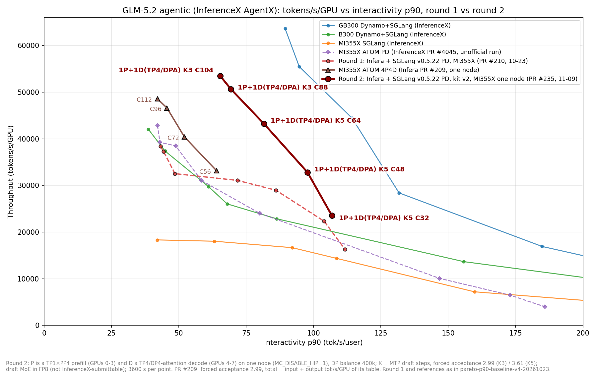

## Summary

`examples/sglang_pd_glm5.2_agentx/`: a self-contained kit that deploys **GLM-5.2-MXFP4** as SGLang prefill / decode
disaggregation behind the Infera router on MI355X, with the AgentX-tuned recipe, and runs InferenceX AgentX against it.

- **Shapes**: **4+4** (default; one TP1 x PP4 prefill + one TP4 / DP4-attention decode, 8 GPUs, on one node or two),
  **2P1D** (`PREFILL_WORKERS=2`, 8-GPU decode, 16 GPUs), **1P2D** (`DECODE_WORKERS=2`, 12 GPUs).
- **Recipe knobs** (`env.sh`): `MTP_STEPS` (EAGLE K3 / K4 / K5; `sweep.sh` scores K at InferenceX's golden acceptance
  2.99 / 3.33 / 3.61), `DECODE_REQUEST_WEIGHT` (router DP balance), `KF_KERNELS` (KernelForge sparse-MLA / indexer /
  MXFP4 MoE kernels on the decode), `DRAFT_MOE_FP8`.
- **Scripts**: `engine/up.sh` checks both images against `patches/BASE_MD5SUMS` before mounting the whole-file
  patches; `engine/smoke.sh`, `engine/eval.sh`, `engine/agentx/{agentx,sweep}.sh` and `summarize.py` cover
  correctness and scoring; `down.sh` keeps every container's log.
- `pyproject.toml`: ruff skips the example's copies of SGLang files (`patches/`) and the KF kernels (`kf_overlay/`),
  which are kept byte-for-byte as validated.

Commits: 77c87815 (kit), 9c4c6660 (kit must be readable by dockerd), 4e65642b (`sweep.sh` under `set -e`),
28c98f81 (`MC_DISABLE_HIP=1`), a1f49449 (`MTP_STEPS`, `DECODE_WORKERS=2`).

## Source patches (whole files over the v0.5.22 image, each with its `.diff`)

| group | role | what | upstream |
|---|---|---|---|
| `dsa-graph-variant` | decode | one TARGET_VERIFY graph; the decode graph variant from the max sequence length over all DP ranks | sgl-project/sglang#48302 (open) |
| `draft-moe-fp8` | decode, `DRAFT_MOE_FP8=1` | quantize the fused NextN experts as FP8 (Quark excludes left them unquantized; real acceptance ~1.2) | backport of sgl-project/sglang#45800 |
| `pp-chunk-wait` | prefill | with PP the KV sender waits on an event recorded after the chunk's launch | Infera only |
| `evict-headroom` | prefill | a `write_back` eviction frees at least `SGLANG_EVICT_HEADROOM_TOKENS` | Infera only |
| `hicache-backup-quota` | prefill | the device-to-host write-back copy runs `SGLANG_HICACHE_BACKUP_BLOCK_QUOTA` workgroups | Infera only |

## Why `MC_DISABLE_HIP=1`

With prefill and decode on one node, Mooncake picks its HIP (XGMI peer copy) transport for the KV, about 1 GB/s per
transfer under load: one-node 4+4 C104 scored 40,807 tok/s/GPU against 53,666 on two nodes. `MC_DISABLE_HIP=1` keeps
it on RDMA loopback on the destination's rail: 53,209 (two nodes 53,666, -0.9%). `MC_DISABLE_HIP_TRANSPORT=1` only
works in images built with Infera's `transfer_engine_impl.diff`.

## Results (AUS MI355X, AgentX 3600 s, tok/s/GPU; interactivity = per-user tok/s)

One-node 4+4 Pareto with this kit (image = Infera main 44a294f8):

| point | tok/s/GPU | interactivity p50 / p90 | TTFT p90 |
|---|---|---|---|
| DP balance 400k + K5 C32 | 23,530 | 121.6 / 106.8 | 2.39 s |
| DP balance 400k + K5 C48 | 32,819 | 108.0 / 97.8 | 2.76 s |
| DP balance 400k + K5 C64 | 43,245 | 91.3 / 81.6 | 3.92 s |
| DP balance 400k + K3 C88 | 50,650 | 76.1 / 69.3 | 6.91 s |
| DP balance 400k + K3 C104 | 53,460 | 73.0 / 65.4 | 11.27 s |

- DP balance (`DECODE_REQUEST_WEIGHT=400000`) moved every measured point up and right (C32 / C48 / C64 / C88 / C104);
  its cost is TTFT p90 (+23% at C88, +2.5% at C104 against the same K without it).
- K5 pays up to about C64 (busiest decode rank under ~14-16 running), K3 from C104 (README "Recipe").
- Two-node 4+4 C104 with the same kit and image: 53,055 (one node 52,409; the earlier package on two nodes 53,666).
- 1P2D (12 GPUs): C96 38,094 @ p90 84.3, C128 37,999 @ 78.2; bound by the single PP4 prefill, below 4+4.

### Against the first baseline (PR #210) and ATOM 4P4D (PR #209)

| this PR (one node, 8 GPUs) | tok/s/GPU @ interactivity p90 | PR #210 at the same interactivity | gain |
|---|---|---|---|
| K3 C104 | 53,460 @ 65.4 | ~31,500 | ~+70% |
| K3 C88 | 50,650 @ 69.3 | ~31,200 | ~+62% |
| K5 C64 | 43,245 @ 81.6 | ~29,600 | ~+46% |
| K5 C48 | 32,819 @ 97.8 | ~24,600 | ~+33% |
| K5 C32 | 23,530 @ 106.8 | ~20,100 | ~+17% |

- PR #210 (the first baseline, 10-23): linear interpolation between its neighbouring points (2P+1D C176 38,392 @ 43.2 through
  1P+1D C32 16,309 @ 111.7).
- ATOM 4P4D (PR #209, one 8-GPU node, forced acceptance 2.99): C56 33,171 @ 64.0, C72 40,397 @ 52.1, C96 46,621 @ 45.6,
  C112 48,560 @ 42.1 (input + output tok/s/GPU of its table). K3 C104 here is above all four in both throughput and
  interactivity.
- The other lines are the InferenceX frontiers (GB300 / B300 Dynamo+SGLang, MI355X SGLang) and ATOM PD from InferenceX
  PR #4045, as in PR #210's figure. Here the draft MoE runs in FP8 (`DRAFT_MOE_FP8=1`, not InferenceX-submittable);
  forced acceptance 2.99 (K3) / 3.61 (K5).

## Validation (this kit, one node, prefill GPUs 0-3 + decode GPUs 4-7)

| check | result |
|---|---|
| `up.sh` image check | the 11 replaced files match `BASE_MD5SUMS` in the main 44a294f8 image |
| `smoke.sh` | 6/6 |
| GSM8K 1,319 (chat, real acceptance) | 0.971, 0 garbled, 0 bad starts |
| long context | 16k: needle 64/64, GSM8K-in-context 62/64; 100k: 16/16, 15/16 |
| `eval.sh` (lm-eval GSM8K) | strict 0.9719 / flexible 0.9735 |
| real MTP acceptance (K3) | 3.59 |
| with `MC_DISABLE_HIP=1` | smoke 6/6, GSM8K probe 195/200, 16k 32/32 + 31/32, acceptance 3.66 |
| 1P2D (`DECODE_WORKERS=2`, two nodes) | smoke 6/6 (router lists two decodes), GSM8K probe 193/200, 16k 32/32 + 32/32, acceptance 3.69 |

## Known limits

- K5 at C88 aborts the decode (`HSA_STATUS_ERROR_OUT_OF_RESOURCES`, 3/3) with `--mem-fraction-static 0.95`: K5's
  graphs leave 2.1 GB free per decode GPU and the run grows 3.6-4.9 GB beyond the static pools; with 0.93 it
  completes. The README says to use K3 there.
- `DRAFT_MOE_FP8=1` is not InferenceX-submittable (the draft must run in the precision it ships in).
- KF MoE kernels cover TP4 only; at TP8 (2P1D decode) the MoE falls back to aiter.

## Test plan

- [x] `up.sh` image check against `BASE_MD5SUMS`
- [x] one-node correctness suite (table above), with and without `MC_DISABLE_HIP=1`
- [x] AgentX sweeps: one-node 4+4 K3 / K5, DP balance, two-node 4+4, 1P2D
- [x] `ruff check` / `ruff format --check` on the kit's Python (`patches/`, `kf_overlay/` excluded)
- [x] C88 DP-balance point
